# The Windows 11 notification center styling guide

***See also**: [The Windows 11 taskbar styling
guide](https://github.com/ramensoftware/windows-11-taskbar-styling-guide/blob/main/README.md),
[The Windows 11 start menu styling
guide](https://github.com/ramensoftware/windows-11-start-menu-styling-guide/blob/main/README.md).*

## Table of contents

* [Introduction](#introduction)
* [Themes](#themes)
* [Style examples](#style-examples)
  * [All panels](#all-panels)
    * [Remove shadows](#remove-shadows)
    * [Square the corners](#square-the-corners)
    * [Make the panels transparent](#make-the-panels-transparent)
    * [Hide the scrollbars](#hide-the-scrollbars)
    * [Move the panels](#move-the-panels)
  * [Notification center](#notification-center)
    * [Hide the notification center](#hide-the-notification-center)
    * [Shrink the notification center height](#shrink-the-notification-center-height)
    * [Move the notification center header to the bottom](#move-the-notification-center-header-to-the-bottom)
    * [Add accelerator key (Alt+X) to clear all notifications](#add-accelerator-key-altx-to-clear-all-notifications)
  * [Calendar](#calendar)
    * [Hide the focus section](#hide-the-focus-section)
    * [Add accelerator key (Alt+E) to expand/collapse the calendar](#add-accelerator-key-alte-to-expandcollapse-the-calendar)
  * [Toast notifications](#toast-notifications)
    * [Change the toast notification background](#change-the-toast-notification-background)
  * [Quick settings](#quick-settings)
    * [Hide control center PipsPager (navigation dots)](#hide-control-center-pipspager-navigation-dots)
    * [Hide control center footer](#hide-control-center-footer)
    * [Hide the quick settings tiles](#hide-the-quick-settings-tiles)
    * [Show more rows of quick settings tiles](#show-more-rows-of-quick-settings-tiles)
    * [Style a specific quick settings tile](#style-a-specific-quick-settings-tile)
    * [Variable volume mixer height](#variable-volume-mixer-height)
  * [Media controls](#media-controls)
    * [Hide media control section](#hide-media-control-section)
  * [Jump lists](#jump-lists)
    * [Change the jump list background](#change-the-jump-list-background)
    * [Change the jump list item highlight colors](#change-the-jump-list-item-highlight-colors)
* [Common targets](#common-targets)
  * [Notification center targets](#notification-center-targets)
  * [Calendar targets](#calendar-targets)
  * [Toast notification targets](#toast-notification-targets)
  * [Quick settings targets](#quick-settings-targets)
  * [Media control targets](#media-control-targets)
  * [Jump list targets](#jump-list-targets)
* [Transforms](#transforms)
  * [Translate](#translate)
  * [Rotate](#rotate)
  * [Scale](#scale)
  * [Skew](#skew)
  * [Other properties and attributes](#other-properties-and-attributes)
* [Colors](#colors)
  * [Solid color](#solid-color)
  * [Accent colors](#accent-colors)
  * [Clear transparent background](#clear-transparent-background)
  * [Acrylic effect as color](#acrylic-effect-as-color)
  * [WindhawkBlur effect as color](#windhawkblur-effect-as-color)
  * [Mica effect as color](#mica-effect-as-color)
  * [Gradient as color](#gradient-as-color)
  * [Image as color](#image-as-color)
  * [Reveal as color](#reveal-as-color)

## Introduction

This is a collection of commonly requested notification center styling
customizations for Windows 11. It is intended to be used with the [Windows 11
Notification Center
Styler](https://windhawk.net/mods/windows-11-notification-center-styler)
Windhawk mod.

If you're not familiar with Windhawk, here are the steps for installing the mod:

* Download Windhawk from [windhawk.net](https://windhawk.net/) and install it.
* Go to "Mods" in the upper right menu.
* Find and install the "Windows 11 Notification Center Styler" mod.

After installing the mod, open its Settings tab and adjust the styles according
to your preferences.

Some customizations are best adjusted with other Windhawk mods. Links to those
mods are provided where applicable.

### Missing customizations

If you're looking for a customization that is not listed here, please [open an
issue](https://github.com/ramensoftware/windows-11-notification-center-styling-guide/issues/new).

### Contributing

If you have a notification center styling customization or theme that you would
like to share, please submit a pull request.

## Themes

Themes are collections of styles that can be imported into the Windows 11
Notification Center Styler mod. The following themes are available:

| Link | Screenshot
| ---- | ----------
| [TranslucentShell](Themes/TranslucentShell/README.md) | [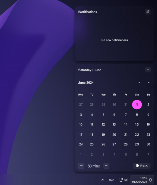](Themes/TranslucentShell/video.gif)
| [Matter](Themes/Matter/README.md) | [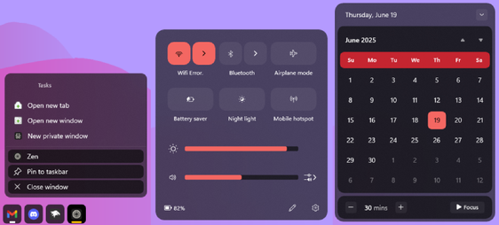](Themes/Matter/screenshot.png)
| [Unified](Themes/Unified/README.md) | [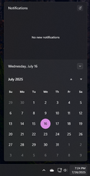](Themes/Unified/screenshot.png)
| [10JumpLists](Themes/10JumpLists/README.md) | [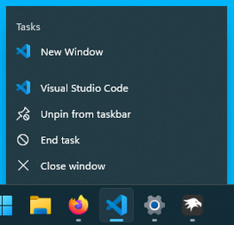](Themes/10JumpLists/screenshot.png)
| [WindowGlass](Themes/WindowGlass/README.md) | [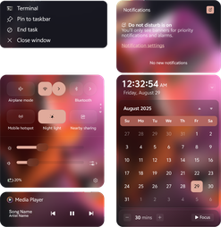](Themes/WindowGlass/screenshot.png)
| [Oversimplified&Accentuated](Themes/Oversimplified&Accentuated/README.md) | [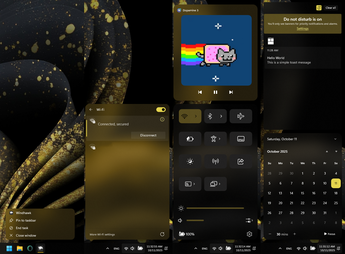](Themes/Oversimplified&Accentuated/screenshot.png)
| [TintedGlass](Themes/TintedGlass/README.md) | [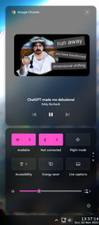](Themes/TintedGlass/screenshot.png)
| [Fluid](Themes/Fluid/README.md) | [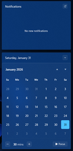](Themes/Fluid/screenshot.png)
| [LiquidGlass](Themes/LiquidGlass/README.md) | [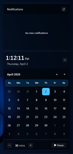](Themes/LiquidGlass/screenshot.png)
| [BetterControl11](Themes/BetterControl11/README.md) | [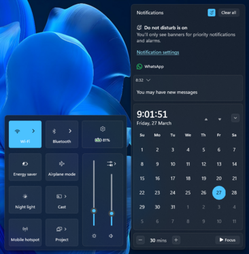](Themes/BetterControl11/screenshot.png)
| [LayerMicaUI](Themes/LayerMicaUI/README.md) | [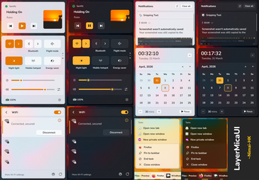](Themes/LayerMicaUI/screenshot.png)
| [Borderless](Themes/Borderless/README.md) | [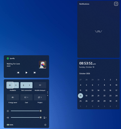](Themes/Borderless/screenshot.png)
| [Densy](Themes/Densy/README.md) | [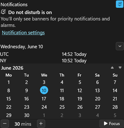](Themes/Densy/screenshot.png)
| [FrostyGlass](Themes/FrostyGlass/README.md) | [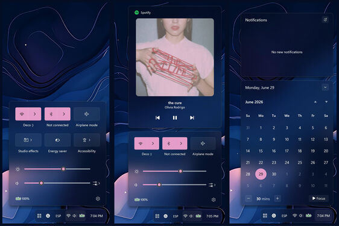](Themes/FrostyGlass/screenshot.png)
| [OS26 Tahoe Glass](Themes/OS26%20Tahoe%20Glass/README.md) | [](Themes/OS26%20Tahoe%20Glass/screenshot.png)
| [Command Center](Themes/Command%20Center/README.md) | [](Themes/Command%20Center/screenshot.png)

## Style examples

### All panels

#### Remove shadows

Targets:
```
Grid#NotificationCenterGrid
```
```
Grid#CalendarCenterGrid
```
```
Grid#ControlCenterRegion
```
```
Grid#MediaTransportControlsRegion
```
```
Border#ToastBackgroundBorder, Border#ToastBackgroundBorder2
```
```
Border#JumpListRestyledAcrylic
```
Style:
```
Shadow:=
```

#### Square the corners

Targets for the panels:
```
Grid#NotificationCenterGrid
```
```
Grid#CalendarCenterGrid
```
```
Grid#ControlCenterRegion
```
```
Grid#MediaTransportControlsRegion
```
```
Border#ToastBackgroundBorder, Border#ToastBackgroundBorder2
```
```
Border#JumpListRestyledAcrylic
```
Targets for the notifications:
```
ActionCenter.FlexibleItemView, Border#ItemOpaquePlating
```
Targets for the calendar buttons:
```
CalendarViewDayItem
```
```
Control
```
```
CalendarViewDayItem > Border
```
```
Control > Border
```
Target for the jump list items:
```
JumpViewUI.JumpListListViewItem > Grid#LayoutRoot > Border#BackgroundBorder, JumpViewUI.SystemItemListViewItem > Grid#LayoutRoot > Border#BackgroundBorder
```
Style:
```
CornerRadius=0
```

`CalendarViewDayItem` is a day in the calendar. `Control` is a month or a year in the views that open when clicking the title above the days.

#### Make the panels transparent
Most panels are made of several layers with their own background, and all of them need to be cleared. Use the targets of the panels you want to change, in order: notification center, calendar, quick settings, media controls, jump lists.

Targets:
```
Grid#NotificationCenterGrid
```
```
Grid#CalendarCenterGrid, Border#CalendarHeaderMinimizedOverlay, ScrollViewer#CalendarControlScrollViewer, Grid#FocusGrid
```
```
Grid#ControlCenterRegion, Grid#L1Grid > Border
```
```
Grid#MediaTransportControlsRegion, Grid#MediaTransportControlsRoot
```
```
Border#JumpListRestyledAcrylic
```
Style:
```
Background=Transparent
```

To keep notifications readable on a transparent notification center, give them a background of their own:

Target:
```
Border#ItemOpaquePlating
```
Style:
```
Background=<color>
```

#### Hide the scrollbars

Target:
```
Windows.UI.Xaml.Controls.Primitives.ScrollBar#VerticalScrollBar
```
Style:
```
Visibility=Collapsed
```

#### Move the panels
Styles can't move a panel to another part of the screen. They only apply to the content inside the panel's container, so content moved with `Margin` or `RenderTransform` gets cut off. Use the [Shell Flyout Positions](https://windhawk.net/mods/shell-flyout-positions) mod instead.

### Notification center

#### Hide the notification center

Target:
```
Grid#NotificationCenterGrid
```
Style:
```
Visibility=Collapsed
```

#### Shrink the notification center height
Makes the panel non-full-height when there are fewer notifications (fit to size).

Target:
```
Grid#NotificationCenterGrid
```
Style:
```
VerticalAlignment=2
```

#### Move the notification center header to the bottom
Moves the row with the title, the do not disturb button and the Clear all button below the notifications.

Target:
```
Grid#NotificationCenterTopBanner
```
Styles:
```
Grid.Row=2
```
```
VerticalAlignment=2
```

#### Add accelerator key (Alt+X) to clear all notifications

Target:
```
Button#ClearAll
```
Style:
```
AccessKey=x
```

### Calendar

#### Hide the focus section
Hides the focus session timer below the calendar.

Target:
```
ActionCenter.FocusSessionControl
```
Style:
```
Height=0
```

#### Add accelerator key (Alt+E) to expand/collapse the calendar

Target:
```
Button#ExpandCollapseButton
```
Style:
```
AccessKey=e
```

### Toast notifications

Toast notifications are the popups that appear before a notification moves to the notification center.

#### Change the toast notification background

Target:
```
Border#ToastBackgroundBorder, Border#ToastBackgroundBorder2
```
Style:
```
Background=<color>
```

`Border#ToastBackgroundBorder2` is the name of this element on older Windows 11 versions.

To use an image, set it on the parent element and make the toast background transparent:

Target:
```
Border#ToastBackgroundBorder, Border#ToastBackgroundBorder2
```
Style:
```
Background=Transparent
```
Target:
```
Grid#RevealGrid, Grid#RevealGrid2
```
Styles:
```
Background:=<ImageBrush Stretch="UniformToFill" ImageSource="<image>" />
```
```
CornerRadius=8
```

### Quick settings

The quick settings panel is also known as the control center or the quick action center.

#### Hide control center PipsPager (navigation dots)

Target:
```
Microsoft.UI.Xaml.Controls.PipsPager#QuickActionsPager
```
Style:
```
Visibility=Collapsed
```

#### Hide control center footer

Target:
```
Grid#FooterGrid
```
Style:
```
Visibility=Collapsed
```

#### Hide the quick settings tiles
Keeps the sliders and the footer.

Target:
```
ContentControl#TogglesGroup
```
Style:
```
Visibility=Collapsed
```

#### Show more rows of quick settings tiles
Makes more rows of tiles visible at once, without paging. Increase the height to fit more rows.

Target:
```
ControlCenter.PaginatedGridView > Grid > GridView#RootGridView
```
Style:
```
Height=280
```
Target:
```
Microsoft.UI.Xaml.Controls.PipsPager#QuickActionsPager
```
Style:
```
Visibility=Collapsed
```
Target:
```
ControlCenter.PaginatedGridView > Grid > GridView#RootGridView > Border > ScrollViewer
```
Style:
```
ScrollViewer.VerticalScrollBarVisibility=0
```

#### Style a specific quick settings tile

Target:
```
ControlCenter.PaginatedToggleButton#ToggleButton[AutomationProperties.AutomationId=Microsoft.QuickAction.WiFi]
```
Style:
```
CornerRadius=0
```

Replace `WiFi` with the ID of the tile:

| Tile | ID
| ---- | --
| Wi-Fi | `WiFi`
| Bluetooth | `Bluetooth`
| Airplane mode | `AirplaneMode`
| Energy saver | `BatterySaver`
| Night light | `BlueLightReduction`
| Accessibility | `Accessibility`
| Live captions | `LiveCaptions`
| Mobile hotspot | `MobileHotspot`
| Nearby sharing | `NearShare`
| Cast | `Cast`
| Project | `ProjectL2`

Hiding a tile this way leaves an empty space in the grid.

#### Variable volume mixer height
Makes the volume mixer grow or shrink depending on how many volume sliders are visible.

Target:
```
ControlCenter.FrameWithContentChanged#L2Frame, QuickActions.ControlCenter.FrameWithContentChanged#L2Frame
```
Style:
```
Height=Auto
```

`QuickActions.ControlCenter.FrameWithContentChanged#L2Frame` is the name of this element on older Windows 11 versions.

### Media controls

#### Hide media control section
Useful for having separate Media Control UIs.

Target:
```
ControlCenter.MediaTransportControls#MediaTransportControls
```
Style:
```
Visibility=Collapsed
```

### Jump lists

Jump lists are the menus that open when right-clicking a taskbar button. Windows shows them in the same process as the notification center, so they're styled with this mod and not with the taskbar styler.

#### Change the jump list background

Target:
```
Border#JumpListRestyledAcrylic
```
Style:
```
Background=<color>
```

#### Change the jump list item highlight colors
Changes the colors of an item while it's hovered over and while it's pressed.

Target:
```
JumpViewUI.JumpListListViewItem > Grid#LayoutRoot@CommonStates > Border#BackgroundBorder, JumpViewUI.SystemItemListViewItem > Grid#LayoutRoot@CommonStates > Border#BackgroundBorder
```
Styles:
```
Background@PointerOver=<color>
```
```
Background@Pressed=<color>
```

## Common targets

These are the main elements of each part of the UI, including the ones that the existing themes style most often, which makes them a good starting point for your own styles. Element names can change between Windows versions.

To apply the same styles to several targets, separate them with commas. This also covers elements with different names on different Windows versions. The full target syntax is described on the [mod's page](https://windhawk.net/mods/windows-11-notification-center-styler).

### Notification center targets

| Target | Element
| ------ | -------
| `Grid#NotificationCenterGrid` | Notification center panel
| `Grid#NotificationCenterTopBanner` | Row with the title and the buttons
| `Windows.UI.Xaml.Controls.Primitives.ToggleButton#DoNotDisturbButton` | Do not disturb button
| `Button#ClearAll` | Clear all button
| `Grid#DoNotDisturbSubtext` | "Do not disturb is on" message
| `TextBlock#NoNotificationsTextBlock` | "No new notifications" text
| `ActionCenter.FlexibleItemView` | Notification
| `Border#ItemOpaquePlating` | Notification background
| `TextBlock#SenderName` | App name on a notification or a toast
| `Button#DismissButton` | Dismiss button on a notification or a toast
| `Button#SettingsButton` | Settings button on a notification or a toast

### Calendar targets

| Target | Element
| ------ | -------
| `Grid#CalendarCenterGrid` | Calendar panel
| `StackPanel#CalendarHeader` | Date at the top of the panel
| `Border#CalendarHeaderMinimizedOverlay` | Date row background while the calendar is collapsed
| `Button#ExpandCollapseButton` | Expand/collapse button
| `ScrollViewer#CalendarControlScrollViewer` | Calendar background
| `Button#HeaderButton` | Title above the days, which opens the year and decade views
| `Button#PreviousButton` | Previous button above the days
| `Button#NextButton` | Next button above the days
| `Grid#WeekDayNames` | Row with the names of the days
| `CalendarViewDayItem` | Day
| `Windows.UI.Xaml.Controls.Primitives.CalendarPanel#YearViewPanel > Control` | Month in the year view
| `Windows.UI.Xaml.Controls.Primitives.CalendarPanel#DecadeViewPanel > Control` | Year in the decade view
| `ActionCenter.FocusSessionControl` | Focus section
| `Grid#FocusGrid` | Focus section background

### Toast notification targets

| Target | Element
| ------ | -------
| `Border#ToastBackgroundBorder, Border#ToastBackgroundBorder2` | Toast background
| `Grid#RevealGrid, Grid#RevealGrid2` | Parent of the toast background
| `Grid#ToastTitleBar > TextBlock#SenderName` | App name on a toast

### Quick settings targets

| Target | Element
| ------ | -------
| `Grid#ControlCenterRegion` | Quick settings panel
| `Grid#L1Grid > Border` | Background behind the tiles and the sliders
| `ContentControl#TogglesGroup` | Section with the tiles
| `ControlCenter.PaginatedGridView > Grid > GridView#RootGridView` | Grid of tiles
| `ControlCenter.PaginatedToggleButton#ToggleButton` | Tile
| `ControlCenter.PaginatedToggleButton#SplitL2Button` | Arrow on the Wi-Fi and Bluetooth tiles
| `Microsoft.UI.Xaml.Controls.PipsPager#QuickActionsPager` | Navigation dots
| `ContentControl#SlidersGroup` | Section with the sliders
| `Grid#HorizontalTemplate > Windows.UI.Xaml.Controls.Primitives.Thumb#HorizontalThumb` | Slider knob
| `Grid#HorizontalTemplate > Rectangle#HorizontalDecreaseRect` | Filled part of a slider
| `Grid#HorizontalTemplate > Rectangle#HorizontalTrackRect` | Slider track
| `Button#VolumeL2Button` | Sound output button next to the volume slider
| `Grid#FooterGrid` | Footer
| `Button[AutomationProperties.AutomationId=Microsoft.QuickAction.Battery]` | Battery button in the footer
| `Button#FooterButton` | All settings button in the footer
| `ControlCenter.FrameWithContentChanged#L2Frame` | Frame of the pages opened from the tiles and the volume slider

### Media control targets

| Target | Element
| ------ | -------
| `ControlCenter.MediaTransportControls#MediaTransportControls` | Media controls section
| `Grid#MediaTransportControlsRegion` | Media controls panel
| `Grid#MediaTransportControlsRoot` | Media controls background
| `Grid#ThumbnailImage` | Album art
| `StackPanel#PrimaryAndSecondaryTextContainer` | Title and artist
| `StackPanel#PrimaryAndSecondaryTextContainer > TextBlock#TitleText` | Title
| `StackPanel#PrimaryAndSecondaryTextContainer > TextBlock#SubtitleText` | Artist
| `ListView#MediaButtonsListView` | Playback buttons
| `TextBlock#AppNameText` | App name
| `Image#IconImage` | App icon

### Jump list targets

| Target | Element
| ------ | -------
| `Grid#JumpListGrid` | Jump list content
| `Border#JumpListRestyledAcrylic` | Jump list background
| `ScrollViewer#JumpListScroller` | Upper section, with the recent, pinned and task items
| `JumpViewUI.JumpListCategoryHeaderControl` | Category header, such as "Recent"
| `TextBlock#HeadingTextBlock` | Category header text
| `JumpViewUI.JumpListListViewItem` | Item in the upper section
| `JumpViewUI.JumpListListViewItem > Grid#LayoutRoot > Border#BackgroundBorder` | Background of an item in the upper section
| `Button#PinButton` | Pin button on an item in the upper section
| `Grid#SystemItemsContainer` | Lower section, with the app name and the pin and close items
| `Grid#SystemItemsContainer > Rectangle` | Line above the lower section
| `JumpViewUI.SystemItemListViewItem` | Item in the lower section
| `JumpViewUI.SystemItemListViewItem > Grid#LayoutRoot > Border#BackgroundBorder` | Background of an item in the lower section
| `JumpViewUI.SystemItemControl > Grid > Grid > TextBlock` | Icon of the pin and close items
| `TextBlock#DisplayNameTextBlock` | Item text in both sections

## Transforms

You can use transformation styles to translate, rotate, scale, or skew elements.

> [!TIP]
> **Should I use `RenderTransform` or `Transform3D`?**
>
> For 2D transformations, it is best to stick to `RenderTransform` in most cases. Using `Transform3D` for 2D transformations can cause elements to become blurry. For 3D transformations, you must use `Transform3D`.

> [!TIP]
> You can mix and match transformations when using `Transform3D`! You can also use `RenderTransform` and `Transform3D` together.
>
> For example: `Transform3D:=<CompositeTransform3D ScaleX="1.5" TranslateY="-15" RotationZ="15" />`

### Translate

```
RenderTransform:=<TranslateTransform X="15" Y="-15" />
```

-- or --

```
Transform3D:=<CompositeTransform3D TranslateX="15" TranslateY="-15" TranslateZ="-15" />
```

### Rotate

```
RenderTransform:=<RotateTransform Angle="15" />
```

-- or --

```
Transform3D:=<CompositeTransform3D RotationX="-15" RotationY="15" RotationZ="-15" />
```

- `X`: 3D vertical rotation.
- `Y`: 3D horizontal rotation.
- `Z`: 2D rotation.

### Scale

```
RenderTransform:=<ScaleTransform ScaleX="1.5" ScaleY="-1.5" />
```

-- or --

```
Transform3D:=<CompositeTransform3D ScaleX="-1.5" ScaleY="1.5" ScaleZ="-1.5" />
```

### Skew

```
RenderTransform:=<SkewTransform AngleX="-15" AngleY="15" />
```

### Other properties and attributes
- Applies to Rotate, Scale and Skew:
  - `CenterX`: Offsets the transform's origin on the X axis.
  - `CenterY`: Offsets the transform's origin on the Y axis.
  - `CenterZ`: Offsets the transform's origin on the Z axis. (Only for `Transform3D`)

  Example:
  ```
  RenderTransform:=<RotateTransform Angle="15" CenterX="10" CenterY="20" />
  ```
- `RenderTransformOrigin`
  - Applies to `RenderTransform` only, `Transform3D` does not support this attribute. It is a separate attribute and is not set inside of the `RenderTransform` like `CenterX/Y/Z`.
  - Sets the transform origin relative to its target's width and height. Format is `X,Y` and both numbers range from 0-1.

  Example:

  ```
  RenderTransformOrigin=0.5,0.5
  ```
  This centers the transform's origin.
- `TransformGroup`
  - Applies to `RenderTransform` only, `Transform3D` does not support this attribute. It is a separate attribute and is not set inside of the `RenderTransform` like `CenterX/Y/Z`.
  - Allows you to combine RenderTransforms together into one style, mimicking Transform3D's functionality.

  Example:
  ```
  RenderTransform:=<TransformGroup><RotateTransform Angle="15" /><TranslateTransform X="15" Y="-15" /></TransformGroup>
  ```
## Colors

In the following examples, we will use `Background` as our style, but this
also works for other properties that accept colors, such as `Fill`.

### Solid color

```
Background=<color>
```

Replace `<color>` with the desired color.

A color can be a name (e.g. `Red`) or a hex code (e.g. `#FF0000`).

The color can be semi-transparent (e.g. `#80FF0000`). To have a fully
transparent background, use `Transparent` or `#00000000`.

### Accent colors

A color can also be a `ThemeResource` or `StaticResource`. There are many such
styles built into Windows.

```
Background:=<SolidColorBrush Color="{ThemeResource SystemAccentColor}" Opacity="0.8" />
```

Accent colors come as part of an accent color palette. This means that for any color you pick as your system accent color, 3 additional shades are part of that color's palette. For example: `SystemAccentColorLight2` or `SystemAccentColorDark1`.

The word `Light` or `Dark` is appended at the end with a number ranging from 1
to 3. See [the official Microsoft
docs](https://learn.microsoft.com/en-us/windows/apps/design/style/color#accent-color-palette)
for more information.

```
Background:=<SolidColorBrush Color="{ThemeResource SystemAccentColorDark2}" Opacity="0.5" />
```

### Clear Transparent Background

To have a fully transparent background:

Style:
```
Background=Transparent
```

### Acrylic effect as color

In order to use the acrylic effect (a blurred background) you can use the
`AcrylicBrush`.

```
Background:=<AcrylicBrush TintColor="Black" TintOpacity="0.8" />
```

`TintColor` - Required. Defines what color to use.

`TintOpacity` - Defines the strength of the chosen color.

`TintLuminosityOpacity` - Defines the brightness of the acrylic effect.

`BackgroundSource` - Defines what should be considered the background of the acrylic effect. Set to "Backdrop" to use the desktop wallpaper.

`Opacity` - Defines how transparent the brush effect itself is. If set to less than 1, it blends the AcrylicBrush with clear transparency.

You can also set Acrylic to use an accent color for a more dynamic look that fits the current theme.

```
Background:=<AcrylicBrush TintColor="{ThemeResource SystemAccentColorDark2}" TintOpacity="0.3" />
```

### WindhawkBlur effect as color

An alternative to Acrylic is the mod's own blur implementation called `WindhawkBlur`. It differs from Acrylic in that its blur radius, saturation and noise are customizable, and it keeps blurring when battery saver is on or transparency effects are off, unless `FallbackColor` is set.

```
Fill:=<WindhawkBlur BlurAmount="10" TintColor="#80ff0000" />
```

`BlurAmount` - Radius of the blur effect. Set to 30 to roughly mimic Acrylic. Defaults to 0 (no blur).

`TintColor` - Color applied to the blur. Accepts a hex color in `#AARRGGBB` or `#RRGGBB` format, or a `ThemeResource` such as `{ThemeResource SystemAccentColor}`. Color names like `Red` are not supported. Defaults to transparent (no visible tint).

`TintOpacity` - Opacity of the tint, between 0.0 and 1.0. Overrides the alpha component of `TintColor` when set. If omitted, the alpha component of `TintColor` is used (255 for `#RRGGBB`).

`TintLuminosityOpacity` - Shifts pixel luminance towards the tint color's luminance. Range: 0.0 to 1.0. Defaults to 0.0 (no luminosity blend).

`TintSaturation` - Saturation of the blurred content. 1.0 is unchanged, 0.0 is fully desaturated (grayscale). Defaults to 1.0.

`NoiseOpacity` - Visibility of an added procedural noise texture overlay. Range: 0.0 to 1.0. Defaults to 0.0 (no noise).

`NoiseDensity` - Granularity of the noise texture. Defaults to 1.0.

`FallbackColor` - Color used in place of the blur effect when battery saver is on or when transparency effects are disabled in the system settings. Accepts a hex color or a `ThemeResource`. If omitted, the blur effect is used regardless of those settings.

The following two examples produce the same effect, a red tint at 50% opacity:

```
Fill:=<WindhawkBlur BlurAmount="10" TintColor="#80ff0000" />
Fill:=<WindhawkBlur BlurAmount="10" TintColor="#ff0000" TintOpacity="0.5" />
```

> [!TIP]
> There is no need to specify a `TintOpacity` value if your `TintColor` already has an alpha component.

You can use a `ThemeResource` for a dynamic look that fits the current theme, optionally paired with a `FallbackColor`:

```
Fill:=<WindhawkBlur BlurAmount="10" TintColor="{ThemeResource SystemAccentColor}" TintOpacity="0.5" FallbackColor="{ThemeResource SystemAccentColorDark1}" />
```

### Mica effect as color

> [!NOTE]
> Unfortunately, it is not possible to set a Mica effect at this time with any of Windhawk's styler mods.

### Gradient as color

The background can also be a gradient. For example, to have a gradient from
yellow to red to blue to lime green, use the following style:

```
Background:=<LinearGradientBrush StartPoint="0,0.5" EndPoint="1,0.5"><GradientStop Color="Yellow" Offset="0.0" /><GradientStop Color="Red" Offset="0.25" /><GradientStop Color="Blue" Offset="0.75" /><GradientStop Color="LimeGreen" Offset="1.0" /></LinearGradientBrush>
```

### Image as color

The background can also be an image:

```
Background:=<ImageBrush Stretch="UniformToFill" ImageSource="<image>" />
```

Replace `<image>` with your own image, a URL or a local file path.
If you only see a fully transparent background when using a local file path, you must set a URL instead.
Images can be jpg, jpg XR, png, bmp, svg, tiff, gif, or ico.

Stretch can be set to the following values:

`None` - Image is rendered at its native resolution and aspect ratio.

`Fill` - Image is stretched or squished to fill the size of the element.

`Uniform` - Image is resized to fit the element dimensions, while it preserves its native aspect ratio.

`UniformToFill` - Image is resized to fill the destination dimensions while it preserves its native aspect ratio. Crops to fit element.

### Reveal as color

> [!NOTE]
> Reveal is a deprecated XAML feature. It may have issues
> or stop working at any time.

Reveal is the cursor-based illumination effect from Windows 10.

```
Background:=<RevealBorderBrush Color="Transparent" TargetTheme="1" Opacity="1" />
```

```
BorderBrush:=<RevealBorderBrush Color="Transparent" TargetTheme="1" Opacity="1" />
```

**Only** `RevealBorderBrush` should be used, `RevealBackgroundBrush` does not work correctly in most scenarios.

`Opacity` can be changed to increase or decrease the intensity of the effect.
