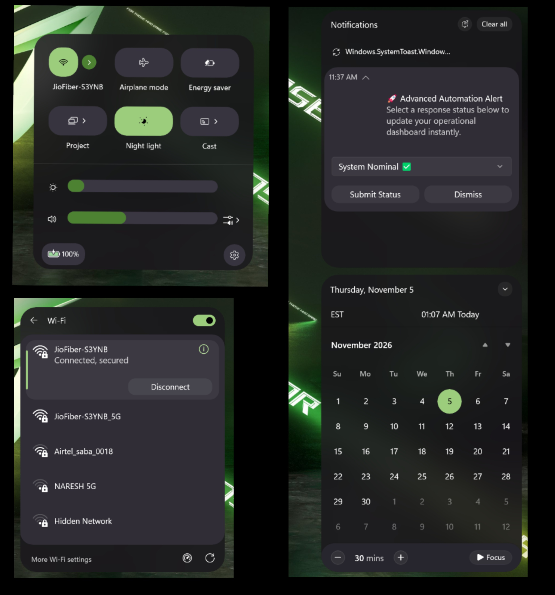

# Droid

By [Deepak Balaraman](https://github.com/DeepakBalaraman) · [dpakb.com](https://dpakb.com)



Droid is a theme for the Windows 11 Notification Center Styler mod. It is inspired by
the language of Android quick settings and applies it to the
notification center, the quick settings panel and the toast popups.

The panels are dark, the corners are large, and the tiles are drawn as separate
rounded cards that fill with the system accent colour when they are on. Sliders
are thick pills with the thumb removed, so the filled part of the track is the
only indicator. Split tiles such as Wi-Fi keep a small round chevron next to the
tile for the sub menu. Borders, drop shadows and the page dots are removed.

The theme is built for dark mode and was tested on Windows 11 25H2.

## Notes

- Tiles that are on use the Windows accent brush, so the theme follows
  Settings > Personalization > Colors.
- The panels use a blur. For a solid panel, set `BlurAmount` to `0` inside the
  `Sheet` constant.
- The element names follow Windows 11 23H2. On older builds some of the styling
  will not apply.
- The slider thumb is hidden on purpose. If you would rather have it back,
  delete the `HorizontalThumb` target.

## Installation

1. Open the Windows 11 Notification Center Styler mod in Windhawk.
2. Go to the Settings tab and switch to "Textual mode".
3. Paste the content below into the text box and click "Save settings".

<details>
<summary>Content to import (click to expand)</summary>

```yaml
styleConstants:
  - PanelRadius=28
  - CardRadius=22
  - TileRadius=20
  - InnerRadius=16
  - PillRadius=999
  - Sheet=<WindhawkBlur BlurAmount="28" TintColor="#D91A171C" TintSaturation="1.08" />
  - Card=<SolidColorBrush Color="#FF302D36" />
  - CardSoft=<SolidColorBrush Color="#FF27252D" />
  - Tile=<SolidColorBrush Color="#FF37343F" />
  - TileHover=<SolidColorBrush Color="#FF47434F" />
  - TilePressed=<SolidColorBrush Color="#FF2C2934" />
  - AccentFill=<SolidColorBrush Color="{ThemeResource SystemAccentColor}" />
  - AccentHover=<SolidColorBrush Color="{ThemeResource SystemAccentColorLight1}" />
  - AccentPressed=<SolidColorBrush Color="{ThemeResource SystemAccentColorDark1}" />
  - Hairline=<SolidColorBrush Color="#26FFFFFF" />
  - Track=<SolidColorBrush Color="#FF3A3642" />
  - SliderFill=<SolidColorBrush Color="{ThemeResource SystemAccentColor}" />
  - Overlay=<SolidColorBrush Color="#33FFFFFF" />
controlStyles:
  - target: Button
    styles:
      - CornerRadius=12
      - BorderThickness=0
  - target: Grid#NotificationCenterGrid
    styles:
      - Background:=$Sheet
      - BorderThickness=0
      - CornerRadius=$PanelRadius
      - Shadow:=
  - target: ActionCenter.NotificationListViewItem
    styles:
      - Margin=4,2,4,2
      - CornerRadius=$CardRadius
  - target: ActionCenter.FlexibleItemView
    styles:
      - CornerRadius=$CardRadius
      - Shadow:=
  - target: Border#ItemOpaquePlating
    styles:
      - Background:=$Card
      - BorderThickness=0
      - CornerRadius=$CardRadius
  - target: Grid#ImageGrid
    styles:
      - Margin=8,0,8,8
  - target: Button#DismissButton, Button#SettingsButton
    styles:
      - CornerRadius=$PillRadius
      - BorderThickness=0
  - target: Button#SeeMoreLessButton, Button#MoreNotificationsButton, Button#ViewAllButton
    styles:
      - CornerRadius=10
      - BorderThickness=0
  - target: TextBlock#SenderName
    styles:
      - FontWeight=SemiBold
  - target: Windows.UI.Xaml.Controls.Primitives.ToggleButton#DoNotDisturbButton
    styles:
      - CornerRadius=$PillRadius
      - BorderThickness=0
  - target: Grid#CalendarCenterGrid
    styles:
      - Background:=$Sheet
      - BorderThickness=0
      - CornerRadius=$PanelRadius
      - Shadow:=
  - target: ScrollViewer#CalendarControlScrollViewer
    styles:
      - Background=Transparent
  - target: Border#CalendarHeaderMinimizedOverlay
    styles:
      - Background=Transparent
  - target: Grid#FocusGrid
    styles:
      - Background:=$CardSoft
      - CornerRadius=$CardRadius
  - target: CalendarViewDayItem, CalendarViewDayItem > Border
    styles:
      - CornerRadius=$PillRadius
      - BorderThickness=0
  - target: Grid#WeekDayNames
    styles:
      - Opacity=0.65
  - target: Button#HeaderButton, Button#PreviousButton, Button#NextButton, Button#ExpandCollapseButton, Button#ClearAll
    styles:
      - CornerRadius=10
      - BorderThickness=0
  - target: Windows.UI.Xaml.Controls.Primitives.CalendarPanel#YearViewPanel > Control, Windows.UI.Xaml.Controls.Primitives.CalendarPanel#DecadeViewPanel > Control
    styles:
      - CornerRadius=$PillRadius
      - BorderThickness=0
  - target: ActionCenter.FocusSessionControl
    styles:
      - CornerRadius=$InnerRadius
      - BorderThickness=0
  - target: Grid#FocusGrid > Button, Grid#FocusGrid > Grid > Button, Grid#FocusGrid > StackPanel > Button, Grid#FocusGrid > Grid > StackPanel > Button
    styles:
      - CornerRadius=$PillRadius
      - BorderThickness=0
      - Background:=$Tile
  - target: Grid#FocusGrid > Button > Grid@CommonStates > Border#BackgroundBorder, Grid#FocusGrid > Grid > Button > Grid@CommonStates > Border#BackgroundBorder, Grid#FocusGrid > StackPanel > Button > Grid@CommonStates > Border#BackgroundBorder
    styles:
      - CornerRadius=$PillRadius
      - BorderThickness=0
  - target: Grid#ControlCenterRegion
    styles:
      - Background:=$Sheet
      - BorderThickness=0
      - CornerRadius=$PanelRadius
      - Shadow:=
  - target: Windows.UI.Xaml.Controls.Grid#L1Grid > Border
    styles:
      - Background=Transparent
  - target: Microsoft.UI.Xaml.Controls.PipsPager#QuickActionsPager
    styles:
      - Visibility=Collapsed
  - target: ControlCenter.PaginatedToggleButton#ToggleButton, QuickActions.AccessibleToggleButton#ToggleButton
    styles:
      - Background:=Transparent
      - BorderThickness=0
      - CornerRadius=$TileRadius
  - target: ControlCenter.PaginatedToggleButton#ToggleButton@CommonStates, QuickActions.AccessibleToggleButton#ToggleButton@CommonStates
    styles:
      - Background@Normal:=$Tile
      - Background@PointerOver:=$TileHover
      - Background@Pressed:=$TilePressed
      - Background@Disabled:=$Tile
  - target: ControlCenter.PaginatedToggleButton#ToggleButton > ContentPresenter#ContentPresenter, ControlCenter.PaginatedToggleButton#ToggleButton > ContentPresenter, QuickActions.AccessibleToggleButton#ToggleButton > ContentPresenter#ContentPresenter, QuickActions.AccessibleToggleButton#ToggleButton > ContentPresenter
    styles:
      - CornerRadius=$TileRadius
      - BorderThickness=0
  - target: ControlCenter.PaginatedToggleButton#ToggleButton > ContentPresenter#ContentPresenter@CommonStates, ControlCenter.PaginatedToggleButton#ToggleButton > ContentPresenter@CommonStates
    styles:
      - Background@Normal:=$Tile
      - Background@PointerOver:=$TileHover
      - Background@Pressed:=$TilePressed
      - Background@Disabled:=$Tile
  - target: ControlCenter.PaginatedToggleButton#SplitL2Button, QuickActions.AccessibleToggleButton#SplitL2Button, Button#SplitL2Button
    styles:
      - Background=Transparent
      - BorderThickness=0
      - CornerRadius=$PillRadius
      - Width=24
      - Height=24
      - Margin=6,0,0,0
      - Padding=0
      - VerticalAlignment=Center
      - HorizontalAlignment=Left
      - Foreground=White
  - target: ControlCenter.PaginatedToggleButton#SplitL2Button > ContentPresenter, QuickActions.AccessibleToggleButton#SplitL2Button > ContentPresenter, Button#SplitL2Button > ContentPresenter, ControlCenter.PaginatedToggleButton#SplitL2Button > ContentPresenter#ContentPresenter, QuickActions.AccessibleToggleButton#SplitL2Button > ContentPresenter#ContentPresenter, Button#SplitL2Button > ContentPresenter#ContentPresenter
    styles:
      - CornerRadius=$PillRadius
      - BorderThickness=0
      - Padding=0
      - Background=Transparent
      - Foreground=White
  - target: ControlCenter.PaginatedToggleButton#SplitL2Button > ContentPresenter@CommonStates, QuickActions.AccessibleToggleButton#SplitL2Button > ContentPresenter@CommonStates, Button#SplitL2Button > ContentPresenter@CommonStates, ControlCenter.PaginatedToggleButton#SplitL2Button > ContentPresenter#ContentPresenter@CommonStates, QuickActions.AccessibleToggleButton#SplitL2Button > ContentPresenter#ContentPresenter@CommonStates, Button#SplitL2Button > ContentPresenter#ContentPresenter@CommonStates
    styles:
      - Background@Normal:=$Overlay
      - Background@PointerOver:=<SolidColorBrush Color="#4DFFFFFF" />
      - Background@Pressed:=<SolidColorBrush Color="#1FFFFFFF" />
      - Background@Disabled:=$Overlay
      - Background@Checked:=$AccentFill
      - Background@CheckedPointerOver:=$AccentHover
      - Background@CheckedPressed:=$AccentPressed
      - Background@CheckedDisabled:=$AccentFill
      - BorderThickness=0
      - CornerRadius=$PillRadius
      - Padding=0
  - target: ControlCenter.PaginatedToggleButton#SplitL2Button > Grid > Border#BackgroundBorder, QuickActions.AccessibleToggleButton#SplitL2Button > Grid > Border#BackgroundBorder, Button#SplitL2Button > Grid > Border#BackgroundBorder, ControlCenter.PaginatedToggleButton#SplitL2Button > Border, QuickActions.AccessibleToggleButton#SplitL2Button > Border, Button#SplitL2Button > Border
    styles:
      - BorderThickness=0
      - CornerRadius=$PillRadius
  - target: Windows.UI.Xaml.Shapes.Rectangle#HorizontalTrackRect
    styles:
      - Height=20
      - RadiusX=10
      - RadiusY=10
      - Fill:=$Track
      - Margin=0,-10,0,10
  - target: Windows.UI.Xaml.Shapes.Rectangle#HorizontalDecreaseRect
    styles:
      - Height=20
      - RadiusX=10
      - RadiusY=10
      - Fill:=$SliderFill
      - Margin=0,-10,0,10
  - target: Windows.UI.Xaml.Controls.Primitives.Thumb#HorizontalThumb
    styles:
      - Visibility=Collapsed
  - target: Button#VolumeL2Button
    styles:
      - CornerRadius=$PillRadius
      - BorderThickness=0
  - target: ControlCenter.FrameWithContentChanged#L2Frame, QuickActions.ControlCenter.FrameWithContentChanged#L2Frame
    styles:
      - Height=Auto
  - target: Grid#FooterGrid
    styles:
      - BorderThickness=0
  - target: Button#FooterButton
    styles:
      - Background:=$Tile
      - BorderThickness=0
      - CornerRadius=$PillRadius
  - target: ContentPresenter#PageContent, Grid#FullScreenPageRoot, ScrollViewer#ListContent
    styles:
      - Background=Transparent
  - target: ContentPresenter#PageHeader
    styles:
      - Background=Transparent
      - BorderThickness=0
  - target: Grid[AutomationProperties.LocalizedLandmarkType=Footer]
    styles:
      - Background=Transparent
      - BorderThickness=0
  - target: ContentPresenter#PageContent > Grid > Border
    styles:
      - Background:=$Card
      - BorderThickness=0
      - CornerRadius=$CardRadius
      - Padding=6,6,6,6
      - Shadow:=
  - target: Border#PopupBorder
    styles:
      - CornerRadius=$CardRadius
  - target: NetworkUX.View.SettingsListView
    styles:
      - Background=Transparent
      - BorderThickness=0
  - target: NetworkUX.View.SettingsListViewItem
    styles:
      - Margin=0,2,0,2
      - CornerRadius=$InnerRadius
      - BorderThickness=0
  - target: NetworkUX.View.SettingsListViewItem > Windows.UI.Xaml.Controls.Primitives.ListViewItemPresenter#Root
    styles:
      - CornerRadius=$InnerRadius
      - BorderThickness=0
  - target: Grid#MediaTransportControlsRegion
    styles:
      - Background:=$Card
      - BorderThickness=0
      - CornerRadius=$CardRadius
      - Shadow:=
  - target: Grid#MediaTransportControlsRoot
    styles:
      - Background=Transparent
  - target: ControlCenter.MediaTransportControls#MediaTransportControls
    styles:
      - Background=Transparent
      - BorderThickness=0
  - target: Grid#ThumbnailImage, Grid#ThumbnailImage > Border
    styles:
      - CornerRadius=$InnerRadius
  - target: Windows.UI.Xaml.Controls.StackPanel#PrimaryAndSecondaryTextContainer > Windows.UI.Xaml.Controls.TextBlock#TitleText
    styles:
      - FontSize=15
  - target: Windows.UI.Xaml.Controls.StackPanel#PrimaryAndSecondaryTextContainer > Windows.UI.Xaml.Controls.TextBlock#SubtitleText
    styles:
      - FontSize=12
  - target: TextBlock#AppNameText
    styles:
      - FontSize=12
  - target: ListView#MediaButtonsListView
    styles:
      - Background=Transparent
  - target: Button#PlayPauseButton > ContentPresenter#ContentPresenter@CommonStates
    styles:
      - Background@Normal:=$AccentFill
      - Background@PointerOver:=$AccentHover
      - Background@Pressed:=$AccentPressed
      - BorderThickness=0
      - CornerRadius=$PillRadius
      - Width=38
      - Height=38
      - Margin=6,0,6,0
  - target: RepeatButton#PreviousButton > ContentPresenter#ContentPresenter@CommonStates, RepeatButton#NextButton > ContentPresenter#ContentPresenter@CommonStates
    styles:
      - Background@Normal=Transparent
      - Background@PointerOver:=$Overlay
      - Background@Pressed:=$AccentPressed
      - BorderThickness=0
      - CornerRadius=$PillRadius
      - Width=36
      - Height=36
      - Margin=4,0,4,0
  - target: ActionCenter.FlexibleToastView#FlexibleNormalToastView
    styles:
      - Background=Transparent
      - Shadow:=
  - target: Border#ToastBackgroundBorder, Border#ToastBackgroundBorder2
    styles:
      - Background:=$Card
      - BorderThickness=0
      - CornerRadius=$CardRadius
      - Shadow:=
  - target: Grid#RevealGrid, Grid#RevealGrid2
    styles:
      - CornerRadius=$CardRadius
  - target: Windows.UI.Xaml.Controls.ComboBox
    styles:
      - CornerRadius=10
      - BorderThickness=0
  - target: Windows.UI.Xaml.Controls.ComboBox > Grid > Border
    styles:
      - CornerRadius=10
      - BorderThickness=0
      - Background:=$Tile
  - target: Windows.UI.Xaml.Controls.ComboBoxItem
    styles:
      - CornerRadius=10
      - BorderThickness=0
  - target: Border#JumpListRestyledAcrylic
    styles:
      - Background:=$CardSoft
      - BorderThickness=0
      - CornerRadius=$CardRadius
      - Margin=-2,-2,-2,-2
      - Shadow:=
  - target: JumpViewUI.JumpListListViewItem > Grid#LayoutRoot > Border#BackgroundBorder, JumpViewUI.SystemItemListViewItem > Grid#LayoutRoot > Border#BackgroundBorder
    styles:
      - CornerRadius=$InnerRadius
      - BorderThickness=0
  - target: Grid#SystemItemsContainer > Rectangle
    styles:
      - Fill:=$Hairline
  - target: Grid#JumpListGrid
    styles:
      - Background=Transparent
  - target: ScrollViewer#JumpListScroller
    styles:
      - Background=Transparent
  - target: Button#PinButton
    styles:
      - CornerRadius=$PillRadius
      - BorderThickness=0
  - target: MenuFlyoutPresenter > Border
    styles:
      - Background:=$Card
      - BorderThickness=0
      - CornerRadius=$CardRadius
      - Padding=2,4,2,4
      - Shadow:=
  - target: MenuFlyoutItem > Grid#LayoutRoot@CommonStates > Border#BackgroundBorder, MenuFlyoutSubItem > Grid#LayoutRoot@CommonStates > Border#BackgroundBorder, MenuFlyoutItem > Border#BackgroundBorder, MenuFlyoutSubItem > Border#BackgroundBorder
    styles:
      - CornerRadius=$PillRadius
      - BorderThickness=0
  - target: Windows.UI.Xaml.Controls.Primitives.ScrollBar#VerticalScrollBar
    styles:
      - Visibility=Collapsed
  - target: Button > Grid@CommonStates > Border#BackgroundBorder
    styles:
      - BorderThickness=0
      - CornerRadius=12
  - target: Windows.UI.Xaml.Controls.ListView
    styles:
      - Background=Transparent
      - BorderThickness=0
  - target: Windows.UI.Xaml.Controls.ListViewItem
    styles:
      - Margin=0,2,0,2
      - CornerRadius=$InnerRadius
      - BorderThickness=0
  - target: Windows.UI.Xaml.Controls.Primitives.ListViewItemPresenter#Root
    styles:
      - CornerRadius=$InnerRadius
      - BorderThickness=0
  - target: ListViewItem > Grid@CommonStates > Border#BackgroundBorder, ListViewItem > Grid@CommonStates > Border#BorderBackground
    styles:
      - BorderThickness=0
      - CornerRadius=$InnerRadius
  - target: Button[AutomationProperties.AutomationId=Microsoft.QuickAction.Battery]
    styles:
      - Background:=$Tile
      - BorderThickness=0
      - CornerRadius=16
  - target: Button[AutomationProperties.AutomationId=Microsoft.QuickAction.Battery] > Grid@CommonStates > Border#BackgroundBorder, Button[AutomationProperties.AutomationId=Microsoft.QuickAction.Battery] > ContentPresenter > Grid@CommonStates > Border#BackgroundBorder
    styles:
      - BorderThickness=0
      - CornerRadius=16
  - target: Button#BackButton, Windows.UI.Xaml.Controls.Button#BackButton
    styles:
      - BorderThickness=0
      - CornerRadius=$PillRadius
  - target: Button#BackButton > Grid@CommonStates > Border#BackgroundBorder, Windows.UI.Xaml.Controls.Button#BackButton > Grid@CommonStates > Border#BackgroundBorder, Button#BackButton > ContentPresenter > Grid@CommonStates > Border#BackgroundBorder
    styles:
      - BorderThickness=0
      - CornerRadius=$PillRadius
  - target: ControlCenter.PaginatedToggleButton#ToggleButton > Grid@CommonStates > Border#BackgroundBorder, QuickActions.AccessibleToggleButton#ToggleButton > Grid@CommonStates > Border#BackgroundBorder, ControlCenter.PaginatedToggleButton#ToggleButton > ContentPresenter > Grid@CommonStates > Border#BackgroundBorder, QuickActions.AccessibleToggleButton#ToggleButton > ContentPresenter > Grid@CommonStates > Border#BackgroundBorder, ControlCenter.PaginatedToggleButton#ToggleButton > Border#BackgroundBorder, QuickActions.AccessibleToggleButton#ToggleButton > Border#BackgroundBorder
    styles:
      - CornerRadius=$TileRadius
      - BorderThickness=0
  - target: ControlCenter.PaginatedToggleButton#SplitL2Button > ContentPresenter > FontIcon, QuickActions.AccessibleToggleButton#SplitL2Button > ContentPresenter > FontIcon, Button#SplitL2Button > ContentPresenter > FontIcon
    styles:
      - Foreground=White
      - FontSize=11
      - HorizontalAlignment=Center
      - VerticalAlignment=Center
  - target: ControlCenter.PaginatedToggleButton#SplitL2Button > Grid@CommonStates > Border#BackgroundBorder, QuickActions.AccessibleToggleButton#SplitL2Button > Grid@CommonStates > Border#BackgroundBorder, Button#SplitL2Button > Grid@CommonStates > Border#BackgroundBorder, ControlCenter.PaginatedToggleButton#SplitL2Button > ContentPresenter > Grid@CommonStates > Border#BackgroundBorder, QuickActions.AccessibleToggleButton#SplitL2Button > ContentPresenter > Grid@CommonStates > Border#BackgroundBorder, Button#SplitL2Button > ContentPresenter > Grid@CommonStates > Border#BackgroundBorder
    styles:
      - CornerRadius=$PillRadius
      - BorderThickness=0
```

</details>

## Customizing

Colours and corner radii live in the "Style constants" section, so the look can
be adjusted without touching the styles.

The radii are built so nested corners stay concentric: an element inside another
one loses as much radius as the gap between them.

- `PanelRadius` 28 for the sheets
- `CardRadius` 22 for cards inside a sheet (28 minus a 6px gap)
- `TileRadius` 20 for the quick settings tiles
- `InnerRadius` 16 for rows and artwork inside a card (22 minus a 6px gap)
- `PillRadius` 999 for anything that should be a capsule

| Constant                                       | What it changes                                                                     |
| ---------------------------------------------- | ----------------------------------------------------------------------------------- |
| `PanelRadius`                                  | Corner radius of the notification center, the calendar and the quick settings panel |
| `CardRadius`                                   | Cards inside a panel: notifications, page content, media, toasts, jump lists, menus |
| `TileRadius`                                   | Corner radius of the quick settings tiles                                           |
| `InnerRadius`                                  | Album art, jump list rows and list item highlights inside a card                    |
| `PillRadius`                                   | Radius used for sliders, buttons and menu items                                     |
| `Sheet`                                        | Blur and tint of the panel background                                               |
| `Card` / `CardSoft`                            | Fills of the notification cards, media controls and jump lists                      |
| `Tile` / `TileHover` / `TilePressed`           | Fill of a tile that is off                                                          |
| `AccentFill` / `AccentHover` / `AccentPressed` | Fill of the media play button and of the split chevron when the tile is on          |
| `Track` / `SliderFill`                         | Unfilled slider track and the filled part of the slider                             |
