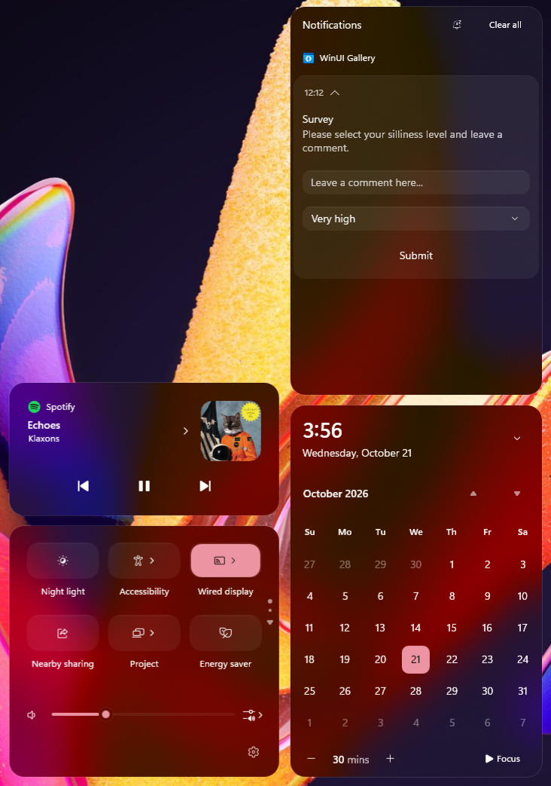
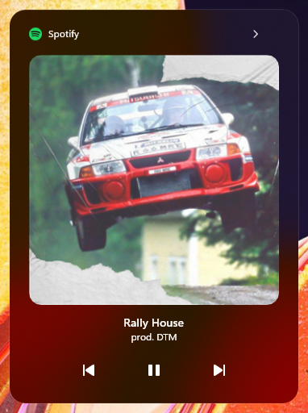
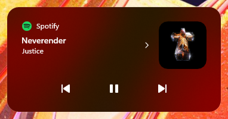
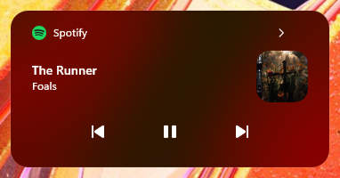
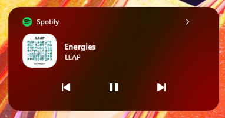

# Luminosity theme for Windows 11 Notification Center Styler

**Author**: [mendes.image](https://github.com/mendesimage)



## Intro

**Luminosity** is inspired on native Acrylic, using the maximum **TintLuminosityOpacity** value as its backdrop.

It's meant to be used with **Mica** or **MicaAlt** backdrops, I recommend the **Translucent Windows** mod.

<br>

## General Information

The theme changes the following things:

<Details>
<summary>(click to expand)</summary>

- Media thingy (Media... Window? Media uh... Center?)
- Action Center
	- Main page
	- Mixer
	- Accessibility
	- Wired Display background
	- Project display page
- Notification Center
- Notification Center animations
	- Do-Not-Disturb button repositioning
	- Notification entrance
	- Notification elements entrance (e.g. Text box)
	- Notification elements repositioning (when expanding / collapsing some notifications)
- Notification Toast
- Adds effects to many buttons and text boxes
- Jump lists (basic styling)
- Right-Click Menu
- Right-Click Menu Entrance animations
- Tooltips
- Removes drop shadows

</details>

<br>

## Guides

**Visual Mode** and **Textual Mode** refer to which mode your **Settings** tab is set to. These guides are mostly for **theme selection through the Styler mod**. If you're using a **manual installation**, you may need to adapt the instructions: search for the referenced target in your installation, then edit or remove things as needed.

### Faster Right-Click Menu Animation

<details>
<summary>(Click to expand guide)</summary>

<br>

**Note:** This doesn't fully disable all menu animations.

Set the style constant `MenuAnimation` to `False`.

**Default value:** `True`

#### Visual Mode

In **Style Constants**, paste:

```txt
MenuAnimation=False
```

---

#### Textual Mode

Anywhere under `styleConstants:`, paste:

```yaml
  - MenuAnimation=False
```

</details>

<br>

### Change Button Fade Speed

<details>
<summary>(Click to expand guide)</summary>

<br>

Edit the style constant `FadeSpeed`. Its value is a duration in `hours:minutes:seconds` format.

**Default value:** `0:0:0.200` (200 milliseconds)

#### Visual Mode

In **Style Constants**, paste:

```txt
FadeSpeed=0:0:0.200
```

And edit its value.

---

#### Textual Mode

Anywhere under `styleConstants:`, paste:

```yaml
  - FadeSpeed=0:0:0.200
```

And... edit its value.

</details>

<br>

### Remove Specific Animations

<details>
<summary>(click to expand guide)</summary>

<br>

This is a list of each individual animation, if you want to remove any in particular.

#### Visual Mode

In **Target**, paste one or as many targets as you would like; if more than one, separate each target with a comma (`,`), like this: `Target1, Target2`

And in **Styles**, paste:

```txt
Transitions:={{skip()}}
```

---

#### Textual Mode (Template)

Anywhere under `controlStyles:`, paste:

```yaml
  - target: 
    styles:
      - Transitions:={{skip()}}
```
**Note:** This is just a template, add the targets after `target:`.

*Also check [Remove All Animations](#remove-all-animations), if interested.*

<br>

<br>

### Notifications Add / Delete Animation

```yaml
ActionCenter.NotificationListView#MainListView > Border > ScrollViewer#ScrollViewer > Border#Root > Grid > ScrollContentPresenter#ScrollContentPresenter
```

**Default `Transitions` Value:**

```yaml
<TransitionCollection><AddDeleteThemeTransition /></TransitionCollection>
```

<br>

### Notification Entrance Animation

```yaml
ActionCenter.FlexibleItemView
```

**Default `Transitions` Value:**

```yaml
<TransitionCollection><PaneThemeTransition Edge="Bottom" /></TransitionCollection>
```

<br>

### Notification Image Reposition Animation

```yaml
ActionCenter.FlexibleItemView > Grid > Grid > Grid#StandardHeroContainer
```

**Default `Transitions` Value:**

```yaml
<TransitionCollection><RepositionThemeTransition /></TransitionCollection>
```

<br>

### Notification Progress Bar (and some other stuff I don't know) Entrance and Reposition Animation

```yaml
ActionCenter.FlexibleItemView > Grid > Grid > Grid#HeaderInteractiveGrid
```

**Default `Transitions` Value:**

```yaml
<TransitionCollection><AddDeleteThemeTransition /><EntranceThemeTransition IsStaggeringEnabled="False" FromHorizontalOffset="0" FromVerticalOffset="50" /></TransitionCollection>
```

<br>

### Notification Button and Other Interactive Items Entrance and Reposition Animation

```yaml
ActionCenter.FlexibleItemView > Grid > Grid > Grid#InteractiveGrid
```

**Default `Transitions` Value:**

```yaml
<TransitionCollection><AddDeleteThemeTransition /><EntranceThemeTransition IsStaggeringEnabled="False" FromHorizontalOffset="0" FromVerticalOffset="50" /></TransitionCollection>
```

<br>

### Notification See More / Notification See Less / Notification See Fewer Button Reposition Animation

```yaml
ActionCenter.SeeMoreLessView#SeeMoreLessViewInstance
```

**Default `Transitions` Value:**

```yaml
<TransitionCollection><RepositionThemeTransition /></TransitionCollection>
```

<br>

### Remove All Animations

This is all targets above in one line.

```yaml
ActionCenter.NotificationListView#MainListView > Border > ScrollViewer#ScrollViewer > Border#Root > Grid > ScrollContentPresenter#ScrollContentPresenter, ActionCenter.FlexibleItemView, ActionCenter.FlexibleItemView > Grid > Grid > Grid#StandardHeroContainer, ActionCenter.FlexibleItemView > Grid > Grid > Grid#HeaderInteractiveGrid, ActionCenter.FlexibleItemView > Grid > Grid > Grid#InteractiveGrid, ActionCenter.SeeMoreLessView#SeeMoreLessViewInstance
```

</details>

<br>

## Known Issues

I didn't know how to fix these. I couldn't find the correct target names, or I'm not sure if they can even be changed / fixed.

- **Action Center**
	- **Buttons:** Some buttons (e.g. Output Device, Spatial Sound buttons) don't match the theme.
	- **Laptops:** Pages that are exclusive for laptops (e.g. Wi-Fi and Bluetooth) might not match the theme.
- **Notification Center**<br>
	- **Animations**
		- Notifications with image attachment don't animate correctly.
		- Notification elements (e.g. Text box) entrance plays only once.
	- Some notification elements might not be styled or animated.
	- The "Send" / Buddy button next to texbox sometimes doesn't match the theme.
- **Jump lists:** Jump lists (e.g. Right-click on taskbar program buttons) don't feature animations.

<br>

## Theme selection

The theme is integrated into the mod and can be selected directly from the mod's settings:

* Open the Windows 11 Notification Center Styler mod in Windhawk.
* Go to the "Settings" tab.
* Select the theme and save the settings.

## Manual installation

The theme styles can also be imported manually. To do that, follow these steps:

* Open the Windows 11 Notification Center Styler mod in Windhawk.
* Go to the "Settings" tab and select "Textual mode".
* Copy the content below to the text box and click "Save settings".

---

### Tall Media



- Mostly based on [**AromaKitsune's Windows XAML Styles**](https://github.com/AromaKitsune/Windows-XAML-Styles#further-configuration) and [**TranslucentShell**](https://github.com/ramensoftware/windows-11-notification-center-styling-guide/tree/main/Themes/TranslucentShell) with a few tweaks. It's a pretty common layout, and looks nice, so why not? :D

<details>
<summary>Content to import (click to expand)</summary>

```yaml
styleConstants:
# General Settings
  - MenuAnimation=True
  - FadeSpeed=0:0:0.200
  - lumiBackground=<WindhawkBlur BlurAmount="30" TintColor="{ThemeResource CardStrokeColorDefaultSolid}" TintOpacity="0.0" TintLuminosityOpacity="1.0" TintSaturation="1.0" NoiseDensity="1.0" NoiseOpacity="0.1" />
  - lumiBackground2=<WindhawkBlur BlurAmount="15" TintColor="#00000000" />
  - lumiAccentColor=<SolidColorBrush Color="{ThemeResource LumiAccent}" />
  - wcr=20
  - mcr=15
  - bcr=10
  - t=Transparent
  - bb=#20FFFFFF
  - bt=1
  - bbb=<LinearGradientBrush x:Key="ShellTaskbarItemGradientStrokeColorSecondaryBrush" MappingMode="Absolute" StartPoint="0,0" EndPoint="0,3"><LinearGradientBrush.GradientStops><GradientStop Offset="0.33" Color="#1AFFFFFF" /><GradientStop Offset="1" Color="#0FFFFFFF" /></LinearGradientBrush.GradientStops></LinearGradientBrush>
  - bbt=2
  - bso=<SolidColorBrush Color="{ThemeResource ControlFillColorDefault}" />
  - bn=Transparent
  - bh=<SolidColorBrush Color="{ThemeResource ControlFillColorSecondary}" />
  - bp=<SolidColorBrush Color="{ThemeResource ControlFillColorTertiary}" />
controlStyles:
# =====================================
# HOW TO NAVIGATE THIS FILE           |
#                                     |
# 1. # Target Name / Description      |
# 2. # NOTE: Additional Information   |
# 3. Target and Styling               |
# (Target always below Name and Note) |
#                                     |
# That's all! :3                      |
# =====================================
# Media Region / Media Window Background and Border
# NOTE: Media region variant styling are at the end!
  - target: Grid#MediaTransportControlsRegion
    styles:
      - Background:=$lumiBackground
      - CornerRadius=$wcr
      - BorderThickness=$bt
      - BorderBrush=$bb
      - Shadow:=
# Media Region Background Overlay
  - target: Grid#MediaTransportControlsRoot
    styles:
      - Background:=$t
# Media Switch Button Margins
  - target: Button#SessionSwitchButton
    styles:
      - Margin=-9,-12,1,-12
# Media Switch Button
  - target: Button#SessionSwitchButton > Grid@CommonStates > ContentPresenter#ContentPresenter
    styles:
      - Width=58
      - CornerRadius=$bcr
      - Background@Normal:=$bn
      - Background@PointerOver:=$bh
      - Background@Pressed:=$bp
      - Background@Disabled:=$bn
      - BorderThickness=$bbt
      - BorderBrush@Normal:=$bn
      - BorderBrush@PointerOver:=$bbb
      - BorderBrush@Pressed:=$bbb
      - BorderBrush@Disabled:=$bn
      - BackgroundSizing=InnerBorderEdge
      - BackgroundTransition:=<BrushTransition Duration="$FadeSpeed" />
# Media Image Corner Radius
  - target: Grid#AlbumTextAndArtContainer > Grid#ThumbnailImage > Border
    styles:
      - CornerRadius=$mcr
# Previous Media Button Margins
# NOTE: Fixes the button partially disappearing during animation
  - target: Windows.UI.Xaml.Controls.Primitives.RepeatButton#PreviousButton
    styles:
      - Margin=5,0,0,0
# Previous Media Button
  - target: Windows.UI.Xaml.Controls.Primitives.RepeatButton#PreviousButton > ContentPresenter#ContentPresenter@CommonStates
    styles:
      - Width=50
      - Height=40
      - CornerRadius=$bcr
      - Background@Normal:=$bn
      - Background@PointerOver:=$bh
      - Background@Pressed:=$bp
      - Background@Disabled:=$bn
      - BorderThickness=$bbt
      - BorderBrush@Normal:=$bn
      - BorderBrush@PointerOver:=$bbb
      - BorderBrush@Pressed:=$bbb
      - BorderBrush@Disabled:=$bn
      - BackgroundSizing=InnerBorderEdge
      - BackgroundTransition:=<BrushTransition Duration="$FadeSpeed" />
# Play / Pause Media Button
  - target: Button#PlayPauseButton > ContentPresenter#ContentPresenter@CommonStates
    styles:
      - Margin=-20,0,-20,0
      - Width=100
      - Height=40
      - CornerRadius=$bcr
      - Background@Normal:=$bn
      - Background@PointerOver:=$bh
      - Background@Pressed:=$bp
      - Background@Disabled:=$bn
      - BorderThickness=$bbt
      - BorderBrush@Normal:=$bn
      - BorderBrush@PointerOver:=$bbb
      - BorderBrush@Pressed:=$bbb
      - BorderBrush@Disabled:=$bn
      - BackgroundSizing=InnerBorderEdge
      - BackgroundTransition:=<BrushTransition Duration="$FadeSpeed" />
# Next Media Button Margins
# NOTE: Fixes the button partially disappearing during click animation
  - target: Windows.UI.Xaml.Controls.Primitives.RepeatButton#NextButton > ContentPresenter#ContentPresenter@CommonStates
    styles:
      - Margin=0,0,5,0
# Next Media Button
  - target: Windows.UI.Xaml.Controls.Primitives.RepeatButton#NextButton > ContentPresenter#ContentPresenter@CommonStates
    styles:
      - Width=50
      - Height=40
      - CornerRadius=$bcr
      - Background@Normal:=$bn
      - Background@PointerOver:=$bh
      - Background@Pressed:=$bp
      - Background@Disabled:=$bn
      - BorderThickness=$bbt
      - BorderBrush@Normal:=$bn
      - BorderBrush@PointerOver:=$bbb
      - BorderBrush@Pressed:=$bbb
      - BorderBrush@Disabled:=$bn
      - BackgroundSizing=InnerBorderEdge
      - BackgroundTransition:=<BrushTransition Duration="$FadeSpeed" />
# Action Center Background and Border
  - target: Grid#ControlCenterRegion
    styles:
      - Background:=$lumiBackground
      - CornerRadius=$wcr
      - BorderThickness=$bt
      - BorderBrush=$bb
      - Shadow:=
# Action Center Main Page Background Overlay
  - target: Grid#L1Grid > Border
    styles:
      - Background:=$t
      - BorderBrush:=$t
# Action Center Main Page Footer Border Remove
  - target: Grid#FooterGrid
    styles:
      - BorderBrush:=$t
# Action Center Other Pages Header Background Overlay
  - target: ControlCenter.FrameWithContentChanged#L2Frame > ContentPresenter > ControlCenter.FullScreenPage#FullScreenPageControl > ContentControl#PageWindow > ContentPresenter > Grid#FullScreenPageRoot > ContentPresenter#PageHeader
    styles:
      - Background:=$t
      - BorderBrush:=$t
# Action Center Other Pages Background Overlay
  - target: ControlCenter.FrameWithContentChanged#L2Frame > ContentPresenter > ControlCenter.FullScreenPage#FullScreenPageControl > ContentControl#PageWindow > ContentPresenter > Grid#FullScreenPageRoot > ContentPresenter#PageContent > Grid > ScrollViewer#ListContent
    styles:
      - Background:=$t
      - BorderBrush:=$t
# Action Center Other Pages Footer Background Overlay
  - target: ControlCenter.FrameWithContentChanged#L2Frame > ContentPresenter > ControlCenter.FullScreenPage#FullScreenPageControl > ContentControl#PageWindow > ContentPresenter > Grid#FullScreenPageRoot > ContentPresenter#PageContent > Grid > ItemsControl#Footer > ItemsPresenter > StackPanel > ContentPresenter > Border
    styles:
      - BorderBrush:=$t
# Action Center Main Page Button thingies Or Button Toggles
  - target: ControlCenter.PaginatedToggleButton#ToggleButton > ContentPresenter#ContentPresenter@CommonStates
    styles:
      - CornerRadius=$mcr
      - BorderThickness=$bbt
      - BackgroundSizing=InnerBorderEdge
      - BackgroundTransition:=<BrushTransition Duration="$FadeSpeed" />
# Action Center Main Page Bottom Separator (separates the toggle thingies from the volume thingies)
  - target: Grid#L1Grid > ContentControl#TogglesGroup > ContentPresenter > ControlCenter.PaginatedGridView > Grid
    styles:
      - BorderBrush:=$t
# Action Center Main Page Mute Button
  - target: Windows.UI.Xaml.Controls.Primitives.ToggleButton > ContentPresenter@CommonStates 
    styles:
      - CornerRadius=$bcr
      - Background@Normal:=$bn
      - Background@PointerOver:=$bh
      - Background@Pressed:=$bp
      - Background@Disabled:=$bn
      - BorderThickness=$bbt
      - BorderBrush@Normal:=$bn
      - BorderBrush@PointerOver:=$bbb
      - BorderBrush@Pressed:=$bbb
      - BorderBrush@Disabled:=$bn
      - BackgroundSizing=InnerBorderEdge
      - BackgroundTransition:=<BrushTransition Duration="$FadeSpeed" />
# Action Center Main Page Volume Bar Track
  - target: Windows.UI.Xaml.Shapes.Rectangle#HorizontalTrackRect
    styles:
      - Fill:=<SolidColorBrush Color="{ThemeResource TrackRect}" />
# Action Center Main Page Volume Slider
  - target: Windows.UI.Xaml.Controls.Primitives.Thumb#HorizontalThumb > Border
    styles:
      - Background:=$lumiBackground
# Action Center Main Page Mixer Button
  - target: Button#VolumeL2Button > ContentPresenter#ContentPresenter@CommonStates
    styles:
      - CornerRadius=$bcr
      - Background@Normal:=$bn
      - Background@PointerOver:=$bh
      - Background@Pressed:=$bp
      - Background@Disabled:=$bn
      - BorderThickness=$bbt
      - BorderBrush@Normal:=$bn
      - BorderBrush@PointerOver:=$bbb
      - BorderBrush@Pressed:=$bbb
      - BorderBrush@Disabled:=$bn
      - BackgroundSizing=InnerBorderEdge
      - BackgroundTransition:=<BrushTransition Duration="$FadeSpeed" />
# Action Center Main Page Settings Button Custom Position
  - target: ItemsControl#RightFooter
    styles:
      - RenderTransform:=<TranslateTransform X="-2" Y="-9" />
# Action Center Main Page Settings Button
  - target: Button#FooterButton > ContentPresenter#ContentPresenter@CommonStates
    styles:
      - CornerRadius=$bcr
      - Background@Normal:=$bn
      - Background@PointerOver:=$bh
      - Background@Pressed:=$bp
      - Background@Disabled:=$bn
      - BorderThickness=$bbt
      - BorderBrush@Normal:=$bn
      - BorderBrush@PointerOver:=$bbb
      - BorderBrush@Pressed:=$bbb
      - BorderBrush@Disabled:=$bn
      - BackgroundSizing=InnerBorderEdge
      - BackgroundTransition:=<BrushTransition Duration="$FadeSpeed" />
      - Margin=2,0,2,0
# Action Center Other Pages' Back Button
  - target: ControlCenter.FrameWithContentChanged#L2Frame > ContentPresenter > ControlCenter.FullScreenPage#FullScreenPageControl > ContentControl#PageWindow > ContentPresenter > Grid#FullScreenPageRoot > ContentPresenter#PageHeader > Border > Grid > Button#BackButton > ContentPresenter#ContentPresenter@CommonStates
    styles:
      - CornerRadius=$mcr
      - Background@Normal:=$bn
      - Background@PointerOver:=$bh
      - Background@Pressed:=$bp
      - Background@Disabled:=$bn
      - BorderThickness=$bbt
      - BorderBrush@Normal:=$bn
      - BorderBrush@PointerOver:=$bbb
      - BorderBrush@Pressed:=$bbb
      - BorderBrush@Disabled:=$bn
      - BackgroundSizing=InnerBorderEdge
      - BackgroundTransition:=<BrushTransition Duration="$FadeSpeed" />
# Mixer Output Device Buttons
  - target: Windows.UI.Xaml.Controls.Primitives.ListViewItemPresenter#Root > ContentControl > ContentPresenter > StackPanel > ListView#ListWithOutputGroupTitle > Border > ScrollViewer#ScrollViewer > Border#Root > Grid > ScrollContentPresenter#ScrollContentPresenter > ItemsPresenter > ItemsStackPanel > ListViewItem > Windows.UI.Xaml.Controls.Primitives.ListViewItemPresenter#Root > Border[HorizontalAlignment=3]
    styles:
      - CornerRadius=$bcr
      - BackgroundTransition:=<BrushTransition Duration="$FadeSpeed" />
# Mixer Spatial Sound Buttons
  - target: Windows.UI.Xaml.Controls.Primitives.ListViewItemPresenter#Root > ContentControl > ContentPresenter > StackPanel > ListView > Border > ScrollViewer#ScrollViewer > Border#Root > Grid > ScrollContentPresenter#ScrollContentPresenter > ItemsPresenter > ItemsStackPanel > ListViewItem > Windows.UI.Xaml.Controls.Primitives.ListViewItemPresenter#Root > Border[HorizontalAlignment=3]
    styles:
      - CornerRadius=$bcr
      - BackgroundTransition:=<BrushTransition Duration="$FadeSpeed" />
# Mixer "More mixer settings" Button
  - target: ControlCenter.VolumeMixerList > StackPanel > Grid > Button > ContentPresenter#ContentPresenter@CommonStates
    styles:
      - CornerRadius=$bcr
      - Background@Normal:=$bn
      - Background@PointerOver:=$bh
      - Background@Pressed:=$bp
      - Background@Disabled:=$bn
      - BorderThickness=$bbt
      - BorderBrush@Normal:=$bn
      - BorderBrush@PointerOver:=$bbb
      - BorderBrush@Pressed:=$bbb
      - BorderBrush@Disabled:=$bn
      - BackgroundSizing=InnerBorderEdge
      - BackgroundTransition:=<BrushTransition Duration="$FadeSpeed" />
# Mixer Mute Buttons
  - target: ControlCenter.VolumeMixerList > StackPanel > ListView > Border > ScrollViewer#ScrollViewer > Border#Root > Grid > ScrollContentPresenter#ScrollContentPresenter > ItemsPresenter > ItemsStackPanel > ListViewItem > Windows.UI.Xaml.Controls.Primitives.ListViewItemPresenter#Root > Grid > Windows.UI.Xaml.Controls.Primitives.ToggleButton > ContentPresenter#ContentPresenter@CommonStates
    styles:
      - CornerRadius=$bcr
      - Background@Normal:=$bn
      - Background@PointerOver:=$bh
      - Background@Pressed:=$bp
      - Background@Disabled:=$bn
      - BorderThickness=$bbt
      - BorderBrush@Normal:=$bn
      - BorderBrush@PointerOver:=$bbb
      - BorderBrush@Pressed:=$bbb
      - BorderBrush@Disabled:=$bn
      - BackgroundSizing=InnerBorderEdge
      - BackgroundTransition:=<BrushTransition Duration="$FadeSpeed" />
# Mixer Volume Bars Track
  - target: ControlCenter.VolumeMixerList > StackPanel > ListView > Border > ScrollViewer#ScrollViewer > Border#Root > Grid > ScrollContentPresenter#ScrollContentPresenter > ItemsPresenter > ItemsStackPanel > ListViewItem > Windows.UI.Xaml.Controls.Primitives.ListViewItemPresenter#Root > Grid > Slider#AppVolumeLevel > Grid > Grid#SliderContainer > Grid#HorizontalTemplate > Rectangle#HorizontalTrackRect
    styles:
      - Fill:=<SolidColorBrush Color="{ThemeResource TrackRect}" />
# Mixer Volume Sliders
  - target: ControlCenter.VolumeMixerList > StackPanel > ListView > Border > ScrollViewer#ScrollViewer > Border#Root > Grid > ScrollContentPresenter#ScrollContentPresenter > ItemsPresenter > ItemsStackPanel > ListViewItem > Windows.UI.Xaml.Controls.Primitives.ListViewItemPresenter#Root > Grid > Slider#AppVolumeLevel > Grid > Grid#SliderContainer > Grid#HorizontalTemplate > Windows.UI.Xaml.Controls.Primitives.Thumb#HorizontalThumb > Border
    styles:
      - Background:=$lumiBackground
# Wired Display Background Overlay
  - target: ScrollViewer > ScrollContentPresenter > Border > ControlCenter.ControlCenterPage > Grid#RootGrid > Grid#RootContent > Grid#ControlCenterRegion > ControlCenter.ControlCenterView#ControlCenterView > Grid#RootGrid > ControlCenter.FrameWithContentChanged#L2Frame > ContentPresenter > ControlCenter.FullScreenPage#FullScreenPageControl > ContentControl#PageWindow > ContentPresenter > Grid#FullScreenPageRoot > ContentPresenter#PageContent > Grid > Border
    styles:
      - Background:=$t
      - BorderBrush:=$t
# Wired Display Footer Background Overlay
  - target: ControlCenter.DevicesFlowWrapper > Grid#MainGrid > DevicesFlowUI.DisconnectConnectedDeviceControl#DisconnectConnectedDeviceControl > Grid > Border#WADFeatureFooter
    styles:
      - BorderBrush:=$t
# Project Page Buttons
  - target: DevicesFlowUI.View.NoKeyboardFocusListView#displayTopologyList > Border > ScrollViewer#ScrollViewer > Border#Root > Grid > ScrollContentPresenter#ScrollContentPresenter > ItemsPresenter > ItemsStackPanel > DevicesFlowUI.View.NoKeyboardFocusListViewItem > Windows.UI.Xaml.Controls.Primitives.ListViewItemPresenter#Root > Border[HorizontalAlignment=3]
    styles:
      - CornerRadius=$bcr
      - BackgroundTransition:=<BrushTransition Duration="$FadeSpeed" />
# Action Center Other Pages Buttons (hopefully)
  - target: Windows.UI.Xaml.Controls.Primitives.ListViewItemPresenter#Root > Border[HorizontalAlignment=3]
    styles:
      - CornerRadius=$bcr
      - BackgroundTransition:=<BrushTransition Duration="$FadeSpeed" />
# Notification Center Background and Border
  - target: Grid#NotificationCenterGrid
    styles:
      - Background:=$lumiBackground
      - CornerRadius=$wcr
      - BorderThickness=$bt
      - BorderBrush=$bb
      - Shadow:=
# Do-Not-Disturb Button / Do Not Disturb Button / DND Button
  - target: Windows.UI.Xaml.Controls.Primitives.ToggleButton#DoNotDisturbButton > Grid@CommonStates > ContentPresenter#ContentPresenter
    styles:
      - Width=50
      - CornerRadius=$bcr
      - Background@Normal:=$bn
      - Background@PointerOver:=$bh
      - Background@Pressed:=$bp
      - Background@Disabled:=$bn
      - BorderThickness=$bbt
      - BorderBrush@Normal:=$bn
      - BorderBrush@PointerOver:=$bbb
      - BorderBrush@Pressed:=$bbb
      - BorderBrush@Disabled:=$bn
      - BackgroundSizing=InnerBorderEdge
      - BackgroundTransition:=<BrushTransition Duration="$FadeSpeed" />
# Clear All Notifications Button
  - target: Button#ClearAll > ContentPresenter#ContentPresenter@CommonStates
    styles:
      - CornerRadius=$bcr
      - Background@Normal:=$bn
      - Background@PointerOver:=$bh
      - Background@Pressed:=$bp
      - Background@Disabled:=$bn
      - BorderThickness=$bbt
      - BorderBrush@Normal:=$bn
      - BorderBrush@PointerOver:=$bbb
      - BorderBrush@Pressed:=$bbb
      - BorderBrush@Disabled:=$bn
      - BackgroundSizing=InnerBorderEdge
      - BackgroundTransition:=<BrushTransition Duration="$FadeSpeed" />
# Notification Title More Button / Notification Header More Button / Notification Header Settings Button Custom Position
  - target: ActionCenter.NotificationListViewHeaderItem > Grid#RootGrid > ContentPresenter#ContentPresenter > ActionCenter.GroupView > Grid#GroupGrid > Button#SettingsButton
    styles:
      - Margin=0,0,-10,0
# Notification Title More Button / Notification Header More Button / Notification Header Settings Button
  - target: ActionCenter.NotificationListViewHeaderItem > Grid#RootGrid > ContentPresenter#ContentPresenter > ActionCenter.GroupView > Grid#GroupGrid > Button#SettingsButton > Grid@CommonStates > Border#Border
    styles:
      - CornerRadius=$bcr
      - Background@Normal:=$bn
      - Background@PointerOver:=$bh
      - Background@Pressed:=$bp
      - Background@Disabled:=$bn
      - BorderThickness=$bbt
      - BorderBrush@Normal:=$bn
      - BorderBrush@PointerOver:=$bbb
      - BorderBrush@Pressed:=$bbb
      - BorderBrush@Disabled:=$bn
      - BackgroundSizing=InnerBorderEdge
      - BackgroundTransition:=<BrushTransition Duration="$FadeSpeed" />
# Notification Title Close Button / Dismiss Button
  - target: ActionCenter.NotificationListViewHeaderItem > Grid#RootGrid > ContentPresenter#ContentPresenter > ActionCenter.GroupView > Grid#GroupGrid > Button#DismissButton > Grid@CommonStates > Border#Border
    styles:
      - CornerRadius=$bcr
      - Background@Normal:=$bn
      - Background@PointerOver:=$bh
      - Background@Pressed:=$bp
      - Background@Disabled:=$bn
      - BorderThickness=$bbt
      - BorderBrush@Normal:=$bn
      - BorderBrush@PointerOver:=$bbb
      - BorderBrush@Pressed:=$bbb
      - BorderBrush@Disabled:=$bn
      - BackgroundSizing=InnerBorderEdge
      - BackgroundTransition:=<BrushTransition Duration="$FadeSpeed" />
# Notification Close Button / Dismiss Button Custom Position
  - target: StackPanel#AuxAreaPanel > Button#DismissButton
    styles:
      - Margin=0,0,1,0
# Notification Close Button / Dismiss Button
  - target: StackPanel#AuxAreaPanel > Button#DismissButton > Grid@CommonStates > Border#Border
    styles:
      - Margin=-4,0,-4,0
      - CornerRadius=$bcr
      - Background@Normal:=$bn
      - Background@PointerOver:=$bh
      - Background@Pressed:=$bp
      - Background@Disabled:=$bn
      - BorderThickness=$bbt
      - BorderBrush@Normal:=$bn
      - BorderBrush@PointerOver:=$bbb
      - BorderBrush@Pressed:=$bbb
      - BorderBrush@Disabled:=$bn
      - BackgroundSizing=InnerBorderEdge
      - BackgroundTransition:=<BrushTransition Duration="$FadeSpeed" />
# Notification Background
  - target: Grid > Border#ItemOpaquePlating
    styles:
      - CornerRadius=$mcr
      - Background:=$bso
      - BorderBrush:=$bbb
# Notification Image Attachment
  - target: ActionCenter.FlexibleItemView > Grid#MainGrid > Grid#ItemGrid > Grid#StandardHeroContainer > Image
    styles:
      - Margin=15
# Notification Expand / Collapse Button
  - target: ActionCenter.ExpandButtonView#ExpandButtonView > Button#ExpandButton > Grid@CommonStates > Border#Border
    styles:
      - Margin=2,8,0,0
      - Padding=3,0,0,2
      - CornerRadius=$bcr
      - Background@Normal:=$bn
      - Background@PointerOver:=$bh
      - Background@Pressed:=$bp
      - Background@Disabled:=$bn
      - BorderThickness=$bbt
      - BorderBrush@Normal:=$bn
      - BorderBrush@PointerOver:=$bbb
      - BorderBrush@Pressed:=$bbb
      - BorderBrush@Disabled:=$bn
      - BackgroundSizing=InnerBorderEdge
      - BackgroundTransition:=<BrushTransition Duration="$FadeSpeed" />
# Notification More Button / Notification Settings Button Custom Position
  - target: ActionCenter.NotificationContentView#NotificationContentView > Grid#ContentGrid > Grid#TitleGrid > Button#SettingsButton
    styles:
      - Margin=10,8,-10,0
# Notification More Button / Notification Settings Button
  - target: ActionCenter.NotificationContentView#NotificationContentView > Grid#ContentGrid > Grid#TitleGrid > Button#SettingsButton > Grid@CommonStates > Border#Border
    styles:
      - Margin=-4
      - CornerRadius=$bcr
      - Background@Normal:=$bn
      - Background@PointerOver:=$bh
      - Background@Pressed:=$bp
      - Background@Disabled:=$bn
      - BorderThickness=$bbt
      - BorderBrush@Normal:=$bn
      - BorderBrush@PointerOver:=$bbb
      - BorderBrush@Pressed:=$bbb
      - BorderBrush@Disabled:=$bn
      - BackgroundSizing=InnerBorderEdge
      - BackgroundTransition:=<BrushTransition Duration="$FadeSpeed" />
# Notification Close Button / Notification Dismiss Button Custom Position
  - target: ActionCenter.NotificationContentView#NotificationContentView > Grid#ContentGrid > Grid#TitleGrid > Button#DismissButton
    styles:
      - Margin=0,8,3,0
# Notification Close Button / Notification Dismiss Button
  - target: ActionCenter.NotificationContentView#NotificationContentView > Grid#ContentGrid > Grid#TitleGrid > Button#DismissButton > Grid@CommonStates > Border#Border
    styles:
      - Margin=-4
      - CornerRadius=$bcr
      - Background@Normal:=$bn
      - Background@PointerOver:=$bh
      - Background@Pressed:=$bp
      - Background@Disabled:=$bn
      - BorderThickness=$bbt
      - BorderBrush@Normal:=$bn
      - BorderBrush@PointerOver:=$bbb
      - BorderBrush@Pressed:=$bbb
      - BorderBrush@Disabled:=$bn
      - BackgroundSizing=InnerBorderEdge
      - BackgroundTransition:=<BrushTransition Duration="$FadeSpeed" />
# Notification Text Bawks (Notification Text Box)
  - target: ActionCenter.MultiLineTextBox#Edit > Grid@CommonStates > Border#BorderElement
    styles:
      - CornerRadius=$bcr
      - Background@Normal:=$bso
      - Background@PointerOver:=$bh
      - Background@Pressed:=$bp
      - Background@Focused:=$bp
      - BorderThickness=$bbt
      - BorderBrush@Normal:=$bbb
      - BorderBrush@PointerOver:=$bbb
      - BorderBrush@Pressed:=$bbb
      - BorderBrush@Focused:=$bbb
      - BackgroundSizing=InnerBorderEdge
      - BackgroundTransition:=<BrushTransition Duration="$FadeSpeed" />
# Notification Buddy Button / Notification Send Button
  - target: Button#BuddyButton > ContentPresenter#ContentPresenter@CommonStates
    styles:
      - CornerRadius=$bcr
      - Background@Normal:=$bn
      - Background@PointerOver:=$bh
      - Background@Pressed:=$bp
      - BorderBrush@Disabled:=$bn
      - BorderThickness=$bbt
      - BorderBrush@Normal:=$bn
      - BorderBrush@PointerOver:=$bbb
      - BorderBrush@Pressed:=$bbb
      - BorderBrush@Disabled:=$bn
      - BackgroundSizing=InnerBorderEdge
      - BackgroundTransition:=<BrushTransition Duration="$FadeSpeed" />
# Notification Buddy Button / Notification Send Button Icon Fix
  - target: Button#BuddyButton > ContentPresenter#ContentPresenter@CommonStates > StackPanel > Image
    styles:
      - Margin=0,-1,0,0
# Notification Drop Down Button
  - target: ActionCenter.AccessibleComboBox#Picker > Grid#LayoutRoot@CommonStates > Border#Background
    styles:
      - CornerRadius=$bcr
      - Background@Normal:=$bso
      - Background@PointerOver:=$bh
      - Background@Pressed:=$bp
      - Background@Focused:=$bn
      - BorderThickness=$bbt
      - BorderBrush@Normal:=$bbb
      - BorderBrush@PointerOver:=$bbb
      - BorderBrush@Pressed:=$bbb
      - BorderBrush@Focused:=$bn
      - BackgroundSizing=InnerBorderEdge
      - BackgroundTransition:=<BrushTransition Duration="$FadeSpeed" />
# Notification Drop Down Pop-up / Notification Drop Down Flyout Background and Border
  - target: Border#PopupBorder
    styles:
      - Background:=$lumiBackground2
      - CornerRadius:=$mcr
      - BorderThickness=$bt
      - BorderBrush=$bb
      - Shadow:=
# Notification Drop Down Pop-up / Notification Drop Down Flyout Item Border
  - target: ComboBoxItem > Grid#LayoutRoot
    styles:
      - CornerRadius=$bcr
      - BackgroundTransition:=<BrushTransition Duration="$FadeSpeed" />
# Notification Button
  - target: Button#VerbButton > ContentPresenter#ContentPresenter@CommonStates
    styles:
      - CornerRadius=$bcr
      - Background@Normal:=$bn
      - Background@PointerOver:=$bh
      - Background@Pressed:=$bp
      - Background@Focused:=$bn
      - BorderThickness=$bbt
      - BorderBrush@Normal:=$bn
      - BorderBrush@PointerOver:=$bbb
      - BorderBrush@Pressed:=$bbb
      - BorderBrush@Focused:=$bn
      - BackgroundSizing=InnerBorderEdge
      - BackgroundTransition:=<BrushTransition Duration="$FadeSpeed" />
# Notification See More / Notification See Less / Notification See Fewer Button
  - target: ActionCenter.SeeMoreLessView#SeeMoreLessViewInstance > Button#SeeMoreLessButton > ContentPresenter#ContentPresenter@CommonStates
    styles:
      - CornerRadius=$bcr
      - Background@Normal:=$bn
      - Background@PointerOver:=$bh
      - Background@Pressed:=$bp
      - Background@Focused:=$bn
      - BorderThickness=$bbt
      - BorderBrush@Normal:=$bn
      - BorderBrush@PointerOver:=$bbb
      - BorderBrush@Pressed:=$bbb
      - BorderBrush@Focused:=$bn
      - BackgroundSizing=InnerBorderEdge
      - BackgroundTransition:=<BrushTransition Duration="$FadeSpeed" />
# Notification Toast Background and Border
  - target: Border#ToastBackgroundBorder, Border#ToastBackgroundBorder2
    styles:
      - Background:=$lumiBackground
      - BorderThickness=$bt
      - BorderBrush:=$bb
      - CornerRadius=$wcr
      - Shadow:=
# Notification Toast Icon
  - target: Grid#ToastTitleBar > Border#AppLogoBorder
    styles:
      - Margin=0,-8,0,8
# Notification Toast Name
  - target: Grid#ToastTitleBar > TextBlock#SenderName
    styles:
      - Margin=10,-10,0,10
# Notification Toast More Button / Notification Toast Settings Button Custom Position
  - target: Grid#ToastTitleBar > Grid#AuxAreaPanel > Button#SettingsButton
    styles:
      - Margin=0,-2,0,0
# Notification Toast More Button / Notification Toast Settings Button
  - target: Grid#ToastTitleBar > Grid#AuxAreaPanel > Button#SettingsButton > Grid@CommonStates > Border#Border
    styles:
      - Margin=-1
      - CornerRadius=$bcr
      - Background@Normal:=$bn
      - Background@PointerOver:=$bh
      - Background@Pressed:=$bp
      - Background@Disabled:=$bn
      - BorderThickness=$bbt
      - BorderBrush@Normal:=$bn
      - BorderBrush@PointerOver:=$bbb
      - BorderBrush@Pressed:=$bbb
      - BorderBrush@Disabled:=$bn
      - BackgroundSizing=InnerBorderEdge
      - BackgroundTransition:=<BrushTransition Duration="$FadeSpeed" />
# Notification Toast Close Button / Notification Dismiss Button Custom Position
  - target: Grid#ToastTitleBar > Grid#AuxAreaPanel > Button#DismissButton
    styles:
      - Margin=0,-2,-4,0
# Notification Toast Close Button / Notification Dismiss Button
  - target: Grid#ToastTitleBar > Grid#AuxAreaPanel > Button#DismissButton > Grid@CommonStates > Border#Border
    styles:
      - Margin=-1
      - CornerRadius=$bcr
      - Background@Normal:=$bn
      - Background@PointerOver:=$bh
      - Background@Pressed:=$bp
      - Background@Disabled:=$bn
      - BorderThickness=$bbt
      - BorderBrush@Normal:=$bn
      - BorderBrush@PointerOver:=$bbb
      - BorderBrush@Pressed:=$bbb
      - BorderBrush@Disabled:=$bn
      - BackgroundSizing=InnerBorderEdge
      - BackgroundTransition:=<BrushTransition Duration="$FadeSpeed" />
# Calendar Background and Border
  - target: Grid#CalendarCenterGrid
    styles:
      - Background:=$lumiBackground
      - CornerRadius=$wcr
      - BorderThickness=$bt
      - BorderBrush=$bb
      - Shadow:=
# Calendar Minimized Header Background Overlay
  - target: Border#CalendarHeaderMinimizedOverlay
    styles:
      - Background:=$t
# Calendar Background Overlay
  - target: ScrollViewer#CalendarControlScrollViewer
    styles:
      - Background:=$t
      - BorderBrush:=$t
# Calendar Footer / Focus Footer Background Overlay
  - target: Grid#FocusGrid
    styles:
      - Background:=$t
      - BorderBrush:=$t
# Calendar Expand / Calendar Collapse / Calendar Minimize Button Custom Position
  - target: Grid#CalendarSection > Button#ExpandCollapseButton
    styles:
      - RenderTransform:=<TranslateTransform X="-5" Y="0" />
# Calendar Expand / Calendar Collapse / Calendar Minimize Button
  - target: Grid#CalendarSection > Button#ExpandCollapseButton > ContentPresenter#ContentPresenter@CommonStates
    styles:
      - Margin=-5,-15,-5,-15
      - CornerRadius=$bcr
      - Background@Normal:=$bn
      - Background@PointerOver:=$bh
      - Background@Pressed:=$bp
      - Background@Disabled:=$bn
      - BorderThickness=$bbt
      - BorderBrush@Normal:=$bn
      - BorderBrush@PointerOver:=$bbb
      - BorderBrush@Pressed:=$bbb
      - BorderBrush@Disabled:=$bn
      - BackgroundSizing=InnerBorderEdge
      - BackgroundTransition:=<BrushTransition Duration="$FadeSpeed" />
# Month / Year Zoom Out Button
  - target: CalendarView#CalendarControl > Border > Grid > Grid > Button#HeaderButton > ContentPresenter#Text@CommonStates
    styles:
      - CornerRadius=$bcr
      - Background@Normal:=$bn
      - Background@PointerOver:=$bh
      - Background@Pressed:=$bp
      - Background@Disabled:=$bn
      - BorderThickness=$bbt
      - BorderBrush@Normal:=$bn
      - BorderBrush@PointerOver:=$bbb
      - BorderBrush@Pressed:=$bbb
      - BorderBrush@Disabled:=$bn
      - BackgroundSizing=InnerBorderEdge
      - BackgroundTransition:=<BrushTransition Duration="$FadeSpeed" />
# Previous Month / Year / Decade Button
  - target: CalendarView#CalendarControl > Border > Grid > Grid > Button#PreviousButton > ContentPresenter#Text@CommonStates
    styles:
      - Padding=20,0,20,0
      - CornerRadius=$bcr
      - Background@Normal:=$bn
      - Background@PointerOver:=$bh
      - Background@Pressed:=$bp
      - Background@Disabled:=$bn
      - BorderThickness=$bbt
      - BorderBrush@Normal:=$bn
      - BorderBrush@PointerOver:=$bbb
      - BorderBrush@Pressed:=$bbb
      - BorderBrush@Disabled:=$bn
      - BackgroundSizing=InnerBorderEdge
      - BackgroundTransition:=<BrushTransition Duration="$FadeSpeed" />
# Next Month / Year / Decade Button
  - target: CalendarView#CalendarControl > Border > Grid > Grid > Button#NextButton > ContentPresenter#Text@CommonStates
    styles:
      - Padding=20,0,20,0
      - CornerRadius=$bcr
      - Background@Normal:=$bn
      - Background@PointerOver:=$bh
      - Background@Pressed:=$bp
      - Background@Disabled:=$bn
      - BorderThickness=$bbt
      - BorderBrush@Normal:=$bn
      - BorderBrush@PointerOver:=$bbb
      - BorderBrush@Pressed:=$bbb
      - BorderBrush@Disabled:=$bn
      - BackgroundSizing=InnerBorderEdge
      - BackgroundTransition:=<BrushTransition Duration="$FadeSpeed" />
# Month View Buttons / Day Buttons Corner Radius
  - target: Windows.UI.Xaml.Controls.Primitives.CalendarPanel#MonthViewPanel > CalendarViewDayItem
    styles:
      - CornerRadius=$bcr
# Month View Buttons / Day Buttons
  - target: Windows.UI.Xaml.Controls.Primitives.CalendarPanel#MonthViewPanel > CalendarViewDayItem > Border@CommonStates
    styles:
      - CornerRadius=$bcr
      - Background@Normal:=$bn
      - Background@PointerOver:=$bh
      - Background@Pressed:=$bp
      - Background@Disabled:=$bn
      - BorderThickness=$bbt
      - BorderBrush@Normal:=$bn
      - BorderBrush@PointerOver:=$bbb
      - BorderBrush@Pressed:=$bbb
      - BorderBrush@Disabled:=$bn
      - BackgroundSizing=InnerBorderEdge
      - BackgroundTransition:=<BrushTransition Duration="$FadeSpeed" />
# Year View Buttons / Month Buttons Corner Radius
  - target: Windows.UI.Xaml.Controls.Primitives.CalendarPanel#YearViewPanel > Control
    styles:
      - CornerRadius=$mcr
# Year View Buttons / Month Buttons
  - target: Windows.UI.Xaml.Controls.Primitives.CalendarPanel#YearViewPanel > Control > Border@CommonStates
    styles:
      - CornerRadius=$mcr
      - Background@Normal:=$bn
      - Background@PointerOver:=$bh
      - Background@Pressed:=$bp
      - Background@Disabled:=$bn
      - BorderThickness=$bbt
      - BorderBrush@Normal:=$bn
      - BorderBrush@PointerOver:=$bbb
      - BorderBrush@Pressed:=$bbb
      - BorderBrush@Disabled:=$bn
      - BackgroundSizing=InnerBorderEdge
      - BackgroundTransition:=<BrushTransition Duration="$FadeSpeed" />
# Decade View Buttons / Year Buttons Corner Radius
  - target: Windows.UI.Xaml.Controls.Primitives.CalendarPanel#DecadeViewPanel > Control
    styles:
      - CornerRadius=$mcr
# Decade View Buttons / Year Buttons
  - target: Windows.UI.Xaml.Controls.Primitives.CalendarPanel#DecadeViewPanel > Control > Border@CommonStates
    styles:
      - CornerRadius=$mcr
      - Background@Normal:=$bn
      - Background@PointerOver:=$bh
      - Background@Pressed:=$bp
      - Background@Disabled:=$bn
      - BorderThickness=$bbt
      - BorderBrush@Normal:=$bn
      - BorderBrush@PointerOver:=$bbb
      - BorderBrush@Pressed:=$bbb
      - BorderBrush@Disabled:=$bn
      - BackgroundSizing=InnerBorderEdge
      - BackgroundTransition:=<BrushTransition Duration="$FadeSpeed" />
# Focus Session Minus / Decrease Time Button
  - target: Grid#FocusStateGrid > Grid#FocusTimeSelector > Button#DecreaseTimeButton > ContentPresenter#ContentPresenter@CommonStates
    styles:
      - CornerRadius=$bcr
      - Background@Normal:=$bn
      - Background@PointerOver:=$bh
      - Background@Pressed:=$bp
      - Background@Disabled:=$bn
      - BorderThickness=$bbt
      - BorderBrush@Normal:=$bn
      - BorderBrush@PointerOver:=$bbb
      - BorderBrush@Pressed:=$bbb
      - BorderBrush@Disabled:=$bn
      - BackgroundSizing=InnerBorderEdge
      - BackgroundTransition:=<BrushTransition Duration="$FadeSpeed" />
# Focus Session Plus / Increase Button
  - target: Grid#FocusStateGrid > Grid#FocusTimeSelector > Button#IncreaseTimeButton > ContentPresenter#ContentPresenter@CommonStates
    styles:
      - CornerRadius=$bcr
      - Background@Normal:=$bn
      - Background@PointerOver:=$bh
      - Background@Pressed:=$bp
      - Background@Disabled:=$bn
      - BorderThickness=$bbt
      - BorderBrush@Normal:=$bn
      - BorderBrush@PointerOver:=$bbb
      - BorderBrush@Pressed:=$bbb
      - BorderBrush@Disabled:=$bn
      - BackgroundSizing=InnerBorderEdge
      - BackgroundTransition:=<BrushTransition Duration="$FadeSpeed" />
# Focus Session Start Button
  - target: Grid#FocusControlGrid > Button#StartButton > ContentPresenter#ContentPresenter@CommonStates
    styles:
      - CornerRadius=$bcr
      - Background@Normal:=$bn
      - Background@PointerOver:=$bh
      - Background@Pressed:=$bp
      - Background@Disabled:=$bn
      - BorderThickness=$bbt
      - BorderBrush@Normal:=$bn
      - BorderBrush@PointerOver:=$bbb
      - BorderBrush@Pressed:=$bbb
      - BorderBrush@Disabled:=$bn
      - BackgroundSizing=InnerBorderEdge
      - BackgroundTransition:=<BrushTransition Duration="$FadeSpeed" />
# Focus Session Start Symbol Fix
  - target: Grid#FocusControlGrid > Button#StartButton > ContentPresenter#ContentPresenter > StackPanel > FontIcon > Grid
    styles:
      - Margin=0,1,0,0
# Focus Session Stop Button
  - target: Grid#FocusControlGrid > Button#StopButton > ContentPresenter#ContentPresenter@CommonStates
    styles:
      - CornerRadius=$bcr
      - Background@Normal:=$bn
      - Background@PointerOver:=$bh
      - Background@Pressed:=$bp
      - Background@Disabled:=$bn
      - BorderThickness=$bbt
      - BorderBrush@Normal:=$bn
      - BorderBrush@PointerOver:=$bbb
      - BorderBrush@Pressed:=$bbb
      - BorderBrush@Disabled:=$bn
      - BackgroundSizing=InnerBorderEdge
      - BackgroundTransition:=<BrushTransition Duration="$FadeSpeed" />
# Focus Session Stop Symbol Fix
  - target: Grid#FocusControlGrid > Button#StopButton > ContentPresenter#ContentPresenter > StackPanel > FontIcon > Grid
    styles:
      - Margin=0,1,0,0
# Scroll Bars Background
  - target: Windows.UI.Xaml.Controls.Primitives.ScrollBar#VerticalScrollBar > Grid#Root > Grid#VerticalRoot > Rectangle#VerticalTrackRect
    styles:
      - Fill:=$lumiBackground2
# Right-click Menu Drop Shadow
  - target: MenuFlyoutPresenter
    styles:
      - CornerRadius:=$wcr
      - Shadow:=
# Right-click Menu Background And Border
  - target: MenuFlyoutPresenter > Border
    styles:
      - Background:=$lumiBackground
      - CornerRadius=$mcr
      - BorderThickness=$bt
      - BorderBrush=$bb
# Right-click Menu Item Border
  - target: MenuFlyoutItem > Grid@CommonStates
    styles:
      - CornerRadius=$bcr
      - BackgroundTransition:=<BrushTransition Duration="$FadeSpeed" />
# Right-click Menu Subitem Border
  - target: MenuFlyoutSubItem > Grid@CommonStates
    styles:
      - CornerRadius=$bcr
      - BackgroundTransition:=<BrushTransition Duration="$FadeSpeed" />
# Jumplists Background and Border
  - target: Border#JumpListRestyledAcrylic
    styles:
      - Background:=$lumiBackground
      - CornerRadius:=$mcr
      - BorderThickness=$bt
      - BorderBrush=$bb
      - Shadow:=
# Jumplists Pinned / Tasks / Actions Item
  - target: JumpViewUI.JumpListListViewItem > Grid#LayoutRoot > Border#BackgroundBorder
    styles:
      - CornerRadius=$bcr
      - BackgroundTransition:=<BrushTransition Duration="$FadeSpeed" />
# Jumplists Unpin Button and Share Button Separator
  - target:  JumpViewUI.JumpListItemControl > Grid#GridForContextMenuInvoke_MustHave_No_Columns_Or_Rows > Grid#LayoutRoot > Button#PinButton > Grid > Windows.UI.Xaml.Shapes.Rectangle, JumpViewUI.JumpListItemControl > Grid#GridForContextMenuInvoke_MustHave_No_Columns_Or_Rows > Grid#LayoutRoot > Button#ShareButton > Grid > Windows.UI.Xaml.Shapes.Rectangle
    styles:
      - Visibility=Collapsed
# Jumplists Item Share Button
  - target: JumpViewUI.JumpListItemControl > Grid#GridForContextMenuInvoke_MustHave_No_Columns_Or_Rows > Grid#LayoutRoot > Button#ShareButton > Grid@CommonStates > Border#BackgroundBorder
    styles:
      - Margin=2
      - CornerRadius=$bcr
      - Background@Normal:=$bn
      - Background@PointerOver:=$bh
      - Background@Pressed:=$bp
      - Background@Disabled:=$bn
      - BorderThickness=$bbt
      - BorderBrush@Normal:=$bn
      - BorderBrush@PointerOver:=$bbb
      - BorderBrush@Pressed:=$bbb
      - BorderBrush@Disabled:=$bn
      - BackgroundSizing=InnerBorderEdge
      - BackgroundTransition:=<BrushTransition Duration="$FadeSpeed" />
# Jumplists Item Unpin Button
  - target: JumpViewUI.JumpListItemControl > Grid#GridForContextMenuInvoke_MustHave_No_Columns_Or_Rows > Grid#LayoutRoot > Button#PinButton > Grid@CommonStates > Border#BackgroundBorder
    styles:
      - Margin=2
      - CornerRadius=$bcr
      - Background@Normal:=$bn
      - Background@PointerOver:=$bh
      - Background@Pressed:=$bp
      - Background@Disabled:=$bn
      - BorderThickness=$bbt
      - BorderBrush@Normal:=$bn
      - BorderBrush@PointerOver:=$bbb
      - BorderBrush@Pressed:=$bbb
      - BorderBrush@Disabled:=$bn
      - BackgroundSizing=InnerBorderEdge
      - BackgroundTransition:=<BrushTransition Duration="$FadeSpeed" />
# Jumplists Item Border
  - target: JumpViewUI.SystemItemListViewItem > Grid#LayoutRoot@CommonStates > Border#BackgroundBorder
    styles:
      - CornerRadius=$bcr
      - BackgroundTransition:=<BrushTransition Duration="$FadeSpeed" />
# Tooltip
  - target: ToolTip > ContentPresenter#LayoutRoot
    styles:
      - Background:=$lumiBackground
      - CornerRadius=$mcr
      - BorderThickness=$bt
      - BorderBrush=$bb
      - Shadow:=
# ============
# Animations |
# ============
# Do-Not-Disturb Button / Do Not Disturb Button / DND Button Reposition Animation
  - target: Windows.UI.Xaml.Controls.Primitives.ToggleButton#DoNotDisturbButton
    styles:
      - Transitions:=<TransitionCollection><RepositionThemeTransition /></TransitionCollection>
# Notifications Add / Delete Animation
  - target: ActionCenter.NotificationListView#MainListView > Border > ScrollViewer#ScrollViewer > Border#Root > Grid > ScrollContentPresenter#ScrollContentPresenter
    styles:
      - Transitions:=<TransitionCollection><AddDeleteThemeTransition /></TransitionCollection>
# Notification Entrance Animation
  - target: ActionCenter.FlexibleItemView
    styles:
      - Transitions:=<TransitionCollection><PaneThemeTransition Edge="Bottom" /></TransitionCollection>
# Notification Image Reposition Animation
# NOTE: When text above it expands / retracts.
  - target: ActionCenter.FlexibleItemView > Grid > Grid > Grid#StandardHeroContainer
    styles:
      - Transitions:=<TransitionCollection><RepositionThemeTransition /></TransitionCollection>
# Notification Progress Bar (and some other stuff I don't know) Entrance and Reposition Animation
# NOTE: Repositions when text above it expands / retracts.
  - target: ActionCenter.FlexibleItemView > Grid > Grid > Grid#HeaderInteractiveGrid
    styles:
      - Transitions:=<TransitionCollection><AddDeleteThemeTransition /><EntranceThemeTransition IsStaggeringEnabled="False" FromHorizontalOffset="0" FromVerticalOffset="50" /></TransitionCollection>
# Notification Button and Other Interactive Items Entrance and Reposition Animation
# NOTE: Repositions when text above it expands / retracts.
  - target: ActionCenter.FlexibleItemView > Grid > Grid > Grid#InteractiveGrid
    styles:
      - Transitions:=<TransitionCollection><AddDeleteThemeTransition /><EntranceThemeTransition IsStaggeringEnabled="False" FromHorizontalOffset="0" FromVerticalOffset="50" /></TransitionCollection>
# Notification See More / Notification See Less / Notification See Fewer Button Reposition Animation
  - target: ActionCenter.SeeMoreLessView#SeeMoreLessViewInstance
    styles:
      - Transitions:=<TransitionCollection><RepositionThemeTransition /></TransitionCollection>
# Right-click Menu Entrance Animation
  - target: MenuFlyoutPresenter > Border
    styles:
      - Transitions:=<TransitionCollection><EntranceThemeTransition FromHorizontalOffset="0" FromVerticalOffset="50" /></TransitionCollection>
# Right-Click Menu Items Entrance Animation
  - target: ScrollViewer#MenuFlyoutPresenterScrollViewer > Border > Grid > ScrollContentPresenter > ItemsPresenter > StackPanel
    styles:
      - ChildrenTransitions:=<TransitionCollection><EntranceThemeTransition IsStaggeringEnabled="$MenuAnimation" FromHorizontalOffset="-50" FromVerticalOffset="50" /></TransitionCollection>
# ================================
# Tall Media Styling Begins Here |
# ================================
# Media Region / Media Window Height
  - target: ControlCenter.MediaTransportControls#MediaTransportControls > Grid#MediaTransportControlsRegion
    styles:
      - Height=490
# Media Source Icon / App Icon Custom Position
  - target: Grid#MediaTransportControlsRoot > Grid > Image#IconImage
    styles:
      - Margin=0,5,0,0
# Media Source Name / App Name Custom Position
  - target: Grid#MediaTransportControlsRoot > Grid > TextBlock#AppNameText
    styles:
      - Margin=8,3,0,0
# Media Switch Button
  - target: Button#SessionSwitchButton
    styles:
      - Margin=0,-6,0,-11
# Media Image
  - target: Grid#ThumbnailImage
    styles:
      - Width=310
      - Height=310
      - HorizontalAlignment=Center
      - VerticalAlignment=Top
      - Grid.Column=1
      - Margin=0,5,0,47
# Media Text Grid Custom Position
  - target: StackPanel#PrimaryAndSecondaryTextContainer
    styles:
      - VerticalAlignment=Bottom
# Media Title Custom Position
  - target: StackPanel#PrimaryAndSecondaryTextContainer > TextBlock#TitleText, StackPanel#PrimaryAndSecondaryTextContainer > TextBlock#Title
    styles:
      - TextAlignment=Center
# Media Subtitle / Media Artist Custom Position
  - target: StackPanel#PrimaryAndSecondaryTextContainer > TextBlock#SubtitleText, StackPanel#PrimaryAndSecondaryTextContainer > TextBlock#Subtitle
    styles:
      - TextAlignment=Center
themeResourceVariables:
  - LumiAccent@Dark={ThemeResource SystemAccentColorLight2}
  - LumiAccent@Light={ThemeResource SystemAccentColorDark1}
  - TrackRect@Dark=#10FFFFFF
  - TrackRect@Light=#30202020
  - SolidBg@Dark=#10FFFFFF
  - SolidBg@Light=#90FFFFFF
```

</details>

<br>

### Compact Media



- For small screens.

<details>
<summary>Content to import (click to expand)</summary>

```yaml
styleConstants:
# General Settings
  - MenuAnimation=True
  - FadeSpeed=0:0:0.200
  - lumiBackground=<WindhawkBlur BlurAmount="30" TintColor="{ThemeResource CardStrokeColorDefaultSolid}" TintOpacity="0.0" TintLuminosityOpacity="1.0" TintSaturation="1.0" NoiseDensity="1.0" NoiseOpacity="0.1" />
  - lumiBackground2=<WindhawkBlur BlurAmount="15" TintColor="#00000000" />
  - lumiAccentColor=<SolidColorBrush Color="{ThemeResource LumiAccent}" />
  - wcr=20
  - mcr=15
  - bcr=10
  - t=Transparent
  - bb=#20FFFFFF
  - bt=1
  - bbb=<LinearGradientBrush x:Key="ShellTaskbarItemGradientStrokeColorSecondaryBrush" MappingMode="Absolute" StartPoint="0,0" EndPoint="0,3"><LinearGradientBrush.GradientStops><GradientStop Offset="0.33" Color="#1AFFFFFF" /><GradientStop Offset="1" Color="#0FFFFFFF" /></LinearGradientBrush.GradientStops></LinearGradientBrush>
  - bbt=2
  - bso=<SolidColorBrush Color="{ThemeResource ControlFillColorDefault}" />
  - bn=Transparent
  - bh=<SolidColorBrush Color="{ThemeResource ControlFillColorSecondary}" />
  - bp=<SolidColorBrush Color="{ThemeResource ControlFillColorTertiary}" />
controlStyles:
# =====================================
# HOW TO NAVIGATE THIS FILE           |
#                                     |
# 1. # Target Name / Description      |
# 2. # NOTE: Additional Information   |
# 3. Target and Styling               |
# (Target always below Name and Note) |
#                                     |
# That's all! :3                      |
# =====================================
# Media Region / Media Window Background and Border
# NOTE: Media region variant styling are at the end!
  - target: Grid#MediaTransportControlsRegion
    styles:
      - Background:=$lumiBackground
      - CornerRadius=$wcr
      - BorderThickness=$bt
      - BorderBrush=$bb
      - Shadow:=
# Media Region Background Overlay
  - target: Grid#MediaTransportControlsRoot
    styles:
      - Background:=$t
# Media Switch Button Margins
  - target: Button#SessionSwitchButton
    styles:
      - Margin=-9,-12,1,-12
# Media Switch Button
  - target: Button#SessionSwitchButton > Grid@CommonStates > ContentPresenter#ContentPresenter
    styles:
      - Width=58
      - CornerRadius=$bcr
      - Background@Normal:=$bn
      - Background@PointerOver:=$bh
      - Background@Pressed:=$bp
      - Background@Disabled:=$bn
      - BorderThickness=$bbt
      - BorderBrush@Normal:=$bn
      - BorderBrush@PointerOver:=$bbb
      - BorderBrush@Pressed:=$bbb
      - BorderBrush@Disabled:=$bn
      - BackgroundSizing=InnerBorderEdge
      - BackgroundTransition:=<BrushTransition Duration="$FadeSpeed" />
# Media Image Corner Radius
  - target: Grid#AlbumTextAndArtContainer > Grid#ThumbnailImage > Border
    styles:
      - CornerRadius=$mcr
# Previous Media Button Margins
# NOTE: Fixes the button partially disappearing during animation
  - target: Windows.UI.Xaml.Controls.Primitives.RepeatButton#PreviousButton
    styles:
      - Margin=5,0,0,0
# Previous Media Button
  - target: Windows.UI.Xaml.Controls.Primitives.RepeatButton#PreviousButton > ContentPresenter#ContentPresenter@CommonStates
    styles:
      - Width=50
      - Height=40
      - CornerRadius=$bcr
      - Background@Normal:=$bn
      - Background@PointerOver:=$bh
      - Background@Pressed:=$bp
      - Background@Disabled:=$bn
      - BorderThickness=$bbt
      - BorderBrush@Normal:=$bn
      - BorderBrush@PointerOver:=$bbb
      - BorderBrush@Pressed:=$bbb
      - BorderBrush@Disabled:=$bn
      - BackgroundSizing=InnerBorderEdge
      - BackgroundTransition:=<BrushTransition Duration="$FadeSpeed" />
# Play / Pause Media Button
  - target: Button#PlayPauseButton > ContentPresenter#ContentPresenter@CommonStates
    styles:
      - Margin=-20,0,-20,0
      - Width=100
      - Height=40
      - CornerRadius=$bcr
      - Background@Normal:=$bn
      - Background@PointerOver:=$bh
      - Background@Pressed:=$bp
      - Background@Disabled:=$bn
      - BorderThickness=$bbt
      - BorderBrush@Normal:=$bn
      - BorderBrush@PointerOver:=$bbb
      - BorderBrush@Pressed:=$bbb
      - BorderBrush@Disabled:=$bn
      - BackgroundSizing=InnerBorderEdge
      - BackgroundTransition:=<BrushTransition Duration="$FadeSpeed" />
# Next Media Button Margins
# NOTE: Fixes the button partially disappearing during click animation
  - target: Windows.UI.Xaml.Controls.Primitives.RepeatButton#NextButton > ContentPresenter#ContentPresenter@CommonStates
    styles:
      - Margin=0,0,5,0
# Next Media Button
  - target: Windows.UI.Xaml.Controls.Primitives.RepeatButton#NextButton > ContentPresenter#ContentPresenter@CommonStates
    styles:
      - Width=50
      - Height=40
      - CornerRadius=$bcr
      - Background@Normal:=$bn
      - Background@PointerOver:=$bh
      - Background@Pressed:=$bp
      - Background@Disabled:=$bn
      - BorderThickness=$bbt
      - BorderBrush@Normal:=$bn
      - BorderBrush@PointerOver:=$bbb
      - BorderBrush@Pressed:=$bbb
      - BorderBrush@Disabled:=$bn
      - BackgroundSizing=InnerBorderEdge
      - BackgroundTransition:=<BrushTransition Duration="$FadeSpeed" />
# Action Center Background and Border
  - target: Grid#ControlCenterRegion
    styles:
      - Background:=$lumiBackground
      - CornerRadius=$wcr
      - BorderThickness=$bt
      - BorderBrush=$bb
      - Shadow:=
# Action Center Main Page Background Overlay
  - target: Grid#L1Grid > Border
    styles:
      - Background:=$t
      - BorderBrush:=$t
# Action Center Main Page Footer Border Remove
  - target: Grid#FooterGrid
    styles:
      - BorderBrush:=$t
# Action Center Other Pages Header Background Overlay
  - target: ControlCenter.FrameWithContentChanged#L2Frame > ContentPresenter > ControlCenter.FullScreenPage#FullScreenPageControl > ContentControl#PageWindow > ContentPresenter > Grid#FullScreenPageRoot > ContentPresenter#PageHeader
    styles:
      - Background:=$t
      - BorderBrush:=$t
# Action Center Other Pages Background Overlay
  - target: ControlCenter.FrameWithContentChanged#L2Frame > ContentPresenter > ControlCenter.FullScreenPage#FullScreenPageControl > ContentControl#PageWindow > ContentPresenter > Grid#FullScreenPageRoot > ContentPresenter#PageContent > Grid > ScrollViewer#ListContent
    styles:
      - Background:=$t
      - BorderBrush:=$t
# Action Center Other Pages Footer Background Overlay
  - target: ControlCenter.FrameWithContentChanged#L2Frame > ContentPresenter > ControlCenter.FullScreenPage#FullScreenPageControl > ContentControl#PageWindow > ContentPresenter > Grid#FullScreenPageRoot > ContentPresenter#PageContent > Grid > ItemsControl#Footer > ItemsPresenter > StackPanel > ContentPresenter > Border
    styles:
      - BorderBrush:=$t
# Action Center Main Page Button thingies Or Button Toggles
  - target: ControlCenter.PaginatedToggleButton#ToggleButton > ContentPresenter#ContentPresenter@CommonStates
    styles:
      - CornerRadius=$mcr
      - BorderThickness=$bbt
      - BackgroundSizing=InnerBorderEdge
      - BackgroundTransition:=<BrushTransition Duration="$FadeSpeed" />
# Action Center Main Page Bottom Separator (separates the toggle thingies from the volume thingies)
  - target: Grid#L1Grid > ContentControl#TogglesGroup > ContentPresenter > ControlCenter.PaginatedGridView > Grid
    styles:
      - BorderBrush:=$t
# Action Center Main Page Mute Button
  - target: Windows.UI.Xaml.Controls.Primitives.ToggleButton > ContentPresenter@CommonStates 
    styles:
      - CornerRadius=$bcr
      - Background@Normal:=$bn
      - Background@PointerOver:=$bh
      - Background@Pressed:=$bp
      - Background@Disabled:=$bn
      - BorderThickness=$bbt
      - BorderBrush@Normal:=$bn
      - BorderBrush@PointerOver:=$bbb
      - BorderBrush@Pressed:=$bbb
      - BorderBrush@Disabled:=$bn
      - BackgroundSizing=InnerBorderEdge
      - BackgroundTransition:=<BrushTransition Duration="$FadeSpeed" />
# Action Center Main Page Volume Bar Track
  - target: Windows.UI.Xaml.Shapes.Rectangle#HorizontalTrackRect
    styles:
      - Fill:=<SolidColorBrush Color="{ThemeResource TrackRect}" />
# Action Center Main Page Volume Slider
  - target: Windows.UI.Xaml.Controls.Primitives.Thumb#HorizontalThumb > Border
    styles:
      - Background:=$lumiBackground
# Action Center Main Page Mixer Button
  - target: Button#VolumeL2Button > ContentPresenter#ContentPresenter@CommonStates
    styles:
      - CornerRadius=$bcr
      - Background@Normal:=$bn
      - Background@PointerOver:=$bh
      - Background@Pressed:=$bp
      - Background@Disabled:=$bn
      - BorderThickness=$bbt
      - BorderBrush@Normal:=$bn
      - BorderBrush@PointerOver:=$bbb
      - BorderBrush@Pressed:=$bbb
      - BorderBrush@Disabled:=$bn
      - BackgroundSizing=InnerBorderEdge
      - BackgroundTransition:=<BrushTransition Duration="$FadeSpeed" />
# Action Center Main Page Settings Button Custom Position
  - target: ItemsControl#RightFooter
    styles:
      - RenderTransform:=<TranslateTransform X="-2" Y="-9" />
# Action Center Main Page Settings Button
  - target: Button#FooterButton > ContentPresenter#ContentPresenter@CommonStates
    styles:
      - CornerRadius=$bcr
      - Background@Normal:=$bn
      - Background@PointerOver:=$bh
      - Background@Pressed:=$bp
      - Background@Disabled:=$bn
      - BorderThickness=$bbt
      - BorderBrush@Normal:=$bn
      - BorderBrush@PointerOver:=$bbb
      - BorderBrush@Pressed:=$bbb
      - BorderBrush@Disabled:=$bn
      - BackgroundSizing=InnerBorderEdge
      - BackgroundTransition:=<BrushTransition Duration="$FadeSpeed" />
      - Margin=2,0,2,0
# Action Center Other Pages' Back Button
  - target: ControlCenter.FrameWithContentChanged#L2Frame > ContentPresenter > ControlCenter.FullScreenPage#FullScreenPageControl > ContentControl#PageWindow > ContentPresenter > Grid#FullScreenPageRoot > ContentPresenter#PageHeader > Border > Grid > Button#BackButton > ContentPresenter#ContentPresenter@CommonStates
    styles:
      - CornerRadius=$mcr
      - Background@Normal:=$bn
      - Background@PointerOver:=$bh
      - Background@Pressed:=$bp
      - Background@Disabled:=$bn
      - BorderThickness=$bbt
      - BorderBrush@Normal:=$bn
      - BorderBrush@PointerOver:=$bbb
      - BorderBrush@Pressed:=$bbb
      - BorderBrush@Disabled:=$bn
      - BackgroundSizing=InnerBorderEdge
      - BackgroundTransition:=<BrushTransition Duration="$FadeSpeed" />
# Mixer Output Device Buttons
  - target: Windows.UI.Xaml.Controls.Primitives.ListViewItemPresenter#Root > ContentControl > ContentPresenter > StackPanel > ListView#ListWithOutputGroupTitle > Border > ScrollViewer#ScrollViewer > Border#Root > Grid > ScrollContentPresenter#ScrollContentPresenter > ItemsPresenter > ItemsStackPanel > ListViewItem > Windows.UI.Xaml.Controls.Primitives.ListViewItemPresenter#Root > Border[HorizontalAlignment=3]
    styles:
      - CornerRadius=$bcr
      - BackgroundTransition:=<BrushTransition Duration="$FadeSpeed" />
# Mixer Spatial Sound Buttons
  - target: Windows.UI.Xaml.Controls.Primitives.ListViewItemPresenter#Root > ContentControl > ContentPresenter > StackPanel > ListView > Border > ScrollViewer#ScrollViewer > Border#Root > Grid > ScrollContentPresenter#ScrollContentPresenter > ItemsPresenter > ItemsStackPanel > ListViewItem > Windows.UI.Xaml.Controls.Primitives.ListViewItemPresenter#Root > Border[HorizontalAlignment=3]
    styles:
      - CornerRadius=$bcr
      - BackgroundTransition:=<BrushTransition Duration="$FadeSpeed" />
# Mixer "More mixer settings" Button
  - target: ControlCenter.VolumeMixerList > StackPanel > Grid > Button > ContentPresenter#ContentPresenter@CommonStates
    styles:
      - CornerRadius=$bcr
      - Background@Normal:=$bn
      - Background@PointerOver:=$bh
      - Background@Pressed:=$bp
      - Background@Disabled:=$bn
      - BorderThickness=$bbt
      - BorderBrush@Normal:=$bn
      - BorderBrush@PointerOver:=$bbb
      - BorderBrush@Pressed:=$bbb
      - BorderBrush@Disabled:=$bn
      - BackgroundSizing=InnerBorderEdge
      - BackgroundTransition:=<BrushTransition Duration="$FadeSpeed" />
# Mixer Mute Buttons
  - target: ControlCenter.VolumeMixerList > StackPanel > ListView > Border > ScrollViewer#ScrollViewer > Border#Root > Grid > ScrollContentPresenter#ScrollContentPresenter > ItemsPresenter > ItemsStackPanel > ListViewItem > Windows.UI.Xaml.Controls.Primitives.ListViewItemPresenter#Root > Grid > Windows.UI.Xaml.Controls.Primitives.ToggleButton > ContentPresenter#ContentPresenter@CommonStates
    styles:
      - CornerRadius=$bcr
      - Background@Normal:=$bn
      - Background@PointerOver:=$bh
      - Background@Pressed:=$bp
      - Background@Disabled:=$bn
      - BorderThickness=$bbt
      - BorderBrush@Normal:=$bn
      - BorderBrush@PointerOver:=$bbb
      - BorderBrush@Pressed:=$bbb
      - BorderBrush@Disabled:=$bn
      - BackgroundSizing=InnerBorderEdge
      - BackgroundTransition:=<BrushTransition Duration="$FadeSpeed" />
# Mixer Volume Bars Track
  - target: ControlCenter.VolumeMixerList > StackPanel > ListView > Border > ScrollViewer#ScrollViewer > Border#Root > Grid > ScrollContentPresenter#ScrollContentPresenter > ItemsPresenter > ItemsStackPanel > ListViewItem > Windows.UI.Xaml.Controls.Primitives.ListViewItemPresenter#Root > Grid > Slider#AppVolumeLevel > Grid > Grid#SliderContainer > Grid#HorizontalTemplate > Rectangle#HorizontalTrackRect
    styles:
      - Fill:=<SolidColorBrush Color="{ThemeResource TrackRect}" />
# Mixer Volume Sliders
  - target: ControlCenter.VolumeMixerList > StackPanel > ListView > Border > ScrollViewer#ScrollViewer > Border#Root > Grid > ScrollContentPresenter#ScrollContentPresenter > ItemsPresenter > ItemsStackPanel > ListViewItem > Windows.UI.Xaml.Controls.Primitives.ListViewItemPresenter#Root > Grid > Slider#AppVolumeLevel > Grid > Grid#SliderContainer > Grid#HorizontalTemplate > Windows.UI.Xaml.Controls.Primitives.Thumb#HorizontalThumb > Border
    styles:
      - Background:=$lumiBackground
# Wired Display Background Overlay
  - target: ScrollViewer > ScrollContentPresenter > Border > ControlCenter.ControlCenterPage > Grid#RootGrid > Grid#RootContent > Grid#ControlCenterRegion > ControlCenter.ControlCenterView#ControlCenterView > Grid#RootGrid > ControlCenter.FrameWithContentChanged#L2Frame > ContentPresenter > ControlCenter.FullScreenPage#FullScreenPageControl > ContentControl#PageWindow > ContentPresenter > Grid#FullScreenPageRoot > ContentPresenter#PageContent > Grid > Border
    styles:
      - Background:=$t
      - BorderBrush:=$t
# Wired Display Footer Background Overlay
  - target: ControlCenter.DevicesFlowWrapper > Grid#MainGrid > DevicesFlowUI.DisconnectConnectedDeviceControl#DisconnectConnectedDeviceControl > Grid > Border#WADFeatureFooter
    styles:
      - BorderBrush:=$t
# Project Page Buttons
  - target: DevicesFlowUI.View.NoKeyboardFocusListView#displayTopologyList > Border > ScrollViewer#ScrollViewer > Border#Root > Grid > ScrollContentPresenter#ScrollContentPresenter > ItemsPresenter > ItemsStackPanel > DevicesFlowUI.View.NoKeyboardFocusListViewItem > Windows.UI.Xaml.Controls.Primitives.ListViewItemPresenter#Root > Border[HorizontalAlignment=3]
    styles:
      - CornerRadius=$bcr
      - BackgroundTransition:=<BrushTransition Duration="$FadeSpeed" />
# Action Center Other Pages Buttons (hopefully)
  - target: Windows.UI.Xaml.Controls.Primitives.ListViewItemPresenter#Root > Border[HorizontalAlignment=3]
    styles:
      - CornerRadius=$bcr
      - BackgroundTransition:=<BrushTransition Duration="$FadeSpeed" />
# Notification Center Background and Border
  - target: Grid#NotificationCenterGrid
    styles:
      - Background:=$lumiBackground
      - CornerRadius=$wcr
      - BorderThickness=$bt
      - BorderBrush=$bb
      - Shadow:=
# Do-Not-Disturb Button / Do Not Disturb Button / DND Button
  - target: Windows.UI.Xaml.Controls.Primitives.ToggleButton#DoNotDisturbButton > Grid@CommonStates > ContentPresenter#ContentPresenter
    styles:
      - Width=50
      - CornerRadius=$bcr
      - Background@Normal:=$bn
      - Background@PointerOver:=$bh
      - Background@Pressed:=$bp
      - Background@Disabled:=$bn
      - BorderThickness=$bbt
      - BorderBrush@Normal:=$bn
      - BorderBrush@PointerOver:=$bbb
      - BorderBrush@Pressed:=$bbb
      - BorderBrush@Disabled:=$bn
      - BackgroundSizing=InnerBorderEdge
      - BackgroundTransition:=<BrushTransition Duration="$FadeSpeed" />
# Clear All Notifications Button
  - target: Button#ClearAll > ContentPresenter#ContentPresenter@CommonStates
    styles:
      - CornerRadius=$bcr
      - Background@Normal:=$bn
      - Background@PointerOver:=$bh
      - Background@Pressed:=$bp
      - Background@Disabled:=$bn
      - BorderThickness=$bbt
      - BorderBrush@Normal:=$bn
      - BorderBrush@PointerOver:=$bbb
      - BorderBrush@Pressed:=$bbb
      - BorderBrush@Disabled:=$bn
      - BackgroundSizing=InnerBorderEdge
      - BackgroundTransition:=<BrushTransition Duration="$FadeSpeed" />
# Notification Title More Button / Notification Header More Button / Notification Header Settings Button Custom Position
  - target: ActionCenter.NotificationListViewHeaderItem > Grid#RootGrid > ContentPresenter#ContentPresenter > ActionCenter.GroupView > Grid#GroupGrid > Button#SettingsButton
    styles:
      - Margin=0,0,-10,0
# Notification Title More Button / Notification Header More Button / Notification Header Settings Button
  - target: ActionCenter.NotificationListViewHeaderItem > Grid#RootGrid > ContentPresenter#ContentPresenter > ActionCenter.GroupView > Grid#GroupGrid > Button#SettingsButton > Grid@CommonStates > Border#Border
    styles:
      - CornerRadius=$bcr
      - Background@Normal:=$bn
      - Background@PointerOver:=$bh
      - Background@Pressed:=$bp
      - Background@Disabled:=$bn
      - BorderThickness=$bbt
      - BorderBrush@Normal:=$bn
      - BorderBrush@PointerOver:=$bbb
      - BorderBrush@Pressed:=$bbb
      - BorderBrush@Disabled:=$bn
      - BackgroundSizing=InnerBorderEdge
      - BackgroundTransition:=<BrushTransition Duration="$FadeSpeed" />
# Notification Title Close Button / Dismiss Button
  - target: ActionCenter.NotificationListViewHeaderItem > Grid#RootGrid > ContentPresenter#ContentPresenter > ActionCenter.GroupView > Grid#GroupGrid > Button#DismissButton > Grid@CommonStates > Border#Border
    styles:
      - CornerRadius=$bcr
      - Background@Normal:=$bn
      - Background@PointerOver:=$bh
      - Background@Pressed:=$bp
      - Background@Disabled:=$bn
      - BorderThickness=$bbt
      - BorderBrush@Normal:=$bn
      - BorderBrush@PointerOver:=$bbb
      - BorderBrush@Pressed:=$bbb
      - BorderBrush@Disabled:=$bn
      - BackgroundSizing=InnerBorderEdge
      - BackgroundTransition:=<BrushTransition Duration="$FadeSpeed" />
# Notification Close Button / Dismiss Button Custom Position
  - target: StackPanel#AuxAreaPanel > Button#DismissButton
    styles:
      - Margin=0,0,1,0
# Notification Close Button / Dismiss Button
  - target: StackPanel#AuxAreaPanel > Button#DismissButton > Grid@CommonStates > Border#Border
    styles:
      - Margin=-4,0,-4,0
      - CornerRadius=$bcr
      - Background@Normal:=$bn
      - Background@PointerOver:=$bh
      - Background@Pressed:=$bp
      - Background@Disabled:=$bn
      - BorderThickness=$bbt
      - BorderBrush@Normal:=$bn
      - BorderBrush@PointerOver:=$bbb
      - BorderBrush@Pressed:=$bbb
      - BorderBrush@Disabled:=$bn
      - BackgroundSizing=InnerBorderEdge
      - BackgroundTransition:=<BrushTransition Duration="$FadeSpeed" />
# Notification Background
  - target: Grid > Border#ItemOpaquePlating
    styles:
      - CornerRadius=$mcr
      - Background:=$bso
      - BorderBrush:=$bbb
# Notification Image Attachment
  - target: ActionCenter.FlexibleItemView > Grid#MainGrid > Grid#ItemGrid > Grid#StandardHeroContainer > Image
    styles:
      - Margin=15
# Notification Expand / Collapse Button
  - target: ActionCenter.ExpandButtonView#ExpandButtonView > Button#ExpandButton > Grid@CommonStates > Border#Border
    styles:
      - Margin=2,8,0,0
      - Padding=3,0,0,2
      - CornerRadius=$bcr
      - Background@Normal:=$bn
      - Background@PointerOver:=$bh
      - Background@Pressed:=$bp
      - Background@Disabled:=$bn
      - BorderThickness=$bbt
      - BorderBrush@Normal:=$bn
      - BorderBrush@PointerOver:=$bbb
      - BorderBrush@Pressed:=$bbb
      - BorderBrush@Disabled:=$bn
      - BackgroundSizing=InnerBorderEdge
      - BackgroundTransition:=<BrushTransition Duration="$FadeSpeed" />
# Notification More Button / Notification Settings Button Custom Position
  - target: ActionCenter.NotificationContentView#NotificationContentView > Grid#ContentGrid > Grid#TitleGrid > Button#SettingsButton
    styles:
      - Margin=10,8,-10,0
# Notification More Button / Notification Settings Button
  - target: ActionCenter.NotificationContentView#NotificationContentView > Grid#ContentGrid > Grid#TitleGrid > Button#SettingsButton > Grid@CommonStates > Border#Border
    styles:
      - Margin=-4
      - CornerRadius=$bcr
      - Background@Normal:=$bn
      - Background@PointerOver:=$bh
      - Background@Pressed:=$bp
      - Background@Disabled:=$bn
      - BorderThickness=$bbt
      - BorderBrush@Normal:=$bn
      - BorderBrush@PointerOver:=$bbb
      - BorderBrush@Pressed:=$bbb
      - BorderBrush@Disabled:=$bn
      - BackgroundSizing=InnerBorderEdge
      - BackgroundTransition:=<BrushTransition Duration="$FadeSpeed" />
# Notification Close Button / Notification Dismiss Button Custom Position
  - target: ActionCenter.NotificationContentView#NotificationContentView > Grid#ContentGrid > Grid#TitleGrid > Button#DismissButton
    styles:
      - Margin=0,8,3,0
# Notification Close Button / Notification Dismiss Button
  - target: ActionCenter.NotificationContentView#NotificationContentView > Grid#ContentGrid > Grid#TitleGrid > Button#DismissButton > Grid@CommonStates > Border#Border
    styles:
      - Margin=-4
      - CornerRadius=$bcr
      - Background@Normal:=$bn
      - Background@PointerOver:=$bh
      - Background@Pressed:=$bp
      - Background@Disabled:=$bn
      - BorderThickness=$bbt
      - BorderBrush@Normal:=$bn
      - BorderBrush@PointerOver:=$bbb
      - BorderBrush@Pressed:=$bbb
      - BorderBrush@Disabled:=$bn
      - BackgroundSizing=InnerBorderEdge
      - BackgroundTransition:=<BrushTransition Duration="$FadeSpeed" />
# Notification Text Bawks (Notification Text Box)
  - target: ActionCenter.MultiLineTextBox#Edit > Grid@CommonStates > Border#BorderElement
    styles:
      - CornerRadius=$bcr
      - Background@Normal:=$bso
      - Background@PointerOver:=$bh
      - Background@Pressed:=$bp
      - Background@Focused:=$bp
      - BorderThickness=$bbt
      - BorderBrush@Normal:=$bbb
      - BorderBrush@PointerOver:=$bbb
      - BorderBrush@Pressed:=$bbb
      - BorderBrush@Focused:=$bbb
      - BackgroundSizing=InnerBorderEdge
      - BackgroundTransition:=<BrushTransition Duration="$FadeSpeed" />
# Notification Buddy Button / Notification Send Button
  - target: Button#BuddyButton > ContentPresenter#ContentPresenter@CommonStates
    styles:
      - CornerRadius=$bcr
      - Background@Normal:=$bn
      - Background@PointerOver:=$bh
      - Background@Pressed:=$bp
      - BorderBrush@Disabled:=$bn
      - BorderThickness=$bbt
      - BorderBrush@Normal:=$bn
      - BorderBrush@PointerOver:=$bbb
      - BorderBrush@Pressed:=$bbb
      - BorderBrush@Disabled:=$bn
      - BackgroundSizing=InnerBorderEdge
      - BackgroundTransition:=<BrushTransition Duration="$FadeSpeed" />
# Notification Buddy Button / Notification Send Button Icon Fix
  - target: Button#BuddyButton > ContentPresenter#ContentPresenter@CommonStates > StackPanel > Image
    styles:
      - Margin=0,-1,0,0
# Notification Drop Down Button
  - target: ActionCenter.AccessibleComboBox#Picker > Grid#LayoutRoot@CommonStates > Border#Background
    styles:
      - CornerRadius=$bcr
      - Background@Normal:=$bso
      - Background@PointerOver:=$bh
      - Background@Pressed:=$bp
      - Background@Focused:=$bn
      - BorderThickness=$bbt
      - BorderBrush@Normal:=$bbb
      - BorderBrush@PointerOver:=$bbb
      - BorderBrush@Pressed:=$bbb
      - BorderBrush@Focused:=$bn
      - BackgroundSizing=InnerBorderEdge
      - BackgroundTransition:=<BrushTransition Duration="$FadeSpeed" />
# Notification Drop Down Pop-up / Notification Drop Down Flyout Background and Border
  - target: Border#PopupBorder
    styles:
      - Background:=$lumiBackground2
      - CornerRadius:=$mcr
      - BorderThickness=$bt
      - BorderBrush=$bb
      - Shadow:=
# Notification Drop Down Pop-up / Notification Drop Down Flyout Item Border
  - target: ComboBoxItem > Grid#LayoutRoot
    styles:
      - CornerRadius=$bcr
      - BackgroundTransition:=<BrushTransition Duration="$FadeSpeed" />
# Notification Button
  - target: Button#VerbButton > ContentPresenter#ContentPresenter@CommonStates
    styles:
      - CornerRadius=$bcr
      - Background@Normal:=$bn
      - Background@PointerOver:=$bh
      - Background@Pressed:=$bp
      - Background@Focused:=$bn
      - BorderThickness=$bbt
      - BorderBrush@Normal:=$bn
      - BorderBrush@PointerOver:=$bbb
      - BorderBrush@Pressed:=$bbb
      - BorderBrush@Focused:=$bn
      - BackgroundSizing=InnerBorderEdge
      - BackgroundTransition:=<BrushTransition Duration="$FadeSpeed" />
# Notification See More / Notification See Less / Notification See Fewer Button
  - target: ActionCenter.SeeMoreLessView#SeeMoreLessViewInstance > Button#SeeMoreLessButton > ContentPresenter#ContentPresenter@CommonStates
    styles:
      - CornerRadius=$bcr
      - Background@Normal:=$bn
      - Background@PointerOver:=$bh
      - Background@Pressed:=$bp
      - Background@Focused:=$bn
      - BorderThickness=$bbt
      - BorderBrush@Normal:=$bn
      - BorderBrush@PointerOver:=$bbb
      - BorderBrush@Pressed:=$bbb
      - BorderBrush@Focused:=$bn
      - BackgroundSizing=InnerBorderEdge
      - BackgroundTransition:=<BrushTransition Duration="$FadeSpeed" />
# Notification Toast Background and Border
  - target: Border#ToastBackgroundBorder, Border#ToastBackgroundBorder2
    styles:
      - Background:=$lumiBackground
      - BorderThickness=$bt
      - BorderBrush:=$bb
      - CornerRadius=$wcr
      - Shadow:=
# Notification Toast Icon
  - target: Grid#ToastTitleBar > Border#AppLogoBorder
    styles:
      - Margin=0,-8,0,8
# Notification Toast Name
  - target: Grid#ToastTitleBar > TextBlock#SenderName
    styles:
      - Margin=10,-10,0,10
# Notification Toast More Button / Notification Toast Settings Button Custom Position
  - target: Grid#ToastTitleBar > Grid#AuxAreaPanel > Button#SettingsButton
    styles:
      - Margin=0,-2,0,0
# Notification Toast More Button / Notification Toast Settings Button
  - target: Grid#ToastTitleBar > Grid#AuxAreaPanel > Button#SettingsButton > Grid@CommonStates > Border#Border
    styles:
      - Margin=-1
      - CornerRadius=$bcr
      - Background@Normal:=$bn
      - Background@PointerOver:=$bh
      - Background@Pressed:=$bp
      - Background@Disabled:=$bn
      - BorderThickness=$bbt
      - BorderBrush@Normal:=$bn
      - BorderBrush@PointerOver:=$bbb
      - BorderBrush@Pressed:=$bbb
      - BorderBrush@Disabled:=$bn
      - BackgroundSizing=InnerBorderEdge
      - BackgroundTransition:=<BrushTransition Duration="$FadeSpeed" />
# Notification Toast Close Button / Notification Dismiss Button Custom Position
  - target: Grid#ToastTitleBar > Grid#AuxAreaPanel > Button#DismissButton
    styles:
      - Margin=0,-2,-4,0
# Notification Toast Close Button / Notification Dismiss Button
  - target: Grid#ToastTitleBar > Grid#AuxAreaPanel > Button#DismissButton > Grid@CommonStates > Border#Border
    styles:
      - Margin=-1
      - CornerRadius=$bcr
      - Background@Normal:=$bn
      - Background@PointerOver:=$bh
      - Background@Pressed:=$bp
      - Background@Disabled:=$bn
      - BorderThickness=$bbt
      - BorderBrush@Normal:=$bn
      - BorderBrush@PointerOver:=$bbb
      - BorderBrush@Pressed:=$bbb
      - BorderBrush@Disabled:=$bn
      - BackgroundSizing=InnerBorderEdge
      - BackgroundTransition:=<BrushTransition Duration="$FadeSpeed" />
# Calendar Background and Border
  - target: Grid#CalendarCenterGrid
    styles:
      - Background:=$lumiBackground
      - CornerRadius=$wcr
      - BorderThickness=$bt
      - BorderBrush=$bb
      - Shadow:=
# Calendar Minimized Header Background Overlay
  - target: Border#CalendarHeaderMinimizedOverlay
    styles:
      - Background:=$t
# Calendar Background Overlay
  - target: ScrollViewer#CalendarControlScrollViewer
    styles:
      - Background:=$t
      - BorderBrush:=$t
# Calendar Footer / Focus Footer Background Overlay
  - target: Grid#FocusGrid
    styles:
      - Background:=$t
      - BorderBrush:=$t
# Calendar Expand / Calendar Collapse / Calendar Minimize Button Custom Position
  - target: Grid#CalendarSection > Button#ExpandCollapseButton
    styles:
      - RenderTransform:=<TranslateTransform X="-5" Y="0" />
# Calendar Expand / Calendar Collapse / Calendar Minimize Button
  - target: Grid#CalendarSection > Button#ExpandCollapseButton > ContentPresenter#ContentPresenter@CommonStates
    styles:
      - Margin=-5,-15,-5,-15
      - CornerRadius=$bcr
      - Background@Normal:=$bn
      - Background@PointerOver:=$bh
      - Background@Pressed:=$bp
      - Background@Disabled:=$bn
      - BorderThickness=$bbt
      - BorderBrush@Normal:=$bn
      - BorderBrush@PointerOver:=$bbb
      - BorderBrush@Pressed:=$bbb
      - BorderBrush@Disabled:=$bn
      - BackgroundSizing=InnerBorderEdge
      - BackgroundTransition:=<BrushTransition Duration="$FadeSpeed" />
# Month / Year Zoom Out Button
  - target: CalendarView#CalendarControl > Border > Grid > Grid > Button#HeaderButton > ContentPresenter#Text@CommonStates
    styles:
      - CornerRadius=$bcr
      - Background@Normal:=$bn
      - Background@PointerOver:=$bh
      - Background@Pressed:=$bp
      - Background@Disabled:=$bn
      - BorderThickness=$bbt
      - BorderBrush@Normal:=$bn
      - BorderBrush@PointerOver:=$bbb
      - BorderBrush@Pressed:=$bbb
      - BorderBrush@Disabled:=$bn
      - BackgroundSizing=InnerBorderEdge
      - BackgroundTransition:=<BrushTransition Duration="$FadeSpeed" />
# Previous Month / Year / Decade Button
  - target: CalendarView#CalendarControl > Border > Grid > Grid > Button#PreviousButton > ContentPresenter#Text@CommonStates
    styles:
      - Padding=20,0,20,0
      - CornerRadius=$bcr
      - Background@Normal:=$bn
      - Background@PointerOver:=$bh
      - Background@Pressed:=$bp
      - Background@Disabled:=$bn
      - BorderThickness=$bbt
      - BorderBrush@Normal:=$bn
      - BorderBrush@PointerOver:=$bbb
      - BorderBrush@Pressed:=$bbb
      - BorderBrush@Disabled:=$bn
      - BackgroundSizing=InnerBorderEdge
      - BackgroundTransition:=<BrushTransition Duration="$FadeSpeed" />
# Next Month / Year / Decade Button
  - target: CalendarView#CalendarControl > Border > Grid > Grid > Button#NextButton > ContentPresenter#Text@CommonStates
    styles:
      - Padding=20,0,20,0
      - CornerRadius=$bcr
      - Background@Normal:=$bn
      - Background@PointerOver:=$bh
      - Background@Pressed:=$bp
      - Background@Disabled:=$bn
      - BorderThickness=$bbt
      - BorderBrush@Normal:=$bn
      - BorderBrush@PointerOver:=$bbb
      - BorderBrush@Pressed:=$bbb
      - BorderBrush@Disabled:=$bn
      - BackgroundSizing=InnerBorderEdge
      - BackgroundTransition:=<BrushTransition Duration="$FadeSpeed" />
# Month View Buttons / Day Buttons Corner Radius
  - target: Windows.UI.Xaml.Controls.Primitives.CalendarPanel#MonthViewPanel > CalendarViewDayItem
    styles:
      - CornerRadius=$bcr
# Month View Buttons / Day Buttons
  - target: Windows.UI.Xaml.Controls.Primitives.CalendarPanel#MonthViewPanel > CalendarViewDayItem > Border@CommonStates
    styles:
      - CornerRadius=$bcr
      - Background@Normal:=$bn
      - Background@PointerOver:=$bh
      - Background@Pressed:=$bp
      - Background@Disabled:=$bn
      - BorderThickness=$bbt
      - BorderBrush@Normal:=$bn
      - BorderBrush@PointerOver:=$bbb
      - BorderBrush@Pressed:=$bbb
      - BorderBrush@Disabled:=$bn
      - BackgroundSizing=InnerBorderEdge
      - BackgroundTransition:=<BrushTransition Duration="$FadeSpeed" />
# Year View Buttons / Month Buttons Corner Radius
  - target: Windows.UI.Xaml.Controls.Primitives.CalendarPanel#YearViewPanel > Control
    styles:
      - CornerRadius=$mcr
# Year View Buttons / Month Buttons
  - target: Windows.UI.Xaml.Controls.Primitives.CalendarPanel#YearViewPanel > Control > Border@CommonStates
    styles:
      - CornerRadius=$mcr
      - Background@Normal:=$bn
      - Background@PointerOver:=$bh
      - Background@Pressed:=$bp
      - Background@Disabled:=$bn
      - BorderThickness=$bbt
      - BorderBrush@Normal:=$bn
      - BorderBrush@PointerOver:=$bbb
      - BorderBrush@Pressed:=$bbb
      - BorderBrush@Disabled:=$bn
      - BackgroundSizing=InnerBorderEdge
      - BackgroundTransition:=<BrushTransition Duration="$FadeSpeed" />
# Decade View Buttons / Year Buttons Corner Radius
  - target: Windows.UI.Xaml.Controls.Primitives.CalendarPanel#DecadeViewPanel > Control
    styles:
      - CornerRadius=$mcr
# Decade View Buttons / Year Buttons
  - target: Windows.UI.Xaml.Controls.Primitives.CalendarPanel#DecadeViewPanel > Control > Border@CommonStates
    styles:
      - CornerRadius=$mcr
      - Background@Normal:=$bn
      - Background@PointerOver:=$bh
      - Background@Pressed:=$bp
      - Background@Disabled:=$bn
      - BorderThickness=$bbt
      - BorderBrush@Normal:=$bn
      - BorderBrush@PointerOver:=$bbb
      - BorderBrush@Pressed:=$bbb
      - BorderBrush@Disabled:=$bn
      - BackgroundSizing=InnerBorderEdge
      - BackgroundTransition:=<BrushTransition Duration="$FadeSpeed" />
# Focus Session Minus / Decrease Time Button
  - target: Grid#FocusStateGrid > Grid#FocusTimeSelector > Button#DecreaseTimeButton > ContentPresenter#ContentPresenter@CommonStates
    styles:
      - CornerRadius=$bcr
      - Background@Normal:=$bn
      - Background@PointerOver:=$bh
      - Background@Pressed:=$bp
      - Background@Disabled:=$bn
      - BorderThickness=$bbt
      - BorderBrush@Normal:=$bn
      - BorderBrush@PointerOver:=$bbb
      - BorderBrush@Pressed:=$bbb
      - BorderBrush@Disabled:=$bn
      - BackgroundSizing=InnerBorderEdge
      - BackgroundTransition:=<BrushTransition Duration="$FadeSpeed" />
# Focus Session Plus / Increase Button
  - target: Grid#FocusStateGrid > Grid#FocusTimeSelector > Button#IncreaseTimeButton > ContentPresenter#ContentPresenter@CommonStates
    styles:
      - CornerRadius=$bcr
      - Background@Normal:=$bn
      - Background@PointerOver:=$bh
      - Background@Pressed:=$bp
      - Background@Disabled:=$bn
      - BorderThickness=$bbt
      - BorderBrush@Normal:=$bn
      - BorderBrush@PointerOver:=$bbb
      - BorderBrush@Pressed:=$bbb
      - BorderBrush@Disabled:=$bn
      - BackgroundSizing=InnerBorderEdge
      - BackgroundTransition:=<BrushTransition Duration="$FadeSpeed" />
# Focus Session Start Button
  - target: Grid#FocusControlGrid > Button#StartButton > ContentPresenter#ContentPresenter@CommonStates
    styles:
      - CornerRadius=$bcr
      - Background@Normal:=$bn
      - Background@PointerOver:=$bh
      - Background@Pressed:=$bp
      - Background@Disabled:=$bn
      - BorderThickness=$bbt
      - BorderBrush@Normal:=$bn
      - BorderBrush@PointerOver:=$bbb
      - BorderBrush@Pressed:=$bbb
      - BorderBrush@Disabled:=$bn
      - BackgroundSizing=InnerBorderEdge
      - BackgroundTransition:=<BrushTransition Duration="$FadeSpeed" />
# Focus Session Start Symbol Fix
  - target: Grid#FocusControlGrid > Button#StartButton > ContentPresenter#ContentPresenter > StackPanel > FontIcon > Grid
    styles:
      - Margin=0,1,0,0
# Focus Session Stop Button
  - target: Grid#FocusControlGrid > Button#StopButton > ContentPresenter#ContentPresenter@CommonStates
    styles:
      - CornerRadius=$bcr
      - Background@Normal:=$bn
      - Background@PointerOver:=$bh
      - Background@Pressed:=$bp
      - Background@Disabled:=$bn
      - BorderThickness=$bbt
      - BorderBrush@Normal:=$bn
      - BorderBrush@PointerOver:=$bbb
      - BorderBrush@Pressed:=$bbb
      - BorderBrush@Disabled:=$bn
      - BackgroundSizing=InnerBorderEdge
      - BackgroundTransition:=<BrushTransition Duration="$FadeSpeed" />
# Focus Session Stop Symbol Fix
  - target: Grid#FocusControlGrid > Button#StopButton > ContentPresenter#ContentPresenter > StackPanel > FontIcon > Grid
    styles:
      - Margin=0,1,0,0
# Scroll Bars Background
  - target: Windows.UI.Xaml.Controls.Primitives.ScrollBar#VerticalScrollBar > Grid#Root > Grid#VerticalRoot > Rectangle#VerticalTrackRect
    styles:
      - Fill:=$lumiBackground2
# Right-click Menu Drop Shadow
  - target: MenuFlyoutPresenter
    styles:
      - CornerRadius:=$wcr
      - Shadow:=
# Right-click Menu Background And Border
  - target: MenuFlyoutPresenter > Border
    styles:
      - Background:=$lumiBackground
      - CornerRadius=$mcr
      - BorderThickness=$bt
      - BorderBrush=$bb
# Right-click Menu Item Border
  - target: MenuFlyoutItem > Grid@CommonStates
    styles:
      - CornerRadius=$bcr
      - BackgroundTransition:=<BrushTransition Duration="$FadeSpeed" />
# Right-click Menu Subitem Border
  - target: MenuFlyoutSubItem > Grid@CommonStates
    styles:
      - CornerRadius=$bcr
      - BackgroundTransition:=<BrushTransition Duration="$FadeSpeed" />
# Jumplists Background and Border
  - target: Border#JumpListRestyledAcrylic
    styles:
      - Background:=$lumiBackground
      - CornerRadius:=$mcr
      - BorderThickness=$bt
      - BorderBrush=$bb
      - Shadow:=
# Jumplists Pinned / Tasks / Actions Item
  - target: JumpViewUI.JumpListListViewItem > Grid#LayoutRoot > Border#BackgroundBorder
    styles:
      - CornerRadius=$bcr
      - BackgroundTransition:=<BrushTransition Duration="$FadeSpeed" />
# Jumplists Unpin Button and Share Button Separator
  - target:  JumpViewUI.JumpListItemControl > Grid#GridForContextMenuInvoke_MustHave_No_Columns_Or_Rows > Grid#LayoutRoot > Button#PinButton > Grid > Windows.UI.Xaml.Shapes.Rectangle, JumpViewUI.JumpListItemControl > Grid#GridForContextMenuInvoke_MustHave_No_Columns_Or_Rows > Grid#LayoutRoot > Button#ShareButton > Grid > Windows.UI.Xaml.Shapes.Rectangle
    styles:
      - Visibility=Collapsed
# Jumplists Item Share Button
  - target: JumpViewUI.JumpListItemControl > Grid#GridForContextMenuInvoke_MustHave_No_Columns_Or_Rows > Grid#LayoutRoot > Button#ShareButton > Grid@CommonStates > Border#BackgroundBorder
    styles:
      - Margin=2
      - CornerRadius=$bcr
      - Background@Normal:=$bn
      - Background@PointerOver:=$bh
      - Background@Pressed:=$bp
      - Background@Disabled:=$bn
      - BorderThickness=$bbt
      - BorderBrush@Normal:=$bn
      - BorderBrush@PointerOver:=$bbb
      - BorderBrush@Pressed:=$bbb
      - BorderBrush@Disabled:=$bn
      - BackgroundSizing=InnerBorderEdge
      - BackgroundTransition:=<BrushTransition Duration="$FadeSpeed" />
# Jumplists Item Unpin Button
  - target: JumpViewUI.JumpListItemControl > Grid#GridForContextMenuInvoke_MustHave_No_Columns_Or_Rows > Grid#LayoutRoot > Button#PinButton > Grid@CommonStates > Border#BackgroundBorder
    styles:
      - Margin=2
      - CornerRadius=$bcr
      - Background@Normal:=$bn
      - Background@PointerOver:=$bh
      - Background@Pressed:=$bp
      - Background@Disabled:=$bn
      - BorderThickness=$bbt
      - BorderBrush@Normal:=$bn
      - BorderBrush@PointerOver:=$bbb
      - BorderBrush@Pressed:=$bbb
      - BorderBrush@Disabled:=$bn
      - BackgroundSizing=InnerBorderEdge
      - BackgroundTransition:=<BrushTransition Duration="$FadeSpeed" />
# Jumplists Item Border
  - target: JumpViewUI.SystemItemListViewItem > Grid#LayoutRoot@CommonStates > Border#BackgroundBorder
    styles:
      - CornerRadius=$bcr
      - BackgroundTransition:=<BrushTransition Duration="$FadeSpeed" />
# Tooltip
  - target: ToolTip > ContentPresenter#LayoutRoot
    styles:
      - Background:=$lumiBackground
      - CornerRadius=$mcr
      - BorderThickness=$bt
      - BorderBrush=$bb
      - Shadow:=
# ============
# Animations |
# ============
# Do-Not-Disturb Button / Do Not Disturb Button / DND Button Reposition Animation
  - target: Windows.UI.Xaml.Controls.Primitives.ToggleButton#DoNotDisturbButton
    styles:
      - Transitions:=<TransitionCollection><RepositionThemeTransition /></TransitionCollection>
# Notifications Add / Delete Animation
  - target: ActionCenter.NotificationListView#MainListView > Border > ScrollViewer#ScrollViewer > Border#Root > Grid > ScrollContentPresenter#ScrollContentPresenter
    styles:
      - Transitions:=<TransitionCollection><AddDeleteThemeTransition /></TransitionCollection>
# Notification Entrance Animation
  - target: ActionCenter.FlexibleItemView
    styles:
      - Transitions:=<TransitionCollection><PaneThemeTransition Edge="Bottom" /></TransitionCollection>
# Notification Image Reposition Animation
# NOTE: When text above it expands / retracts.
  - target: ActionCenter.FlexibleItemView > Grid > Grid > Grid#StandardHeroContainer
    styles:
      - Transitions:=<TransitionCollection><RepositionThemeTransition /></TransitionCollection>
# Notification Progress Bar (and some other stuff I don't know) Entrance and Reposition Animation
# NOTE: Repositions when text above it expands / retracts.
  - target: ActionCenter.FlexibleItemView > Grid > Grid > Grid#HeaderInteractiveGrid
    styles:
      - Transitions:=<TransitionCollection><AddDeleteThemeTransition /><EntranceThemeTransition IsStaggeringEnabled="False" FromHorizontalOffset="0" FromVerticalOffset="50" /></TransitionCollection>
# Notification Button and Other Interactive Items Entrance and Reposition Animation
# NOTE: Repositions when text above it expands / retracts.
  - target: ActionCenter.FlexibleItemView > Grid > Grid > Grid#InteractiveGrid
    styles:
      - Transitions:=<TransitionCollection><AddDeleteThemeTransition /><EntranceThemeTransition IsStaggeringEnabled="False" FromHorizontalOffset="0" FromVerticalOffset="50" /></TransitionCollection>
# Notification See More / Notification See Less / Notification See Fewer Button Reposition Animation
  - target: ActionCenter.SeeMoreLessView#SeeMoreLessViewInstance
    styles:
      - Transitions:=<TransitionCollection><RepositionThemeTransition /></TransitionCollection>
# Right-click Menu Entrance Animation
  - target: MenuFlyoutPresenter > Border
    styles:
      - Transitions:=<TransitionCollection><EntranceThemeTransition FromHorizontalOffset="0" FromVerticalOffset="50" /></TransitionCollection>
# Right-Click Menu Items Entrance Animation
  - target: ScrollViewer#MenuFlyoutPresenterScrollViewer > Border > Grid > ScrollContentPresenter > ItemsPresenter > StackPanel
    styles:
      - ChildrenTransitions:=<TransitionCollection><EntranceThemeTransition IsStaggeringEnabled="$MenuAnimation" FromHorizontalOffset="-50" FromVerticalOffset="50" /></TransitionCollection>
# ===================================
# Compact Media Styling Begins Here |
# ===================================
# Media Source Icon / App Icon Custom Position
  - target: Grid#MediaTransportControlsRoot > Grid > Image#IconImage
    styles:
      - Margin=1,8,0,-8
# Media Source Name / App Name Custom Position
  - target: Grid#MediaTransportControlsRoot > Grid > TextBlock#AppNameText
    styles:
      - Margin=8,7,0,-7
# Media Switch Button Custom Position
  - target: Button#SessionSwitchButton
    styles:
      - Margin=-80,0,80,-80
# Media Switch Button
  - target: Button#SessionSwitchButton > Grid@CommonStates > ContentPresenter#ContentPresenter
    styles:
      - Width=26
      - Height=80
# Media Image
  - target: Grid#AlbumTextAndArtContainer > Grid#ThumbnailImage
    styles:
      - Width=80
      - Height=80
      - Margin=0,0,0,-30
      - RenderTransform := <TranslateTransform X="0" Y="-20" />
# Media Title Grid
  - target: StackPanel#PrimaryAndSecondaryTextContainer
    styles:
      - Margin=1,-11,40,0
# Media Buttons Custom Margins
  - target: ListView#MediaButtonsListView
    styles:
      - Margin=0,0,0,-20
themeResourceVariables:
  - LumiAccent@Dark={ThemeResource SystemAccentColorLight2}
  - LumiAccent@Light={ThemeResource SystemAccentColorDark1}
  - TrackRect@Dark=#10FFFFFF
  - TrackRect@Light=#30202020
  - SolidBg@Dark=#10FFFFFF
  - SolidBg@Light=#90FFFFFF
```
</details>

<br>

## Extra Media Layouts

### Normal



- Minimal modifications, for users who prefer the normal media layout.

<details>
<summary>Content to import (click to expand)</summary>

```yaml
styleConstants:
# General Settings
  - MenuAnimation=True
  - FadeSpeed=0:0:0.200
  - lumiBackground=<WindhawkBlur BlurAmount="30" TintColor="{ThemeResource CardStrokeColorDefaultSolid}" TintOpacity="0.0" TintLuminosityOpacity="1.0" TintSaturation="1.0" NoiseDensity="1.0" NoiseOpacity="0.1" />
  - lumiBackground2=<WindhawkBlur BlurAmount="15" TintColor="#00000000" />
  - lumiAccentColor=<SolidColorBrush Color="{ThemeResource LumiAccent}" />
  - wcr=20
  - mcr=15
  - bcr=10
  - t=Transparent
  - bb=#20FFFFFF
  - bt=1
  - bbb=<LinearGradientBrush x:Key="ShellTaskbarItemGradientStrokeColorSecondaryBrush" MappingMode="Absolute" StartPoint="0,0" EndPoint="0,3"><LinearGradientBrush.GradientStops><GradientStop Offset="0.33" Color="#1AFFFFFF" /><GradientStop Offset="1" Color="#0FFFFFFF" /></LinearGradientBrush.GradientStops></LinearGradientBrush>
  - bbt=2
  - bso=<SolidColorBrush Color="{ThemeResource ControlFillColorDefault}" />
  - bn=Transparent
  - bh=<SolidColorBrush Color="{ThemeResource ControlFillColorSecondary}" />
  - bp=<SolidColorBrush Color="{ThemeResource ControlFillColorTertiary}" />
controlStyles:
# =====================================
# HOW TO NAVIGATE THIS FILE           |
#                                     |
# 1. # Target Name / Description      |
# 2. # NOTE: Additional Information   |
# 3. Target and Styling               |
# (Target always below Name and Note) |
#                                     |
# That's all! :3                      |
# =====================================
# Media Region / Media Window Background and Border
# NOTE: Media region variant styling are at the end!
  - target: Grid#MediaTransportControlsRegion
    styles:
      - Background:=$lumiBackground
      - CornerRadius=$wcr
      - BorderThickness=$bt
      - BorderBrush=$bb
      - Shadow:=
# Media Region Background Overlay
  - target: Grid#MediaTransportControlsRoot
    styles:
      - Background:=$t
# Media Switch Button Margins
  - target: Button#SessionSwitchButton
    styles:
      - Margin=-9,-12,1,-12
# Media Switch Button
  - target: Button#SessionSwitchButton > Grid@CommonStates > ContentPresenter#ContentPresenter
    styles:
      - Width=58
      - CornerRadius=$bcr
      - Background@Normal:=$bn
      - Background@PointerOver:=$bh
      - Background@Pressed:=$bp
      - Background@Disabled:=$bn
      - BorderThickness=$bbt
      - BorderBrush@Normal:=$bn
      - BorderBrush@PointerOver:=$bbb
      - BorderBrush@Pressed:=$bbb
      - BorderBrush@Disabled:=$bn
      - BackgroundSizing=InnerBorderEdge
      - BackgroundTransition:=<BrushTransition Duration="$FadeSpeed" />
# Media Image Corner Radius
  - target: Grid#AlbumTextAndArtContainer > Grid#ThumbnailImage > Border
    styles:
      - CornerRadius=$mcr
# Previous Media Button Margins
# NOTE: Fixes the button partially disappearing during animation
  - target: Windows.UI.Xaml.Controls.Primitives.RepeatButton#PreviousButton
    styles:
      - Margin=5,0,0,0
# Previous Media Button
  - target: Windows.UI.Xaml.Controls.Primitives.RepeatButton#PreviousButton > ContentPresenter#ContentPresenter@CommonStates
    styles:
      - Width=50
      - Height=40
      - CornerRadius=$bcr
      - Background@Normal:=$bn
      - Background@PointerOver:=$bh
      - Background@Pressed:=$bp
      - Background@Disabled:=$bn
      - BorderThickness=$bbt
      - BorderBrush@Normal:=$bn
      - BorderBrush@PointerOver:=$bbb
      - BorderBrush@Pressed:=$bbb
      - BorderBrush@Disabled:=$bn
      - BackgroundSizing=InnerBorderEdge
      - BackgroundTransition:=<BrushTransition Duration="$FadeSpeed" />
# Play / Pause Media Button
  - target: Button#PlayPauseButton > ContentPresenter#ContentPresenter@CommonStates
    styles:
      - Margin=-20,0,-20,0
      - Width=100
      - Height=40
      - CornerRadius=$bcr
      - Background@Normal:=$bn
      - Background@PointerOver:=$bh
      - Background@Pressed:=$bp
      - Background@Disabled:=$bn
      - BorderThickness=$bbt
      - BorderBrush@Normal:=$bn
      - BorderBrush@PointerOver:=$bbb
      - BorderBrush@Pressed:=$bbb
      - BorderBrush@Disabled:=$bn
      - BackgroundSizing=InnerBorderEdge
      - BackgroundTransition:=<BrushTransition Duration="$FadeSpeed" />
# Next Media Button Margins
# NOTE: Fixes the button partially disappearing during click animation
  - target: Windows.UI.Xaml.Controls.Primitives.RepeatButton#NextButton > ContentPresenter#ContentPresenter@CommonStates
    styles:
      - Margin=0,0,5,0
# Next Media Button
  - target: Windows.UI.Xaml.Controls.Primitives.RepeatButton#NextButton > ContentPresenter#ContentPresenter@CommonStates
    styles:
      - Width=50
      - Height=40
      - CornerRadius=$bcr
      - Background@Normal:=$bn
      - Background@PointerOver:=$bh
      - Background@Pressed:=$bp
      - Background@Disabled:=$bn
      - BorderThickness=$bbt
      - BorderBrush@Normal:=$bn
      - BorderBrush@PointerOver:=$bbb
      - BorderBrush@Pressed:=$bbb
      - BorderBrush@Disabled:=$bn
      - BackgroundSizing=InnerBorderEdge
      - BackgroundTransition:=<BrushTransition Duration="$FadeSpeed" />
# Action Center Background and Border
  - target: Grid#ControlCenterRegion
    styles:
      - Background:=$lumiBackground
      - CornerRadius=$wcr
      - BorderThickness=$bt
      - BorderBrush=$bb
      - Shadow:=
# Action Center Main Page Background Overlay
  - target: Grid#L1Grid > Border
    styles:
      - Background:=$t
      - BorderBrush:=$t
# Action Center Main Page Footer Border Remove
  - target: Grid#FooterGrid
    styles:
      - BorderBrush:=$t
# Action Center Other Pages Header Background Overlay
  - target: ControlCenter.FrameWithContentChanged#L2Frame > ContentPresenter > ControlCenter.FullScreenPage#FullScreenPageControl > ContentControl#PageWindow > ContentPresenter > Grid#FullScreenPageRoot > ContentPresenter#PageHeader
    styles:
      - Background:=$t
      - BorderBrush:=$t
# Action Center Other Pages Background Overlay
  - target: ControlCenter.FrameWithContentChanged#L2Frame > ContentPresenter > ControlCenter.FullScreenPage#FullScreenPageControl > ContentControl#PageWindow > ContentPresenter > Grid#FullScreenPageRoot > ContentPresenter#PageContent > Grid > ScrollViewer#ListContent
    styles:
      - Background:=$t
      - BorderBrush:=$t
# Action Center Other Pages Footer Background Overlay
  - target: ControlCenter.FrameWithContentChanged#L2Frame > ContentPresenter > ControlCenter.FullScreenPage#FullScreenPageControl > ContentControl#PageWindow > ContentPresenter > Grid#FullScreenPageRoot > ContentPresenter#PageContent > Grid > ItemsControl#Footer > ItemsPresenter > StackPanel > ContentPresenter > Border
    styles:
      - BorderBrush:=$t
# Action Center Main Page Button thingies Or Button Toggles
  - target: ControlCenter.PaginatedToggleButton#ToggleButton > ContentPresenter#ContentPresenter@CommonStates
    styles:
      - CornerRadius=$mcr
      - BorderThickness=$bbt
      - BackgroundSizing=InnerBorderEdge
      - BackgroundTransition:=<BrushTransition Duration="$FadeSpeed" />
# Action Center Main Page Bottom Separator (separates the toggle thingies from the volume thingies)
  - target: Grid#L1Grid > ContentControl#TogglesGroup > ContentPresenter > ControlCenter.PaginatedGridView > Grid
    styles:
      - BorderBrush:=$t
# Action Center Main Page Mute Button
  - target: Windows.UI.Xaml.Controls.Primitives.ToggleButton > ContentPresenter@CommonStates 
    styles:
      - CornerRadius=$bcr
      - Background@Normal:=$bn
      - Background@PointerOver:=$bh
      - Background@Pressed:=$bp
      - Background@Disabled:=$bn
      - BorderThickness=$bbt
      - BorderBrush@Normal:=$bn
      - BorderBrush@PointerOver:=$bbb
      - BorderBrush@Pressed:=$bbb
      - BorderBrush@Disabled:=$bn
      - BackgroundSizing=InnerBorderEdge
      - BackgroundTransition:=<BrushTransition Duration="$FadeSpeed" />
# Action Center Main Page Volume Bar Track
  - target: Windows.UI.Xaml.Shapes.Rectangle#HorizontalTrackRect
    styles:
      - Fill:=<SolidColorBrush Color="{ThemeResource TrackRect}" />
# Action Center Main Page Volume Slider
  - target: Windows.UI.Xaml.Controls.Primitives.Thumb#HorizontalThumb > Border
    styles:
      - Background:=$lumiBackground
# Action Center Main Page Mixer Button
  - target: Button#VolumeL2Button > ContentPresenter#ContentPresenter@CommonStates
    styles:
      - CornerRadius=$bcr
      - Background@Normal:=$bn
      - Background@PointerOver:=$bh
      - Background@Pressed:=$bp
      - Background@Disabled:=$bn
      - BorderThickness=$bbt
      - BorderBrush@Normal:=$bn
      - BorderBrush@PointerOver:=$bbb
      - BorderBrush@Pressed:=$bbb
      - BorderBrush@Disabled:=$bn
      - BackgroundSizing=InnerBorderEdge
      - BackgroundTransition:=<BrushTransition Duration="$FadeSpeed" />
# Action Center Main Page Settings Button Custom Position
  - target: ItemsControl#RightFooter
    styles:
      - RenderTransform:=<TranslateTransform X="-2" Y="-9" />
# Action Center Main Page Settings Button
  - target: Button#FooterButton > ContentPresenter#ContentPresenter@CommonStates
    styles:
      - CornerRadius=$bcr
      - Background@Normal:=$bn
      - Background@PointerOver:=$bh
      - Background@Pressed:=$bp
      - Background@Disabled:=$bn
      - BorderThickness=$bbt
      - BorderBrush@Normal:=$bn
      - BorderBrush@PointerOver:=$bbb
      - BorderBrush@Pressed:=$bbb
      - BorderBrush@Disabled:=$bn
      - BackgroundSizing=InnerBorderEdge
      - BackgroundTransition:=<BrushTransition Duration="$FadeSpeed" />
      - Margin=2,0,2,0
# Action Center Other Pages' Back Button
  - target: ControlCenter.FrameWithContentChanged#L2Frame > ContentPresenter > ControlCenter.FullScreenPage#FullScreenPageControl > ContentControl#PageWindow > ContentPresenter > Grid#FullScreenPageRoot > ContentPresenter#PageHeader > Border > Grid > Button#BackButton > ContentPresenter#ContentPresenter@CommonStates
    styles:
      - CornerRadius=$mcr
      - Background@Normal:=$bn
      - Background@PointerOver:=$bh
      - Background@Pressed:=$bp
      - Background@Disabled:=$bn
      - BorderThickness=$bbt
      - BorderBrush@Normal:=$bn
      - BorderBrush@PointerOver:=$bbb
      - BorderBrush@Pressed:=$bbb
      - BorderBrush@Disabled:=$bn
      - BackgroundSizing=InnerBorderEdge
      - BackgroundTransition:=<BrushTransition Duration="$FadeSpeed" />
# Mixer Output Device Buttons
  - target: Windows.UI.Xaml.Controls.Primitives.ListViewItemPresenter#Root > ContentControl > ContentPresenter > StackPanel > ListView#ListWithOutputGroupTitle > Border > ScrollViewer#ScrollViewer > Border#Root > Grid > ScrollContentPresenter#ScrollContentPresenter > ItemsPresenter > ItemsStackPanel > ListViewItem > Windows.UI.Xaml.Controls.Primitives.ListViewItemPresenter#Root > Border[HorizontalAlignment=3]
    styles:
      - CornerRadius=$bcr
      - BackgroundTransition:=<BrushTransition Duration="$FadeSpeed" />
# Mixer Spatial Sound Buttons
  - target: Windows.UI.Xaml.Controls.Primitives.ListViewItemPresenter#Root > ContentControl > ContentPresenter > StackPanel > ListView > Border > ScrollViewer#ScrollViewer > Border#Root > Grid > ScrollContentPresenter#ScrollContentPresenter > ItemsPresenter > ItemsStackPanel > ListViewItem > Windows.UI.Xaml.Controls.Primitives.ListViewItemPresenter#Root > Border[HorizontalAlignment=3]
    styles:
      - CornerRadius=$bcr
      - BackgroundTransition:=<BrushTransition Duration="$FadeSpeed" />
# Mixer "More mixer settings" Button
  - target: ControlCenter.VolumeMixerList > StackPanel > Grid > Button > ContentPresenter#ContentPresenter@CommonStates
    styles:
      - CornerRadius=$bcr
      - Background@Normal:=$bn
      - Background@PointerOver:=$bh
      - Background@Pressed:=$bp
      - Background@Disabled:=$bn
      - BorderThickness=$bbt
      - BorderBrush@Normal:=$bn
      - BorderBrush@PointerOver:=$bbb
      - BorderBrush@Pressed:=$bbb
      - BorderBrush@Disabled:=$bn
      - BackgroundSizing=InnerBorderEdge
      - BackgroundTransition:=<BrushTransition Duration="$FadeSpeed" />
# Mixer Mute Buttons
  - target: ControlCenter.VolumeMixerList > StackPanel > ListView > Border > ScrollViewer#ScrollViewer > Border#Root > Grid > ScrollContentPresenter#ScrollContentPresenter > ItemsPresenter > ItemsStackPanel > ListViewItem > Windows.UI.Xaml.Controls.Primitives.ListViewItemPresenter#Root > Grid > Windows.UI.Xaml.Controls.Primitives.ToggleButton > ContentPresenter#ContentPresenter@CommonStates
    styles:
      - CornerRadius=$bcr
      - Background@Normal:=$bn
      - Background@PointerOver:=$bh
      - Background@Pressed:=$bp
      - Background@Disabled:=$bn
      - BorderThickness=$bbt
      - BorderBrush@Normal:=$bn
      - BorderBrush@PointerOver:=$bbb
      - BorderBrush@Pressed:=$bbb
      - BorderBrush@Disabled:=$bn
      - BackgroundSizing=InnerBorderEdge
      - BackgroundTransition:=<BrushTransition Duration="$FadeSpeed" />
# Mixer Volume Bars Track
  - target: ControlCenter.VolumeMixerList > StackPanel > ListView > Border > ScrollViewer#ScrollViewer > Border#Root > Grid > ScrollContentPresenter#ScrollContentPresenter > ItemsPresenter > ItemsStackPanel > ListViewItem > Windows.UI.Xaml.Controls.Primitives.ListViewItemPresenter#Root > Grid > Slider#AppVolumeLevel > Grid > Grid#SliderContainer > Grid#HorizontalTemplate > Rectangle#HorizontalTrackRect
    styles:
      - Fill:=<SolidColorBrush Color="{ThemeResource TrackRect}" />
# Mixer Volume Sliders
  - target: ControlCenter.VolumeMixerList > StackPanel > ListView > Border > ScrollViewer#ScrollViewer > Border#Root > Grid > ScrollContentPresenter#ScrollContentPresenter > ItemsPresenter > ItemsStackPanel > ListViewItem > Windows.UI.Xaml.Controls.Primitives.ListViewItemPresenter#Root > Grid > Slider#AppVolumeLevel > Grid > Grid#SliderContainer > Grid#HorizontalTemplate > Windows.UI.Xaml.Controls.Primitives.Thumb#HorizontalThumb > Border
    styles:
      - Background:=$lumiBackground
# Wired Display Background Overlay
  - target: ScrollViewer > ScrollContentPresenter > Border > ControlCenter.ControlCenterPage > Grid#RootGrid > Grid#RootContent > Grid#ControlCenterRegion > ControlCenter.ControlCenterView#ControlCenterView > Grid#RootGrid > ControlCenter.FrameWithContentChanged#L2Frame > ContentPresenter > ControlCenter.FullScreenPage#FullScreenPageControl > ContentControl#PageWindow > ContentPresenter > Grid#FullScreenPageRoot > ContentPresenter#PageContent > Grid > Border
    styles:
      - Background:=$t
      - BorderBrush:=$t
# Wired Display Footer Background Overlay
  - target: ControlCenter.DevicesFlowWrapper > Grid#MainGrid > DevicesFlowUI.DisconnectConnectedDeviceControl#DisconnectConnectedDeviceControl > Grid > Border#WADFeatureFooter
    styles:
      - BorderBrush:=$t
# Project Page Buttons
  - target: DevicesFlowUI.View.NoKeyboardFocusListView#displayTopologyList > Border > ScrollViewer#ScrollViewer > Border#Root > Grid > ScrollContentPresenter#ScrollContentPresenter > ItemsPresenter > ItemsStackPanel > DevicesFlowUI.View.NoKeyboardFocusListViewItem > Windows.UI.Xaml.Controls.Primitives.ListViewItemPresenter#Root > Border[HorizontalAlignment=3]
    styles:
      - CornerRadius=$bcr
      - BackgroundTransition:=<BrushTransition Duration="$FadeSpeed" />
# Action Center Other Pages Buttons (hopefully)
  - target: Windows.UI.Xaml.Controls.Primitives.ListViewItemPresenter#Root > Border[HorizontalAlignment=3]
    styles:
      - CornerRadius=$bcr
      - BackgroundTransition:=<BrushTransition Duration="$FadeSpeed" />
# Notification Center Background and Border
  - target: Grid#NotificationCenterGrid
    styles:
      - Background:=$lumiBackground
      - CornerRadius=$wcr
      - BorderThickness=$bt
      - BorderBrush=$bb
      - Shadow:=
# Do-Not-Disturb Button / Do Not Disturb Button / DND Button
  - target: Windows.UI.Xaml.Controls.Primitives.ToggleButton#DoNotDisturbButton > Grid@CommonStates > ContentPresenter#ContentPresenter
    styles:
      - Width=50
      - CornerRadius=$bcr
      - Background@Normal:=$bn
      - Background@PointerOver:=$bh
      - Background@Pressed:=$bp
      - Background@Disabled:=$bn
      - BorderThickness=$bbt
      - BorderBrush@Normal:=$bn
      - BorderBrush@PointerOver:=$bbb
      - BorderBrush@Pressed:=$bbb
      - BorderBrush@Disabled:=$bn
      - BackgroundSizing=InnerBorderEdge
      - BackgroundTransition:=<BrushTransition Duration="$FadeSpeed" />
# Clear All Notifications Button
  - target: Button#ClearAll > ContentPresenter#ContentPresenter@CommonStates
    styles:
      - CornerRadius=$bcr
      - Background@Normal:=$bn
      - Background@PointerOver:=$bh
      - Background@Pressed:=$bp
      - Background@Disabled:=$bn
      - BorderThickness=$bbt
      - BorderBrush@Normal:=$bn
      - BorderBrush@PointerOver:=$bbb
      - BorderBrush@Pressed:=$bbb
      - BorderBrush@Disabled:=$bn
      - BackgroundSizing=InnerBorderEdge
      - BackgroundTransition:=<BrushTransition Duration="$FadeSpeed" />
# Notification Title More Button / Notification Header More Button / Notification Header Settings Button Custom Position
  - target: ActionCenter.NotificationListViewHeaderItem > Grid#RootGrid > ContentPresenter#ContentPresenter > ActionCenter.GroupView > Grid#GroupGrid > Button#SettingsButton
    styles:
      - Margin=0,0,-10,0
# Notification Title More Button / Notification Header More Button / Notification Header Settings Button
  - target: ActionCenter.NotificationListViewHeaderItem > Grid#RootGrid > ContentPresenter#ContentPresenter > ActionCenter.GroupView > Grid#GroupGrid > Button#SettingsButton > Grid@CommonStates > Border#Border
    styles:
      - CornerRadius=$bcr
      - Background@Normal:=$bn
      - Background@PointerOver:=$bh
      - Background@Pressed:=$bp
      - Background@Disabled:=$bn
      - BorderThickness=$bbt
      - BorderBrush@Normal:=$bn
      - BorderBrush@PointerOver:=$bbb
      - BorderBrush@Pressed:=$bbb
      - BorderBrush@Disabled:=$bn
      - BackgroundSizing=InnerBorderEdge
      - BackgroundTransition:=<BrushTransition Duration="$FadeSpeed" />
# Notification Title Close Button / Dismiss Button
  - target: ActionCenter.NotificationListViewHeaderItem > Grid#RootGrid > ContentPresenter#ContentPresenter > ActionCenter.GroupView > Grid#GroupGrid > Button#DismissButton > Grid@CommonStates > Border#Border
    styles:
      - CornerRadius=$bcr
      - Background@Normal:=$bn
      - Background@PointerOver:=$bh
      - Background@Pressed:=$bp
      - Background@Disabled:=$bn
      - BorderThickness=$bbt
      - BorderBrush@Normal:=$bn
      - BorderBrush@PointerOver:=$bbb
      - BorderBrush@Pressed:=$bbb
      - BorderBrush@Disabled:=$bn
      - BackgroundSizing=InnerBorderEdge
      - BackgroundTransition:=<BrushTransition Duration="$FadeSpeed" />
# Notification Close Button / Dismiss Button Custom Position
  - target: StackPanel#AuxAreaPanel > Button#DismissButton
    styles:
      - Margin=0,0,1,0
# Notification Close Button / Dismiss Button
  - target: StackPanel#AuxAreaPanel > Button#DismissButton > Grid@CommonStates > Border#Border
    styles:
      - Margin=-4,0,-4,0
      - CornerRadius=$bcr
      - Background@Normal:=$bn
      - Background@PointerOver:=$bh
      - Background@Pressed:=$bp
      - Background@Disabled:=$bn
      - BorderThickness=$bbt
      - BorderBrush@Normal:=$bn
      - BorderBrush@PointerOver:=$bbb
      - BorderBrush@Pressed:=$bbb
      - BorderBrush@Disabled:=$bn
      - BackgroundSizing=InnerBorderEdge
      - BackgroundTransition:=<BrushTransition Duration="$FadeSpeed" />
# Notification Background
  - target: Grid > Border#ItemOpaquePlating
    styles:
      - CornerRadius=$mcr
      - Background:=$bso
      - BorderBrush:=$bbb
# Notification Image Attachment
  - target: ActionCenter.FlexibleItemView > Grid#MainGrid > Grid#ItemGrid > Grid#StandardHeroContainer > Image
    styles:
      - Margin=15
# Notification Expand / Collapse Button
  - target: ActionCenter.ExpandButtonView#ExpandButtonView > Button#ExpandButton > Grid@CommonStates > Border#Border
    styles:
      - Margin=2,8,0,0
      - Padding=3,0,0,2
      - CornerRadius=$bcr
      - Background@Normal:=$bn
      - Background@PointerOver:=$bh
      - Background@Pressed:=$bp
      - Background@Disabled:=$bn
      - BorderThickness=$bbt
      - BorderBrush@Normal:=$bn
      - BorderBrush@PointerOver:=$bbb
      - BorderBrush@Pressed:=$bbb
      - BorderBrush@Disabled:=$bn
      - BackgroundSizing=InnerBorderEdge
      - BackgroundTransition:=<BrushTransition Duration="$FadeSpeed" />
# Notification More Button / Notification Settings Button Custom Position
  - target: ActionCenter.NotificationContentView#NotificationContentView > Grid#ContentGrid > Grid#TitleGrid > Button#SettingsButton
    styles:
      - Margin=10,8,-10,0
# Notification More Button / Notification Settings Button
  - target: ActionCenter.NotificationContentView#NotificationContentView > Grid#ContentGrid > Grid#TitleGrid > Button#SettingsButton > Grid@CommonStates > Border#Border
    styles:
      - Margin=-4
      - CornerRadius=$bcr
      - Background@Normal:=$bn
      - Background@PointerOver:=$bh
      - Background@Pressed:=$bp
      - Background@Disabled:=$bn
      - BorderThickness=$bbt
      - BorderBrush@Normal:=$bn
      - BorderBrush@PointerOver:=$bbb
      - BorderBrush@Pressed:=$bbb
      - BorderBrush@Disabled:=$bn
      - BackgroundSizing=InnerBorderEdge
      - BackgroundTransition:=<BrushTransition Duration="$FadeSpeed" />
# Notification Close Button / Notification Dismiss Button Custom Position
  - target: ActionCenter.NotificationContentView#NotificationContentView > Grid#ContentGrid > Grid#TitleGrid > Button#DismissButton
    styles:
      - Margin=0,8,3,0
# Notification Close Button / Notification Dismiss Button
  - target: ActionCenter.NotificationContentView#NotificationContentView > Grid#ContentGrid > Grid#TitleGrid > Button#DismissButton > Grid@CommonStates > Border#Border
    styles:
      - Margin=-4
      - CornerRadius=$bcr
      - Background@Normal:=$bn
      - Background@PointerOver:=$bh
      - Background@Pressed:=$bp
      - Background@Disabled:=$bn
      - BorderThickness=$bbt
      - BorderBrush@Normal:=$bn
      - BorderBrush@PointerOver:=$bbb
      - BorderBrush@Pressed:=$bbb
      - BorderBrush@Disabled:=$bn
      - BackgroundSizing=InnerBorderEdge
      - BackgroundTransition:=<BrushTransition Duration="$FadeSpeed" />
# Notification Text Bawks (Notification Text Box)
  - target: ActionCenter.MultiLineTextBox#Edit > Grid@CommonStates > Border#BorderElement
    styles:
      - CornerRadius=$bcr
      - Background@Normal:=$bso
      - Background@PointerOver:=$bh
      - Background@Pressed:=$bp
      - Background@Focused:=$bp
      - BorderThickness=$bbt
      - BorderBrush@Normal:=$bbb
      - BorderBrush@PointerOver:=$bbb
      - BorderBrush@Pressed:=$bbb
      - BorderBrush@Focused:=$bbb
      - BackgroundSizing=InnerBorderEdge
      - BackgroundTransition:=<BrushTransition Duration="$FadeSpeed" />
# Notification Buddy Button / Notification Send Button
  - target: Button#BuddyButton > ContentPresenter#ContentPresenter@CommonStates
    styles:
      - CornerRadius=$bcr
      - Background@Normal:=$bn
      - Background@PointerOver:=$bh
      - Background@Pressed:=$bp
      - BorderBrush@Disabled:=$bn
      - BorderThickness=$bbt
      - BorderBrush@Normal:=$bn
      - BorderBrush@PointerOver:=$bbb
      - BorderBrush@Pressed:=$bbb
      - BorderBrush@Disabled:=$bn
      - BackgroundSizing=InnerBorderEdge
      - BackgroundTransition:=<BrushTransition Duration="$FadeSpeed" />
# Notification Buddy Button / Notification Send Button Icon Fix
  - target: Button#BuddyButton > ContentPresenter#ContentPresenter@CommonStates > StackPanel > Image
    styles:
      - Margin=0,-1,0,0
# Notification Drop Down Button
  - target: ActionCenter.AccessibleComboBox#Picker > Grid#LayoutRoot@CommonStates > Border#Background
    styles:
      - CornerRadius=$bcr
      - Background@Normal:=$bso
      - Background@PointerOver:=$bh
      - Background@Pressed:=$bp
      - Background@Focused:=$bn
      - BorderThickness=$bbt
      - BorderBrush@Normal:=$bbb
      - BorderBrush@PointerOver:=$bbb
      - BorderBrush@Pressed:=$bbb
      - BorderBrush@Focused:=$bn
      - BackgroundSizing=InnerBorderEdge
      - BackgroundTransition:=<BrushTransition Duration="$FadeSpeed" />
# Notification Drop Down Pop-up / Notification Drop Down Flyout Background and Border
  - target: Border#PopupBorder
    styles:
      - Background:=$lumiBackground2
      - CornerRadius:=$mcr
      - BorderThickness=$bt
      - BorderBrush=$bb
      - Shadow:=
# Notification Drop Down Pop-up / Notification Drop Down Flyout Item Border
  - target: ComboBoxItem > Grid#LayoutRoot
    styles:
      - CornerRadius=$bcr
      - BackgroundTransition:=<BrushTransition Duration="$FadeSpeed" />
# Notification Button
  - target: Button#VerbButton > ContentPresenter#ContentPresenter@CommonStates
    styles:
      - CornerRadius=$bcr
      - Background@Normal:=$bn
      - Background@PointerOver:=$bh
      - Background@Pressed:=$bp
      - Background@Focused:=$bn
      - BorderThickness=$bbt
      - BorderBrush@Normal:=$bn
      - BorderBrush@PointerOver:=$bbb
      - BorderBrush@Pressed:=$bbb
      - BorderBrush@Focused:=$bn
      - BackgroundSizing=InnerBorderEdge
      - BackgroundTransition:=<BrushTransition Duration="$FadeSpeed" />
# Notification See More / Notification See Less / Notification See Fewer Button
  - target: ActionCenter.SeeMoreLessView#SeeMoreLessViewInstance > Button#SeeMoreLessButton > ContentPresenter#ContentPresenter@CommonStates
    styles:
      - CornerRadius=$bcr
      - Background@Normal:=$bn
      - Background@PointerOver:=$bh
      - Background@Pressed:=$bp
      - Background@Focused:=$bn
      - BorderThickness=$bbt
      - BorderBrush@Normal:=$bn
      - BorderBrush@PointerOver:=$bbb
      - BorderBrush@Pressed:=$bbb
      - BorderBrush@Focused:=$bn
      - BackgroundSizing=InnerBorderEdge
      - BackgroundTransition:=<BrushTransition Duration="$FadeSpeed" />
# Notification Toast Background and Border
  - target: Border#ToastBackgroundBorder, Border#ToastBackgroundBorder2
    styles:
      - Background:=$lumiBackground
      - BorderThickness=$bt
      - BorderBrush:=$bb
      - CornerRadius=$wcr
      - Shadow:=
# Notification Toast Icon
  - target: Grid#ToastTitleBar > Border#AppLogoBorder
    styles:
      - Margin=0,-8,0,8
# Notification Toast Name
  - target: Grid#ToastTitleBar > TextBlock#SenderName
    styles:
      - Margin=10,-10,0,10
# Notification Toast More Button / Notification Toast Settings Button Custom Position
  - target: Grid#ToastTitleBar > Grid#AuxAreaPanel > Button#SettingsButton
    styles:
      - Margin=0,-2,0,0
# Notification Toast More Button / Notification Toast Settings Button
  - target: Grid#ToastTitleBar > Grid#AuxAreaPanel > Button#SettingsButton > Grid@CommonStates > Border#Border
    styles:
      - Margin=-1
      - CornerRadius=$bcr
      - Background@Normal:=$bn
      - Background@PointerOver:=$bh
      - Background@Pressed:=$bp
      - Background@Disabled:=$bn
      - BorderThickness=$bbt
      - BorderBrush@Normal:=$bn
      - BorderBrush@PointerOver:=$bbb
      - BorderBrush@Pressed:=$bbb
      - BorderBrush@Disabled:=$bn
      - BackgroundSizing=InnerBorderEdge
      - BackgroundTransition:=<BrushTransition Duration="$FadeSpeed" />
# Notification Toast Close Button / Notification Dismiss Button Custom Position
  - target: Grid#ToastTitleBar > Grid#AuxAreaPanel > Button#DismissButton
    styles:
      - Margin=0,-2,-4,0
# Notification Toast Close Button / Notification Dismiss Button
  - target: Grid#ToastTitleBar > Grid#AuxAreaPanel > Button#DismissButton > Grid@CommonStates > Border#Border
    styles:
      - Margin=-1
      - CornerRadius=$bcr
      - Background@Normal:=$bn
      - Background@PointerOver:=$bh
      - Background@Pressed:=$bp
      - Background@Disabled:=$bn
      - BorderThickness=$bbt
      - BorderBrush@Normal:=$bn
      - BorderBrush@PointerOver:=$bbb
      - BorderBrush@Pressed:=$bbb
      - BorderBrush@Disabled:=$bn
      - BackgroundSizing=InnerBorderEdge
      - BackgroundTransition:=<BrushTransition Duration="$FadeSpeed" />
# Calendar Background and Border
  - target: Grid#CalendarCenterGrid
    styles:
      - Background:=$lumiBackground
      - CornerRadius=$wcr
      - BorderThickness=$bt
      - BorderBrush=$bb
      - Shadow:=
# Calendar Minimized Header Background Overlay
  - target: Border#CalendarHeaderMinimizedOverlay
    styles:
      - Background:=$t
# Calendar Background Overlay
  - target: ScrollViewer#CalendarControlScrollViewer
    styles:
      - Background:=$t
      - BorderBrush:=$t
# Calendar Footer / Focus Footer Background Overlay
  - target: Grid#FocusGrid
    styles:
      - Background:=$t
      - BorderBrush:=$t
# Calendar Expand / Calendar Collapse / Calendar Minimize Button Custom Position
  - target: Grid#CalendarSection > Button#ExpandCollapseButton
    styles:
      - RenderTransform:=<TranslateTransform X="-5" Y="0" />
# Calendar Expand / Calendar Collapse / Calendar Minimize Button
  - target: Grid#CalendarSection > Button#ExpandCollapseButton > ContentPresenter#ContentPresenter@CommonStates
    styles:
      - Margin=-5,-15,-5,-15
      - CornerRadius=$bcr
      - Background@Normal:=$bn
      - Background@PointerOver:=$bh
      - Background@Pressed:=$bp
      - Background@Disabled:=$bn
      - BorderThickness=$bbt
      - BorderBrush@Normal:=$bn
      - BorderBrush@PointerOver:=$bbb
      - BorderBrush@Pressed:=$bbb
      - BorderBrush@Disabled:=$bn
      - BackgroundSizing=InnerBorderEdge
      - BackgroundTransition:=<BrushTransition Duration="$FadeSpeed" />
# Month / Year Zoom Out Button
  - target: CalendarView#CalendarControl > Border > Grid > Grid > Button#HeaderButton > ContentPresenter#Text@CommonStates
    styles:
      - CornerRadius=$bcr
      - Background@Normal:=$bn
      - Background@PointerOver:=$bh
      - Background@Pressed:=$bp
      - Background@Disabled:=$bn
      - BorderThickness=$bbt
      - BorderBrush@Normal:=$bn
      - BorderBrush@PointerOver:=$bbb
      - BorderBrush@Pressed:=$bbb
      - BorderBrush@Disabled:=$bn
      - BackgroundSizing=InnerBorderEdge
      - BackgroundTransition:=<BrushTransition Duration="$FadeSpeed" />
# Previous Month / Year / Decade Button
  - target: CalendarView#CalendarControl > Border > Grid > Grid > Button#PreviousButton > ContentPresenter#Text@CommonStates
    styles:
      - Padding=20,0,20,0
      - CornerRadius=$bcr
      - Background@Normal:=$bn
      - Background@PointerOver:=$bh
      - Background@Pressed:=$bp
      - Background@Disabled:=$bn
      - BorderThickness=$bbt
      - BorderBrush@Normal:=$bn
      - BorderBrush@PointerOver:=$bbb
      - BorderBrush@Pressed:=$bbb
      - BorderBrush@Disabled:=$bn
      - BackgroundSizing=InnerBorderEdge
      - BackgroundTransition:=<BrushTransition Duration="$FadeSpeed" />
# Next Month / Year / Decade Button
  - target: CalendarView#CalendarControl > Border > Grid > Grid > Button#NextButton > ContentPresenter#Text@CommonStates
    styles:
      - Padding=20,0,20,0
      - CornerRadius=$bcr
      - Background@Normal:=$bn
      - Background@PointerOver:=$bh
      - Background@Pressed:=$bp
      - Background@Disabled:=$bn
      - BorderThickness=$bbt
      - BorderBrush@Normal:=$bn
      - BorderBrush@PointerOver:=$bbb
      - BorderBrush@Pressed:=$bbb
      - BorderBrush@Disabled:=$bn
      - BackgroundSizing=InnerBorderEdge
      - BackgroundTransition:=<BrushTransition Duration="$FadeSpeed" />
# Month View Buttons / Day Buttons Corner Radius
  - target: Windows.UI.Xaml.Controls.Primitives.CalendarPanel#MonthViewPanel > CalendarViewDayItem
    styles:
      - CornerRadius=$bcr
# Month View Buttons / Day Buttons
  - target: Windows.UI.Xaml.Controls.Primitives.CalendarPanel#MonthViewPanel > CalendarViewDayItem > Border@CommonStates
    styles:
      - CornerRadius=$bcr
      - Background@Normal:=$bn
      - Background@PointerOver:=$bh
      - Background@Pressed:=$bp
      - Background@Disabled:=$bn
      - BorderThickness=$bbt
      - BorderBrush@Normal:=$bn
      - BorderBrush@PointerOver:=$bbb
      - BorderBrush@Pressed:=$bbb
      - BorderBrush@Disabled:=$bn
      - BackgroundSizing=InnerBorderEdge
      - BackgroundTransition:=<BrushTransition Duration="$FadeSpeed" />
# Year View Buttons / Month Buttons Corner Radius
  - target: Windows.UI.Xaml.Controls.Primitives.CalendarPanel#YearViewPanel > Control
    styles:
      - CornerRadius=$mcr
# Year View Buttons / Month Buttons
  - target: Windows.UI.Xaml.Controls.Primitives.CalendarPanel#YearViewPanel > Control > Border@CommonStates
    styles:
      - CornerRadius=$mcr
      - Background@Normal:=$bn
      - Background@PointerOver:=$bh
      - Background@Pressed:=$bp
      - Background@Disabled:=$bn
      - BorderThickness=$bbt
      - BorderBrush@Normal:=$bn
      - BorderBrush@PointerOver:=$bbb
      - BorderBrush@Pressed:=$bbb
      - BorderBrush@Disabled:=$bn
      - BackgroundSizing=InnerBorderEdge
      - BackgroundTransition:=<BrushTransition Duration="$FadeSpeed" />
# Decade View Buttons / Year Buttons Corner Radius
  - target: Windows.UI.Xaml.Controls.Primitives.CalendarPanel#DecadeViewPanel > Control
    styles:
      - CornerRadius=$mcr
# Decade View Buttons / Year Buttons
  - target: Windows.UI.Xaml.Controls.Primitives.CalendarPanel#DecadeViewPanel > Control > Border@CommonStates
    styles:
      - CornerRadius=$mcr
      - Background@Normal:=$bn
      - Background@PointerOver:=$bh
      - Background@Pressed:=$bp
      - Background@Disabled:=$bn
      - BorderThickness=$bbt
      - BorderBrush@Normal:=$bn
      - BorderBrush@PointerOver:=$bbb
      - BorderBrush@Pressed:=$bbb
      - BorderBrush@Disabled:=$bn
      - BackgroundSizing=InnerBorderEdge
      - BackgroundTransition:=<BrushTransition Duration="$FadeSpeed" />
# Focus Session Minus / Decrease Time Button
  - target: Grid#FocusStateGrid > Grid#FocusTimeSelector > Button#DecreaseTimeButton > ContentPresenter#ContentPresenter@CommonStates
    styles:
      - CornerRadius=$bcr
      - Background@Normal:=$bn
      - Background@PointerOver:=$bh
      - Background@Pressed:=$bp
      - Background@Disabled:=$bn
      - BorderThickness=$bbt
      - BorderBrush@Normal:=$bn
      - BorderBrush@PointerOver:=$bbb
      - BorderBrush@Pressed:=$bbb
      - BorderBrush@Disabled:=$bn
      - BackgroundSizing=InnerBorderEdge
      - BackgroundTransition:=<BrushTransition Duration="$FadeSpeed" />
# Focus Session Plus / Increase Button
  - target: Grid#FocusStateGrid > Grid#FocusTimeSelector > Button#IncreaseTimeButton > ContentPresenter#ContentPresenter@CommonStates
    styles:
      - CornerRadius=$bcr
      - Background@Normal:=$bn
      - Background@PointerOver:=$bh
      - Background@Pressed:=$bp
      - Background@Disabled:=$bn
      - BorderThickness=$bbt
      - BorderBrush@Normal:=$bn
      - BorderBrush@PointerOver:=$bbb
      - BorderBrush@Pressed:=$bbb
      - BorderBrush@Disabled:=$bn
      - BackgroundSizing=InnerBorderEdge
      - BackgroundTransition:=<BrushTransition Duration="$FadeSpeed" />
# Focus Session Start Button
  - target: Grid#FocusControlGrid > Button#StartButton > ContentPresenter#ContentPresenter@CommonStates
    styles:
      - CornerRadius=$bcr
      - Background@Normal:=$bn
      - Background@PointerOver:=$bh
      - Background@Pressed:=$bp
      - Background@Disabled:=$bn
      - BorderThickness=$bbt
      - BorderBrush@Normal:=$bn
      - BorderBrush@PointerOver:=$bbb
      - BorderBrush@Pressed:=$bbb
      - BorderBrush@Disabled:=$bn
      - BackgroundSizing=InnerBorderEdge
      - BackgroundTransition:=<BrushTransition Duration="$FadeSpeed" />
# Focus Session Start Symbol Fix
  - target: Grid#FocusControlGrid > Button#StartButton > ContentPresenter#ContentPresenter > StackPanel > FontIcon > Grid
    styles:
      - Margin=0,1,0,0
# Focus Session Stop Button
  - target: Grid#FocusControlGrid > Button#StopButton > ContentPresenter#ContentPresenter@CommonStates
    styles:
      - CornerRadius=$bcr
      - Background@Normal:=$bn
      - Background@PointerOver:=$bh
      - Background@Pressed:=$bp
      - Background@Disabled:=$bn
      - BorderThickness=$bbt
      - BorderBrush@Normal:=$bn
      - BorderBrush@PointerOver:=$bbb
      - BorderBrush@Pressed:=$bbb
      - BorderBrush@Disabled:=$bn
      - BackgroundSizing=InnerBorderEdge
      - BackgroundTransition:=<BrushTransition Duration="$FadeSpeed" />
# Focus Session Stop Symbol Fix
  - target: Grid#FocusControlGrid > Button#StopButton > ContentPresenter#ContentPresenter > StackPanel > FontIcon > Grid
    styles:
      - Margin=0,1,0,0
# Scroll Bars Background
  - target: Windows.UI.Xaml.Controls.Primitives.ScrollBar#VerticalScrollBar > Grid#Root > Grid#VerticalRoot > Rectangle#VerticalTrackRect
    styles:
      - Fill:=$lumiBackground2
# Right-click Menu Drop Shadow
  - target: MenuFlyoutPresenter
    styles:
      - CornerRadius:=$wcr
      - Shadow:=
# Right-click Menu Background And Border
  - target: MenuFlyoutPresenter > Border
    styles:
      - Background:=$lumiBackground
      - CornerRadius=$mcr
      - BorderThickness=$bt
      - BorderBrush=$bb
# Right-click Menu Item Border
  - target: MenuFlyoutItem > Grid@CommonStates
    styles:
      - CornerRadius=$bcr
      - BackgroundTransition:=<BrushTransition Duration="$FadeSpeed" />
# Right-click Menu Subitem Border
  - target: MenuFlyoutSubItem > Grid@CommonStates
    styles:
      - CornerRadius=$bcr
      - BackgroundTransition:=<BrushTransition Duration="$FadeSpeed" />
# Jumplists Background and Border
  - target: Border#JumpListRestyledAcrylic
    styles:
      - Background:=$lumiBackground
      - CornerRadius:=$mcr
      - BorderThickness=$bt
      - BorderBrush=$bb
      - Shadow:=
# Jumplists Pinned / Tasks / Actions Item
  - target: JumpViewUI.JumpListListViewItem > Grid#LayoutRoot > Border#BackgroundBorder
    styles:
      - CornerRadius=$bcr
      - BackgroundTransition:=<BrushTransition Duration="$FadeSpeed" />
# Jumplists Unpin Button and Share Button Separator
  - target:  JumpViewUI.JumpListItemControl > Grid#GridForContextMenuInvoke_MustHave_No_Columns_Or_Rows > Grid#LayoutRoot > Button#PinButton > Grid > Windows.UI.Xaml.Shapes.Rectangle, JumpViewUI.JumpListItemControl > Grid#GridForContextMenuInvoke_MustHave_No_Columns_Or_Rows > Grid#LayoutRoot > Button#ShareButton > Grid > Windows.UI.Xaml.Shapes.Rectangle
    styles:
      - Visibility=Collapsed
# Jumplists Item Share Button
  - target: JumpViewUI.JumpListItemControl > Grid#GridForContextMenuInvoke_MustHave_No_Columns_Or_Rows > Grid#LayoutRoot > Button#ShareButton > Grid@CommonStates > Border#BackgroundBorder
    styles:
      - Margin=2
      - CornerRadius=$bcr
      - Background@Normal:=$bn
      - Background@PointerOver:=$bh
      - Background@Pressed:=$bp
      - Background@Disabled:=$bn
      - BorderThickness=$bbt
      - BorderBrush@Normal:=$bn
      - BorderBrush@PointerOver:=$bbb
      - BorderBrush@Pressed:=$bbb
      - BorderBrush@Disabled:=$bn
      - BackgroundSizing=InnerBorderEdge
      - BackgroundTransition:=<BrushTransition Duration="$FadeSpeed" />
# Jumplists Item Unpin Button
  - target: JumpViewUI.JumpListItemControl > Grid#GridForContextMenuInvoke_MustHave_No_Columns_Or_Rows > Grid#LayoutRoot > Button#PinButton > Grid@CommonStates > Border#BackgroundBorder
    styles:
      - Margin=2
      - CornerRadius=$bcr
      - Background@Normal:=$bn
      - Background@PointerOver:=$bh
      - Background@Pressed:=$bp
      - Background@Disabled:=$bn
      - BorderThickness=$bbt
      - BorderBrush@Normal:=$bn
      - BorderBrush@PointerOver:=$bbb
      - BorderBrush@Pressed:=$bbb
      - BorderBrush@Disabled:=$bn
      - BackgroundSizing=InnerBorderEdge
      - BackgroundTransition:=<BrushTransition Duration="$FadeSpeed" />
# Jumplists Item Border
  - target: JumpViewUI.SystemItemListViewItem > Grid#LayoutRoot@CommonStates > Border#BackgroundBorder
    styles:
      - CornerRadius=$bcr
      - BackgroundTransition:=<BrushTransition Duration="$FadeSpeed" />
# Tooltip
  - target: ToolTip > ContentPresenter#LayoutRoot
    styles:
      - Background:=$lumiBackground
      - CornerRadius=$mcr
      - BorderThickness=$bt
      - BorderBrush=$bb
      - Shadow:=
# ============
# Animations |
# ============
# Do-Not-Disturb Button / Do Not Disturb Button / DND Button Reposition Animation
  - target: Windows.UI.Xaml.Controls.Primitives.ToggleButton#DoNotDisturbButton
    styles:
      - Transitions:=<TransitionCollection><RepositionThemeTransition /></TransitionCollection>
# Notifications Add / Delete Animation
  - target: ActionCenter.NotificationListView#MainListView > Border > ScrollViewer#ScrollViewer > Border#Root > Grid > ScrollContentPresenter#ScrollContentPresenter
    styles:
      - Transitions:=<TransitionCollection><AddDeleteThemeTransition /></TransitionCollection>
# Notification Entrance Animation
  - target: ActionCenter.FlexibleItemView
    styles:
      - Transitions:=<TransitionCollection><PaneThemeTransition Edge="Bottom" /></TransitionCollection>
# Notification Image Reposition Animation
# NOTE: When text above it expands / retracts.
  - target: ActionCenter.FlexibleItemView > Grid > Grid > Grid#StandardHeroContainer
    styles:
      - Transitions:=<TransitionCollection><RepositionThemeTransition /></TransitionCollection>
# Notification Progress Bar (and some other stuff I don't know) Entrance and Reposition Animation
# NOTE: Repositions when text above it expands / retracts.
  - target: ActionCenter.FlexibleItemView > Grid > Grid > Grid#HeaderInteractiveGrid
    styles:
      - Transitions:=<TransitionCollection><AddDeleteThemeTransition /><EntranceThemeTransition IsStaggeringEnabled="False" FromHorizontalOffset="0" FromVerticalOffset="50" /></TransitionCollection>
# Notification Button and Other Interactive Items Entrance and Reposition Animation
# NOTE: Repositions when text above it expands / retracts.
  - target: ActionCenter.FlexibleItemView > Grid > Grid > Grid#InteractiveGrid
    styles:
      - Transitions:=<TransitionCollection><AddDeleteThemeTransition /><EntranceThemeTransition IsStaggeringEnabled="False" FromHorizontalOffset="0" FromVerticalOffset="50" /></TransitionCollection>
# Notification See More / Notification See Less / Notification See Fewer Button Reposition Animation
  - target: ActionCenter.SeeMoreLessView#SeeMoreLessViewInstance
    styles:
      - Transitions:=<TransitionCollection><RepositionThemeTransition /></TransitionCollection>
# Right-click Menu Entrance Animation
  - target: MenuFlyoutPresenter > Border
    styles:
      - Transitions:=<TransitionCollection><EntranceThemeTransition FromHorizontalOffset="0" FromVerticalOffset="50" /></TransitionCollection>
# Right-Click Menu Items Entrance Animation
  - target: ScrollViewer#MenuFlyoutPresenterScrollViewer > Border > Grid > ScrollContentPresenter > ItemsPresenter > StackPanel
    styles:
      - ChildrenTransitions:=<TransitionCollection><EntranceThemeTransition IsStaggeringEnabled="$MenuAnimation" FromHorizontalOffset="-50" FromVerticalOffset="50" /></TransitionCollection>
themeResourceVariables:
  - LumiAccent@Dark={ThemeResource SystemAccentColorLight2}
  - LumiAccent@Light={ThemeResource SystemAccentColorDark1}
  - TrackRect@Dark=#10FFFFFF
  - TrackRect@Light=#30202020
  - SolidBg@Dark=#10FFFFFF
  - SolidBg@Light=#90FFFFFF
```
</details>

<br>

### Alternative



- An alternative layout, commonly found in other Operational Systems, and I think it's nice.

<details>
<summary>Content to import (click to expand)</summary>

```yaml
styleConstants:
# General Settings
  - MenuAnimation=True
  - FadeSpeed=0:0:0.200
  - lumiBackground=<WindhawkBlur BlurAmount="30" TintColor="{ThemeResource CardStrokeColorDefaultSolid}" TintOpacity="0.0" TintLuminosityOpacity="1.0" TintSaturation="1.0" NoiseDensity="1.0" NoiseOpacity="0.1" />
  - lumiBackground2=<WindhawkBlur BlurAmount="15" TintColor="#00000000" />
  - lumiAccentColor=<SolidColorBrush Color="{ThemeResource LumiAccent}" />
  - wcr=20
  - mcr=15
  - bcr=10
  - t=Transparent
  - bb=#20FFFFFF
  - bt=1
  - bbb=<LinearGradientBrush x:Key="ShellTaskbarItemGradientStrokeColorSecondaryBrush" MappingMode="Absolute" StartPoint="0,0" EndPoint="0,3"><LinearGradientBrush.GradientStops><GradientStop Offset="0.33" Color="#1AFFFFFF" /><GradientStop Offset="1" Color="#0FFFFFFF" /></LinearGradientBrush.GradientStops></LinearGradientBrush>
  - bbt=2
  - bso=<SolidColorBrush Color="{ThemeResource ControlFillColorDefault}" />
  - bn=Transparent
  - bh=<SolidColorBrush Color="{ThemeResource ControlFillColorSecondary}" />
  - bp=<SolidColorBrush Color="{ThemeResource ControlFillColorTertiary}" />
controlStyles:
# =====================================
# HOW TO NAVIGATE THIS FILE           |
#                                     |
# 1. # Target Name / Description      |
# 2. # NOTE: Additional Information   |
# 3. Target and Styling               |
# (Target always below Name and Note) |
#                                     |
# That's all! :3                      |
# =====================================
# Media Region / Media Window Background and Border
# NOTE: Media region variant styling are at the end!
  - target: Grid#MediaTransportControlsRegion
    styles:
      - Background:=$lumiBackground
      - CornerRadius=$wcr
      - BorderThickness=$bt
      - BorderBrush=$bb
      - Shadow:=
# Media Region Background Overlay
  - target: Grid#MediaTransportControlsRoot
    styles:
      - Background:=$t
# Media Switch Button Margins
  - target: Button#SessionSwitchButton
    styles:
      - Margin=-9,-12,1,-12
# Media Switch Button
  - target: Button#SessionSwitchButton > Grid@CommonStates > ContentPresenter#ContentPresenter
    styles:
      - Width=58
      - CornerRadius=$bcr
      - Background@Normal:=$bn
      - Background@PointerOver:=$bh
      - Background@Pressed:=$bp
      - Background@Disabled:=$bn
      - BorderThickness=$bbt
      - BorderBrush@Normal:=$bn
      - BorderBrush@PointerOver:=$bbb
      - BorderBrush@Pressed:=$bbb
      - BorderBrush@Disabled:=$bn
      - BackgroundSizing=InnerBorderEdge
      - BackgroundTransition:=<BrushTransition Duration="$FadeSpeed" />
# Media Image Corner Radius
  - target: Grid#AlbumTextAndArtContainer > Grid#ThumbnailImage > Border
    styles:
      - CornerRadius=$mcr
# Previous Media Button Margins
# NOTE: Fixes the button partially disappearing during animation
  - target: Windows.UI.Xaml.Controls.Primitives.RepeatButton#PreviousButton
    styles:
      - Margin=5,0,0,0
# Previous Media Button
  - target: Windows.UI.Xaml.Controls.Primitives.RepeatButton#PreviousButton > ContentPresenter#ContentPresenter@CommonStates
    styles:
      - Width=50
      - Height=40
      - CornerRadius=$bcr
      - Background@Normal:=$bn
      - Background@PointerOver:=$bh
      - Background@Pressed:=$bp
      - Background@Disabled:=$bn
      - BorderThickness=$bbt
      - BorderBrush@Normal:=$bn
      - BorderBrush@PointerOver:=$bbb
      - BorderBrush@Pressed:=$bbb
      - BorderBrush@Disabled:=$bn
      - BackgroundSizing=InnerBorderEdge
      - BackgroundTransition:=<BrushTransition Duration="$FadeSpeed" />
# Play / Pause Media Button
  - target: Button#PlayPauseButton > ContentPresenter#ContentPresenter@CommonStates
    styles:
      - Margin=-20,0,-20,0
      - Width=100
      - Height=40
      - CornerRadius=$bcr
      - Background@Normal:=$bn
      - Background@PointerOver:=$bh
      - Background@Pressed:=$bp
      - Background@Disabled:=$bn
      - BorderThickness=$bbt
      - BorderBrush@Normal:=$bn
      - BorderBrush@PointerOver:=$bbb
      - BorderBrush@Pressed:=$bbb
      - BorderBrush@Disabled:=$bn
      - BackgroundSizing=InnerBorderEdge
      - BackgroundTransition:=<BrushTransition Duration="$FadeSpeed" />
# Next Media Button Margins
# NOTE: Fixes the button partially disappearing during click animation
  - target: Windows.UI.Xaml.Controls.Primitives.RepeatButton#NextButton > ContentPresenter#ContentPresenter@CommonStates
    styles:
      - Margin=0,0,5,0
# Next Media Button
  - target: Windows.UI.Xaml.Controls.Primitives.RepeatButton#NextButton > ContentPresenter#ContentPresenter@CommonStates
    styles:
      - Width=50
      - Height=40
      - CornerRadius=$bcr
      - Background@Normal:=$bn
      - Background@PointerOver:=$bh
      - Background@Pressed:=$bp
      - Background@Disabled:=$bn
      - BorderThickness=$bbt
      - BorderBrush@Normal:=$bn
      - BorderBrush@PointerOver:=$bbb
      - BorderBrush@Pressed:=$bbb
      - BorderBrush@Disabled:=$bn
      - BackgroundSizing=InnerBorderEdge
      - BackgroundTransition:=<BrushTransition Duration="$FadeSpeed" />
# Action Center Background and Border
  - target: Grid#ControlCenterRegion
    styles:
      - Background:=$lumiBackground
      - CornerRadius=$wcr
      - BorderThickness=$bt
      - BorderBrush=$bb
      - Shadow:=
# Action Center Main Page Background Overlay
  - target: Grid#L1Grid > Border
    styles:
      - Background:=$t
      - BorderBrush:=$t
# Action Center Main Page Footer Border Remove
  - target: Grid#FooterGrid
    styles:
      - BorderBrush:=$t
# Action Center Other Pages Header Background Overlay
  - target: ControlCenter.FrameWithContentChanged#L2Frame > ContentPresenter > ControlCenter.FullScreenPage#FullScreenPageControl > ContentControl#PageWindow > ContentPresenter > Grid#FullScreenPageRoot > ContentPresenter#PageHeader
    styles:
      - Background:=$t
      - BorderBrush:=$t
# Action Center Other Pages Background Overlay
  - target: ControlCenter.FrameWithContentChanged#L2Frame > ContentPresenter > ControlCenter.FullScreenPage#FullScreenPageControl > ContentControl#PageWindow > ContentPresenter > Grid#FullScreenPageRoot > ContentPresenter#PageContent > Grid > ScrollViewer#ListContent
    styles:
      - Background:=$t
      - BorderBrush:=$t
# Action Center Other Pages Footer Background Overlay
  - target: ControlCenter.FrameWithContentChanged#L2Frame > ContentPresenter > ControlCenter.FullScreenPage#FullScreenPageControl > ContentControl#PageWindow > ContentPresenter > Grid#FullScreenPageRoot > ContentPresenter#PageContent > Grid > ItemsControl#Footer > ItemsPresenter > StackPanel > ContentPresenter > Border
    styles:
      - BorderBrush:=$t
# Action Center Main Page Button thingies Or Button Toggles
  - target: ControlCenter.PaginatedToggleButton#ToggleButton > ContentPresenter#ContentPresenter@CommonStates
    styles:
      - CornerRadius=$mcr
      - BorderThickness=$bbt
      - BackgroundSizing=InnerBorderEdge
      - BackgroundTransition:=<BrushTransition Duration="$FadeSpeed" />
# Action Center Main Page Bottom Separator (separates the toggle thingies from the volume thingies)
  - target: Grid#L1Grid > ContentControl#TogglesGroup > ContentPresenter > ControlCenter.PaginatedGridView > Grid
    styles:
      - BorderBrush:=$t
# Action Center Main Page Mute Button
  - target: Windows.UI.Xaml.Controls.Primitives.ToggleButton > ContentPresenter@CommonStates 
    styles:
      - CornerRadius=$bcr
      - Background@Normal:=$bn
      - Background@PointerOver:=$bh
      - Background@Pressed:=$bp
      - Background@Disabled:=$bn
      - BorderThickness=$bbt
      - BorderBrush@Normal:=$bn
      - BorderBrush@PointerOver:=$bbb
      - BorderBrush@Pressed:=$bbb
      - BorderBrush@Disabled:=$bn
      - BackgroundSizing=InnerBorderEdge
      - BackgroundTransition:=<BrushTransition Duration="$FadeSpeed" />
# Action Center Main Page Volume Bar Track
  - target: Windows.UI.Xaml.Shapes.Rectangle#HorizontalTrackRect
    styles:
      - Fill:=<SolidColorBrush Color="{ThemeResource TrackRect}" />
# Action Center Main Page Volume Slider
  - target: Windows.UI.Xaml.Controls.Primitives.Thumb#HorizontalThumb > Border
    styles:
      - Background:=$lumiBackground
# Action Center Main Page Mixer Button
  - target: Button#VolumeL2Button > ContentPresenter#ContentPresenter@CommonStates
    styles:
      - CornerRadius=$bcr
      - Background@Normal:=$bn
      - Background@PointerOver:=$bh
      - Background@Pressed:=$bp
      - Background@Disabled:=$bn
      - BorderThickness=$bbt
      - BorderBrush@Normal:=$bn
      - BorderBrush@PointerOver:=$bbb
      - BorderBrush@Pressed:=$bbb
      - BorderBrush@Disabled:=$bn
      - BackgroundSizing=InnerBorderEdge
      - BackgroundTransition:=<BrushTransition Duration="$FadeSpeed" />
# Action Center Main Page Settings Button Custom Position
  - target: ItemsControl#RightFooter
    styles:
      - RenderTransform:=<TranslateTransform X="-2" Y="-9" />
# Action Center Main Page Settings Button
  - target: Button#FooterButton > ContentPresenter#ContentPresenter@CommonStates
    styles:
      - CornerRadius=$bcr
      - Background@Normal:=$bn
      - Background@PointerOver:=$bh
      - Background@Pressed:=$bp
      - Background@Disabled:=$bn
      - BorderThickness=$bbt
      - BorderBrush@Normal:=$bn
      - BorderBrush@PointerOver:=$bbb
      - BorderBrush@Pressed:=$bbb
      - BorderBrush@Disabled:=$bn
      - BackgroundSizing=InnerBorderEdge
      - BackgroundTransition:=<BrushTransition Duration="$FadeSpeed" />
      - Margin=2,0,2,0
# Action Center Other Pages' Back Button
  - target: ControlCenter.FrameWithContentChanged#L2Frame > ContentPresenter > ControlCenter.FullScreenPage#FullScreenPageControl > ContentControl#PageWindow > ContentPresenter > Grid#FullScreenPageRoot > ContentPresenter#PageHeader > Border > Grid > Button#BackButton > ContentPresenter#ContentPresenter@CommonStates
    styles:
      - CornerRadius=$mcr
      - Background@Normal:=$bn
      - Background@PointerOver:=$bh
      - Background@Pressed:=$bp
      - Background@Disabled:=$bn
      - BorderThickness=$bbt
      - BorderBrush@Normal:=$bn
      - BorderBrush@PointerOver:=$bbb
      - BorderBrush@Pressed:=$bbb
      - BorderBrush@Disabled:=$bn
      - BackgroundSizing=InnerBorderEdge
      - BackgroundTransition:=<BrushTransition Duration="$FadeSpeed" />
# Mixer Output Device Buttons
  - target: Windows.UI.Xaml.Controls.Primitives.ListViewItemPresenter#Root > ContentControl > ContentPresenter > StackPanel > ListView#ListWithOutputGroupTitle > Border > ScrollViewer#ScrollViewer > Border#Root > Grid > ScrollContentPresenter#ScrollContentPresenter > ItemsPresenter > ItemsStackPanel > ListViewItem > Windows.UI.Xaml.Controls.Primitives.ListViewItemPresenter#Root > Border[HorizontalAlignment=3]
    styles:
      - CornerRadius=$bcr
      - BackgroundTransition:=<BrushTransition Duration="$FadeSpeed" />
# Mixer Spatial Sound Buttons
  - target: Windows.UI.Xaml.Controls.Primitives.ListViewItemPresenter#Root > ContentControl > ContentPresenter > StackPanel > ListView > Border > ScrollViewer#ScrollViewer > Border#Root > Grid > ScrollContentPresenter#ScrollContentPresenter > ItemsPresenter > ItemsStackPanel > ListViewItem > Windows.UI.Xaml.Controls.Primitives.ListViewItemPresenter#Root > Border[HorizontalAlignment=3]
    styles:
      - CornerRadius=$bcr
      - BackgroundTransition:=<BrushTransition Duration="$FadeSpeed" />
# Mixer "More mixer settings" Button
  - target: ControlCenter.VolumeMixerList > StackPanel > Grid > Button > ContentPresenter#ContentPresenter@CommonStates
    styles:
      - CornerRadius=$bcr
      - Background@Normal:=$bn
      - Background@PointerOver:=$bh
      - Background@Pressed:=$bp
      - Background@Disabled:=$bn
      - BorderThickness=$bbt
      - BorderBrush@Normal:=$bn
      - BorderBrush@PointerOver:=$bbb
      - BorderBrush@Pressed:=$bbb
      - BorderBrush@Disabled:=$bn
      - BackgroundSizing=InnerBorderEdge
      - BackgroundTransition:=<BrushTransition Duration="$FadeSpeed" />
# Mixer Mute Buttons
  - target: ControlCenter.VolumeMixerList > StackPanel > ListView > Border > ScrollViewer#ScrollViewer > Border#Root > Grid > ScrollContentPresenter#ScrollContentPresenter > ItemsPresenter > ItemsStackPanel > ListViewItem > Windows.UI.Xaml.Controls.Primitives.ListViewItemPresenter#Root > Grid > Windows.UI.Xaml.Controls.Primitives.ToggleButton > ContentPresenter#ContentPresenter@CommonStates
    styles:
      - CornerRadius=$bcr
      - Background@Normal:=$bn
      - Background@PointerOver:=$bh
      - Background@Pressed:=$bp
      - Background@Disabled:=$bn
      - BorderThickness=$bbt
      - BorderBrush@Normal:=$bn
      - BorderBrush@PointerOver:=$bbb
      - BorderBrush@Pressed:=$bbb
      - BorderBrush@Disabled:=$bn
      - BackgroundSizing=InnerBorderEdge
      - BackgroundTransition:=<BrushTransition Duration="$FadeSpeed" />
# Mixer Volume Bars Track
  - target: ControlCenter.VolumeMixerList > StackPanel > ListView > Border > ScrollViewer#ScrollViewer > Border#Root > Grid > ScrollContentPresenter#ScrollContentPresenter > ItemsPresenter > ItemsStackPanel > ListViewItem > Windows.UI.Xaml.Controls.Primitives.ListViewItemPresenter#Root > Grid > Slider#AppVolumeLevel > Grid > Grid#SliderContainer > Grid#HorizontalTemplate > Rectangle#HorizontalTrackRect
    styles:
      - Fill:=<SolidColorBrush Color="{ThemeResource TrackRect}" />
# Mixer Volume Sliders
  - target: ControlCenter.VolumeMixerList > StackPanel > ListView > Border > ScrollViewer#ScrollViewer > Border#Root > Grid > ScrollContentPresenter#ScrollContentPresenter > ItemsPresenter > ItemsStackPanel > ListViewItem > Windows.UI.Xaml.Controls.Primitives.ListViewItemPresenter#Root > Grid > Slider#AppVolumeLevel > Grid > Grid#SliderContainer > Grid#HorizontalTemplate > Windows.UI.Xaml.Controls.Primitives.Thumb#HorizontalThumb > Border
    styles:
      - Background:=$lumiBackground
# Wired Display Background Overlay
  - target: ScrollViewer > ScrollContentPresenter > Border > ControlCenter.ControlCenterPage > Grid#RootGrid > Grid#RootContent > Grid#ControlCenterRegion > ControlCenter.ControlCenterView#ControlCenterView > Grid#RootGrid > ControlCenter.FrameWithContentChanged#L2Frame > ContentPresenter > ControlCenter.FullScreenPage#FullScreenPageControl > ContentControl#PageWindow > ContentPresenter > Grid#FullScreenPageRoot > ContentPresenter#PageContent > Grid > Border
    styles:
      - Background:=$t
      - BorderBrush:=$t
# Wired Display Footer Background Overlay
  - target: ControlCenter.DevicesFlowWrapper > Grid#MainGrid > DevicesFlowUI.DisconnectConnectedDeviceControl#DisconnectConnectedDeviceControl > Grid > Border#WADFeatureFooter
    styles:
      - BorderBrush:=$t
# Project Page Buttons
  - target: DevicesFlowUI.View.NoKeyboardFocusListView#displayTopologyList > Border > ScrollViewer#ScrollViewer > Border#Root > Grid > ScrollContentPresenter#ScrollContentPresenter > ItemsPresenter > ItemsStackPanel > DevicesFlowUI.View.NoKeyboardFocusListViewItem > Windows.UI.Xaml.Controls.Primitives.ListViewItemPresenter#Root > Border[HorizontalAlignment=3]
    styles:
      - CornerRadius=$bcr
      - BackgroundTransition:=<BrushTransition Duration="$FadeSpeed" />
# Action Center Other Pages Buttons (hopefully)
  - target: Windows.UI.Xaml.Controls.Primitives.ListViewItemPresenter#Root > Border[HorizontalAlignment=3]
    styles:
      - CornerRadius=$bcr
      - BackgroundTransition:=<BrushTransition Duration="$FadeSpeed" />
# Notification Center Background and Border
  - target: Grid#NotificationCenterGrid
    styles:
      - Background:=$lumiBackground
      - CornerRadius=$wcr
      - BorderThickness=$bt
      - BorderBrush=$bb
      - Shadow:=
# Do-Not-Disturb Button / Do Not Disturb Button / DND Button
  - target: Windows.UI.Xaml.Controls.Primitives.ToggleButton#DoNotDisturbButton > Grid@CommonStates > ContentPresenter#ContentPresenter
    styles:
      - Width=50
      - CornerRadius=$bcr
      - Background@Normal:=$bn
      - Background@PointerOver:=$bh
      - Background@Pressed:=$bp
      - Background@Disabled:=$bn
      - BorderThickness=$bbt
      - BorderBrush@Normal:=$bn
      - BorderBrush@PointerOver:=$bbb
      - BorderBrush@Pressed:=$bbb
      - BorderBrush@Disabled:=$bn
      - BackgroundSizing=InnerBorderEdge
      - BackgroundTransition:=<BrushTransition Duration="$FadeSpeed" />
# Clear All Notifications Button
  - target: Button#ClearAll > ContentPresenter#ContentPresenter@CommonStates
    styles:
      - CornerRadius=$bcr
      - Background@Normal:=$bn
      - Background@PointerOver:=$bh
      - Background@Pressed:=$bp
      - Background@Disabled:=$bn
      - BorderThickness=$bbt
      - BorderBrush@Normal:=$bn
      - BorderBrush@PointerOver:=$bbb
      - BorderBrush@Pressed:=$bbb
      - BorderBrush@Disabled:=$bn
      - BackgroundSizing=InnerBorderEdge
      - BackgroundTransition:=<BrushTransition Duration="$FadeSpeed" />
# Notification Title More Button / Notification Header More Button / Notification Header Settings Button Custom Position
  - target: ActionCenter.NotificationListViewHeaderItem > Grid#RootGrid > ContentPresenter#ContentPresenter > ActionCenter.GroupView > Grid#GroupGrid > Button#SettingsButton
    styles:
      - Margin=0,0,-10,0
# Notification Title More Button / Notification Header More Button / Notification Header Settings Button
  - target: ActionCenter.NotificationListViewHeaderItem > Grid#RootGrid > ContentPresenter#ContentPresenter > ActionCenter.GroupView > Grid#GroupGrid > Button#SettingsButton > Grid@CommonStates > Border#Border
    styles:
      - CornerRadius=$bcr
      - Background@Normal:=$bn
      - Background@PointerOver:=$bh
      - Background@Pressed:=$bp
      - Background@Disabled:=$bn
      - BorderThickness=$bbt
      - BorderBrush@Normal:=$bn
      - BorderBrush@PointerOver:=$bbb
      - BorderBrush@Pressed:=$bbb
      - BorderBrush@Disabled:=$bn
      - BackgroundSizing=InnerBorderEdge
      - BackgroundTransition:=<BrushTransition Duration="$FadeSpeed" />
# Notification Title Close Button / Dismiss Button
  - target: ActionCenter.NotificationListViewHeaderItem > Grid#RootGrid > ContentPresenter#ContentPresenter > ActionCenter.GroupView > Grid#GroupGrid > Button#DismissButton > Grid@CommonStates > Border#Border
    styles:
      - CornerRadius=$bcr
      - Background@Normal:=$bn
      - Background@PointerOver:=$bh
      - Background@Pressed:=$bp
      - Background@Disabled:=$bn
      - BorderThickness=$bbt
      - BorderBrush@Normal:=$bn
      - BorderBrush@PointerOver:=$bbb
      - BorderBrush@Pressed:=$bbb
      - BorderBrush@Disabled:=$bn
      - BackgroundSizing=InnerBorderEdge
      - BackgroundTransition:=<BrushTransition Duration="$FadeSpeed" />
# Notification Close Button / Dismiss Button Custom Position
  - target: StackPanel#AuxAreaPanel > Button#DismissButton
    styles:
      - Margin=0,0,1,0
# Notification Close Button / Dismiss Button
  - target: StackPanel#AuxAreaPanel > Button#DismissButton > Grid@CommonStates > Border#Border
    styles:
      - Margin=-4,0,-4,0
      - CornerRadius=$bcr
      - Background@Normal:=$bn
      - Background@PointerOver:=$bh
      - Background@Pressed:=$bp
      - Background@Disabled:=$bn
      - BorderThickness=$bbt
      - BorderBrush@Normal:=$bn
      - BorderBrush@PointerOver:=$bbb
      - BorderBrush@Pressed:=$bbb
      - BorderBrush@Disabled:=$bn
      - BackgroundSizing=InnerBorderEdge
      - BackgroundTransition:=<BrushTransition Duration="$FadeSpeed" />
# Notification Background
  - target: Grid > Border#ItemOpaquePlating
    styles:
      - CornerRadius=$mcr
      - Background:=$bso
      - BorderBrush:=$bbb
# Notification Image Attachment
  - target: ActionCenter.FlexibleItemView > Grid#MainGrid > Grid#ItemGrid > Grid#StandardHeroContainer > Image
    styles:
      - Margin=15
# Notification Expand / Collapse Button
  - target: ActionCenter.ExpandButtonView#ExpandButtonView > Button#ExpandButton > Grid@CommonStates > Border#Border
    styles:
      - Margin=2,8,0,0
      - Padding=3,0,0,2
      - CornerRadius=$bcr
      - Background@Normal:=$bn
      - Background@PointerOver:=$bh
      - Background@Pressed:=$bp
      - Background@Disabled:=$bn
      - BorderThickness=$bbt
      - BorderBrush@Normal:=$bn
      - BorderBrush@PointerOver:=$bbb
      - BorderBrush@Pressed:=$bbb
      - BorderBrush@Disabled:=$bn
      - BackgroundSizing=InnerBorderEdge
      - BackgroundTransition:=<BrushTransition Duration="$FadeSpeed" />
# Notification More Button / Notification Settings Button Custom Position
  - target: ActionCenter.NotificationContentView#NotificationContentView > Grid#ContentGrid > Grid#TitleGrid > Button#SettingsButton
    styles:
      - Margin=10,8,-10,0
# Notification More Button / Notification Settings Button
  - target: ActionCenter.NotificationContentView#NotificationContentView > Grid#ContentGrid > Grid#TitleGrid > Button#SettingsButton > Grid@CommonStates > Border#Border
    styles:
      - Margin=-4
      - CornerRadius=$bcr
      - Background@Normal:=$bn
      - Background@PointerOver:=$bh
      - Background@Pressed:=$bp
      - Background@Disabled:=$bn
      - BorderThickness=$bbt
      - BorderBrush@Normal:=$bn
      - BorderBrush@PointerOver:=$bbb
      - BorderBrush@Pressed:=$bbb
      - BorderBrush@Disabled:=$bn
      - BackgroundSizing=InnerBorderEdge
      - BackgroundTransition:=<BrushTransition Duration="$FadeSpeed" />
# Notification Close Button / Notification Dismiss Button Custom Position
  - target: ActionCenter.NotificationContentView#NotificationContentView > Grid#ContentGrid > Grid#TitleGrid > Button#DismissButton
    styles:
      - Margin=0,8,3,0
# Notification Close Button / Notification Dismiss Button
  - target: ActionCenter.NotificationContentView#NotificationContentView > Grid#ContentGrid > Grid#TitleGrid > Button#DismissButton > Grid@CommonStates > Border#Border
    styles:
      - Margin=-4
      - CornerRadius=$bcr
      - Background@Normal:=$bn
      - Background@PointerOver:=$bh
      - Background@Pressed:=$bp
      - Background@Disabled:=$bn
      - BorderThickness=$bbt
      - BorderBrush@Normal:=$bn
      - BorderBrush@PointerOver:=$bbb
      - BorderBrush@Pressed:=$bbb
      - BorderBrush@Disabled:=$bn
      - BackgroundSizing=InnerBorderEdge
      - BackgroundTransition:=<BrushTransition Duration="$FadeSpeed" />
# Notification Text Bawks (Notification Text Box)
  - target: ActionCenter.MultiLineTextBox#Edit > Grid@CommonStates > Border#BorderElement
    styles:
      - CornerRadius=$bcr
      - Background@Normal:=$bso
      - Background@PointerOver:=$bh
      - Background@Pressed:=$bp
      - Background@Focused:=$bp
      - BorderThickness=$bbt
      - BorderBrush@Normal:=$bbb
      - BorderBrush@PointerOver:=$bbb
      - BorderBrush@Pressed:=$bbb
      - BorderBrush@Focused:=$bbb
      - BackgroundSizing=InnerBorderEdge
      - BackgroundTransition:=<BrushTransition Duration="$FadeSpeed" />
# Notification Buddy Button / Notification Send Button
  - target: Button#BuddyButton > ContentPresenter#ContentPresenter@CommonStates
    styles:
      - CornerRadius=$bcr
      - Background@Normal:=$bn
      - Background@PointerOver:=$bh
      - Background@Pressed:=$bp
      - BorderBrush@Disabled:=$bn
      - BorderThickness=$bbt
      - BorderBrush@Normal:=$bn
      - BorderBrush@PointerOver:=$bbb
      - BorderBrush@Pressed:=$bbb
      - BorderBrush@Disabled:=$bn
      - BackgroundSizing=InnerBorderEdge
      - BackgroundTransition:=<BrushTransition Duration="$FadeSpeed" />
# Notification Buddy Button / Notification Send Button Icon Fix
  - target: Button#BuddyButton > ContentPresenter#ContentPresenter@CommonStates > StackPanel > Image
    styles:
      - Margin=0,-1,0,0
# Notification Drop Down Button
  - target: ActionCenter.AccessibleComboBox#Picker > Grid#LayoutRoot@CommonStates > Border#Background
    styles:
      - CornerRadius=$bcr
      - Background@Normal:=$bso
      - Background@PointerOver:=$bh
      - Background@Pressed:=$bp
      - Background@Focused:=$bn
      - BorderThickness=$bbt
      - BorderBrush@Normal:=$bbb
      - BorderBrush@PointerOver:=$bbb
      - BorderBrush@Pressed:=$bbb
      - BorderBrush@Focused:=$bn
      - BackgroundSizing=InnerBorderEdge
      - BackgroundTransition:=<BrushTransition Duration="$FadeSpeed" />
# Notification Drop Down Pop-up / Notification Drop Down Flyout Background and Border
  - target: Border#PopupBorder
    styles:
      - Background:=$lumiBackground2
      - CornerRadius:=$mcr
      - BorderThickness=$bt
      - BorderBrush=$bb
      - Shadow:=
# Notification Drop Down Pop-up / Notification Drop Down Flyout Item Border
  - target: ComboBoxItem > Grid#LayoutRoot
    styles:
      - CornerRadius=$bcr
      - BackgroundTransition:=<BrushTransition Duration="$FadeSpeed" />
# Notification Button
  - target: Button#VerbButton > ContentPresenter#ContentPresenter@CommonStates
    styles:
      - CornerRadius=$bcr
      - Background@Normal:=$bn
      - Background@PointerOver:=$bh
      - Background@Pressed:=$bp
      - Background@Focused:=$bn
      - BorderThickness=$bbt
      - BorderBrush@Normal:=$bn
      - BorderBrush@PointerOver:=$bbb
      - BorderBrush@Pressed:=$bbb
      - BorderBrush@Focused:=$bn
      - BackgroundSizing=InnerBorderEdge
      - BackgroundTransition:=<BrushTransition Duration="$FadeSpeed" />
# Notification See More / Notification See Less / Notification See Fewer Button
  - target: ActionCenter.SeeMoreLessView#SeeMoreLessViewInstance > Button#SeeMoreLessButton > ContentPresenter#ContentPresenter@CommonStates
    styles:
      - CornerRadius=$bcr
      - Background@Normal:=$bn
      - Background@PointerOver:=$bh
      - Background@Pressed:=$bp
      - Background@Focused:=$bn
      - BorderThickness=$bbt
      - BorderBrush@Normal:=$bn
      - BorderBrush@PointerOver:=$bbb
      - BorderBrush@Pressed:=$bbb
      - BorderBrush@Focused:=$bn
      - BackgroundSizing=InnerBorderEdge
      - BackgroundTransition:=<BrushTransition Duration="$FadeSpeed" />
# Notification Toast Background and Border
  - target: Border#ToastBackgroundBorder, Border#ToastBackgroundBorder2
    styles:
      - Background:=$lumiBackground
      - BorderThickness=$bt
      - BorderBrush:=$bb
      - CornerRadius=$wcr
      - Shadow:=
# Notification Toast Icon
  - target: Grid#ToastTitleBar > Border#AppLogoBorder
    styles:
      - Margin=0,-8,0,8
# Notification Toast Name
  - target: Grid#ToastTitleBar > TextBlock#SenderName
    styles:
      - Margin=10,-10,0,10
# Notification Toast More Button / Notification Toast Settings Button Custom Position
  - target: Grid#ToastTitleBar > Grid#AuxAreaPanel > Button#SettingsButton
    styles:
      - Margin=0,-2,0,0
# Notification Toast More Button / Notification Toast Settings Button
  - target: Grid#ToastTitleBar > Grid#AuxAreaPanel > Button#SettingsButton > Grid@CommonStates > Border#Border
    styles:
      - Margin=-1
      - CornerRadius=$bcr
      - Background@Normal:=$bn
      - Background@PointerOver:=$bh
      - Background@Pressed:=$bp
      - Background@Disabled:=$bn
      - BorderThickness=$bbt
      - BorderBrush@Normal:=$bn
      - BorderBrush@PointerOver:=$bbb
      - BorderBrush@Pressed:=$bbb
      - BorderBrush@Disabled:=$bn
      - BackgroundSizing=InnerBorderEdge
      - BackgroundTransition:=<BrushTransition Duration="$FadeSpeed" />
# Notification Toast Close Button / Notification Dismiss Button Custom Position
  - target: Grid#ToastTitleBar > Grid#AuxAreaPanel > Button#DismissButton
    styles:
      - Margin=0,-2,-4,0
# Notification Toast Close Button / Notification Dismiss Button
  - target: Grid#ToastTitleBar > Grid#AuxAreaPanel > Button#DismissButton > Grid@CommonStates > Border#Border
    styles:
      - Margin=-1
      - CornerRadius=$bcr
      - Background@Normal:=$bn
      - Background@PointerOver:=$bh
      - Background@Pressed:=$bp
      - Background@Disabled:=$bn
      - BorderThickness=$bbt
      - BorderBrush@Normal:=$bn
      - BorderBrush@PointerOver:=$bbb
      - BorderBrush@Pressed:=$bbb
      - BorderBrush@Disabled:=$bn
      - BackgroundSizing=InnerBorderEdge
      - BackgroundTransition:=<BrushTransition Duration="$FadeSpeed" />
# Calendar Background and Border
  - target: Grid#CalendarCenterGrid
    styles:
      - Background:=$lumiBackground
      - CornerRadius=$wcr
      - BorderThickness=$bt
      - BorderBrush=$bb
      - Shadow:=
# Calendar Minimized Header Background Overlay
  - target: Border#CalendarHeaderMinimizedOverlay
    styles:
      - Background:=$t
# Calendar Background Overlay
  - target: ScrollViewer#CalendarControlScrollViewer
    styles:
      - Background:=$t
      - BorderBrush:=$t
# Calendar Footer / Focus Footer Background Overlay
  - target: Grid#FocusGrid
    styles:
      - Background:=$t
      - BorderBrush:=$t
# Calendar Expand / Calendar Collapse / Calendar Minimize Button Custom Position
  - target: Grid#CalendarSection > Button#ExpandCollapseButton
    styles:
      - RenderTransform:=<TranslateTransform X="-5" Y="0" />
# Calendar Expand / Calendar Collapse / Calendar Minimize Button
  - target: Grid#CalendarSection > Button#ExpandCollapseButton > ContentPresenter#ContentPresenter@CommonStates
    styles:
      - Margin=-5,-15,-5,-15
      - CornerRadius=$bcr
      - Background@Normal:=$bn
      - Background@PointerOver:=$bh
      - Background@Pressed:=$bp
      - Background@Disabled:=$bn
      - BorderThickness=$bbt
      - BorderBrush@Normal:=$bn
      - BorderBrush@PointerOver:=$bbb
      - BorderBrush@Pressed:=$bbb
      - BorderBrush@Disabled:=$bn
      - BackgroundSizing=InnerBorderEdge
      - BackgroundTransition:=<BrushTransition Duration="$FadeSpeed" />
# Month / Year Zoom Out Button
  - target: CalendarView#CalendarControl > Border > Grid > Grid > Button#HeaderButton > ContentPresenter#Text@CommonStates
    styles:
      - CornerRadius=$bcr
      - Background@Normal:=$bn
      - Background@PointerOver:=$bh
      - Background@Pressed:=$bp
      - Background@Disabled:=$bn
      - BorderThickness=$bbt
      - BorderBrush@Normal:=$bn
      - BorderBrush@PointerOver:=$bbb
      - BorderBrush@Pressed:=$bbb
      - BorderBrush@Disabled:=$bn
      - BackgroundSizing=InnerBorderEdge
      - BackgroundTransition:=<BrushTransition Duration="$FadeSpeed" />
# Previous Month / Year / Decade Button
  - target: CalendarView#CalendarControl > Border > Grid > Grid > Button#PreviousButton > ContentPresenter#Text@CommonStates
    styles:
      - Padding=20,0,20,0
      - CornerRadius=$bcr
      - Background@Normal:=$bn
      - Background@PointerOver:=$bh
      - Background@Pressed:=$bp
      - Background@Disabled:=$bn
      - BorderThickness=$bbt
      - BorderBrush@Normal:=$bn
      - BorderBrush@PointerOver:=$bbb
      - BorderBrush@Pressed:=$bbb
      - BorderBrush@Disabled:=$bn
      - BackgroundSizing=InnerBorderEdge
      - BackgroundTransition:=<BrushTransition Duration="$FadeSpeed" />
# Next Month / Year / Decade Button
  - target: CalendarView#CalendarControl > Border > Grid > Grid > Button#NextButton > ContentPresenter#Text@CommonStates
    styles:
      - Padding=20,0,20,0
      - CornerRadius=$bcr
      - Background@Normal:=$bn
      - Background@PointerOver:=$bh
      - Background@Pressed:=$bp
      - Background@Disabled:=$bn
      - BorderThickness=$bbt
      - BorderBrush@Normal:=$bn
      - BorderBrush@PointerOver:=$bbb
      - BorderBrush@Pressed:=$bbb
      - BorderBrush@Disabled:=$bn
      - BackgroundSizing=InnerBorderEdge
      - BackgroundTransition:=<BrushTransition Duration="$FadeSpeed" />
# Month View Buttons / Day Buttons Corner Radius
  - target: Windows.UI.Xaml.Controls.Primitives.CalendarPanel#MonthViewPanel > CalendarViewDayItem
    styles:
      - CornerRadius=$bcr
# Month View Buttons / Day Buttons
  - target: Windows.UI.Xaml.Controls.Primitives.CalendarPanel#MonthViewPanel > CalendarViewDayItem > Border@CommonStates
    styles:
      - CornerRadius=$bcr
      - Background@Normal:=$bn
      - Background@PointerOver:=$bh
      - Background@Pressed:=$bp
      - Background@Disabled:=$bn
      - BorderThickness=$bbt
      - BorderBrush@Normal:=$bn
      - BorderBrush@PointerOver:=$bbb
      - BorderBrush@Pressed:=$bbb
      - BorderBrush@Disabled:=$bn
      - BackgroundSizing=InnerBorderEdge
      - BackgroundTransition:=<BrushTransition Duration="$FadeSpeed" />
# Year View Buttons / Month Buttons Corner Radius
  - target: Windows.UI.Xaml.Controls.Primitives.CalendarPanel#YearViewPanel > Control
    styles:
      - CornerRadius=$mcr
# Year View Buttons / Month Buttons
  - target: Windows.UI.Xaml.Controls.Primitives.CalendarPanel#YearViewPanel > Control > Border@CommonStates
    styles:
      - CornerRadius=$mcr
      - Background@Normal:=$bn
      - Background@PointerOver:=$bh
      - Background@Pressed:=$bp
      - Background@Disabled:=$bn
      - BorderThickness=$bbt
      - BorderBrush@Normal:=$bn
      - BorderBrush@PointerOver:=$bbb
      - BorderBrush@Pressed:=$bbb
      - BorderBrush@Disabled:=$bn
      - BackgroundSizing=InnerBorderEdge
      - BackgroundTransition:=<BrushTransition Duration="$FadeSpeed" />
# Decade View Buttons / Year Buttons Corner Radius
  - target: Windows.UI.Xaml.Controls.Primitives.CalendarPanel#DecadeViewPanel > Control
    styles:
      - CornerRadius=$mcr
# Decade View Buttons / Year Buttons
  - target: Windows.UI.Xaml.Controls.Primitives.CalendarPanel#DecadeViewPanel > Control > Border@CommonStates
    styles:
      - CornerRadius=$mcr
      - Background@Normal:=$bn
      - Background@PointerOver:=$bh
      - Background@Pressed:=$bp
      - Background@Disabled:=$bn
      - BorderThickness=$bbt
      - BorderBrush@Normal:=$bn
      - BorderBrush@PointerOver:=$bbb
      - BorderBrush@Pressed:=$bbb
      - BorderBrush@Disabled:=$bn
      - BackgroundSizing=InnerBorderEdge
      - BackgroundTransition:=<BrushTransition Duration="$FadeSpeed" />
# Focus Session Minus / Decrease Time Button
  - target: Grid#FocusStateGrid > Grid#FocusTimeSelector > Button#DecreaseTimeButton > ContentPresenter#ContentPresenter@CommonStates
    styles:
      - CornerRadius=$bcr
      - Background@Normal:=$bn
      - Background@PointerOver:=$bh
      - Background@Pressed:=$bp
      - Background@Disabled:=$bn
      - BorderThickness=$bbt
      - BorderBrush@Normal:=$bn
      - BorderBrush@PointerOver:=$bbb
      - BorderBrush@Pressed:=$bbb
      - BorderBrush@Disabled:=$bn
      - BackgroundSizing=InnerBorderEdge
      - BackgroundTransition:=<BrushTransition Duration="$FadeSpeed" />
# Focus Session Plus / Increase Button
  - target: Grid#FocusStateGrid > Grid#FocusTimeSelector > Button#IncreaseTimeButton > ContentPresenter#ContentPresenter@CommonStates
    styles:
      - CornerRadius=$bcr
      - Background@Normal:=$bn
      - Background@PointerOver:=$bh
      - Background@Pressed:=$bp
      - Background@Disabled:=$bn
      - BorderThickness=$bbt
      - BorderBrush@Normal:=$bn
      - BorderBrush@PointerOver:=$bbb
      - BorderBrush@Pressed:=$bbb
      - BorderBrush@Disabled:=$bn
      - BackgroundSizing=InnerBorderEdge
      - BackgroundTransition:=<BrushTransition Duration="$FadeSpeed" />
# Focus Session Start Button
  - target: Grid#FocusControlGrid > Button#StartButton > ContentPresenter#ContentPresenter@CommonStates
    styles:
      - CornerRadius=$bcr
      - Background@Normal:=$bn
      - Background@PointerOver:=$bh
      - Background@Pressed:=$bp
      - Background@Disabled:=$bn
      - BorderThickness=$bbt
      - BorderBrush@Normal:=$bn
      - BorderBrush@PointerOver:=$bbb
      - BorderBrush@Pressed:=$bbb
      - BorderBrush@Disabled:=$bn
      - BackgroundSizing=InnerBorderEdge
      - BackgroundTransition:=<BrushTransition Duration="$FadeSpeed" />
# Focus Session Start Symbol Fix
  - target: Grid#FocusControlGrid > Button#StartButton > ContentPresenter#ContentPresenter > StackPanel > FontIcon > Grid
    styles:
      - Margin=0,1,0,0
# Focus Session Stop Button
  - target: Grid#FocusControlGrid > Button#StopButton > ContentPresenter#ContentPresenter@CommonStates
    styles:
      - CornerRadius=$bcr
      - Background@Normal:=$bn
      - Background@PointerOver:=$bh
      - Background@Pressed:=$bp
      - Background@Disabled:=$bn
      - BorderThickness=$bbt
      - BorderBrush@Normal:=$bn
      - BorderBrush@PointerOver:=$bbb
      - BorderBrush@Pressed:=$bbb
      - BorderBrush@Disabled:=$bn
      - BackgroundSizing=InnerBorderEdge
      - BackgroundTransition:=<BrushTransition Duration="$FadeSpeed" />
# Focus Session Stop Symbol Fix
  - target: Grid#FocusControlGrid > Button#StopButton > ContentPresenter#ContentPresenter > StackPanel > FontIcon > Grid
    styles:
      - Margin=0,1,0,0
# Scroll Bars Background
  - target: Windows.UI.Xaml.Controls.Primitives.ScrollBar#VerticalScrollBar > Grid#Root > Grid#VerticalRoot > Rectangle#VerticalTrackRect
    styles:
      - Fill:=$lumiBackground2
# Right-click Menu Drop Shadow
  - target: MenuFlyoutPresenter
    styles:
      - CornerRadius:=$wcr
      - Shadow:=
# Right-click Menu Background And Border
  - target: MenuFlyoutPresenter > Border
    styles:
      - Background:=$lumiBackground
      - CornerRadius=$mcr
      - BorderThickness=$bt
      - BorderBrush=$bb
# Right-click Menu Item Border
  - target: MenuFlyoutItem > Grid@CommonStates
    styles:
      - CornerRadius=$bcr
      - BackgroundTransition:=<BrushTransition Duration="$FadeSpeed" />
# Right-click Menu Subitem Border
  - target: MenuFlyoutSubItem > Grid@CommonStates
    styles:
      - CornerRadius=$bcr
      - BackgroundTransition:=<BrushTransition Duration="$FadeSpeed" />
# Jumplists Background and Border
  - target: Border#JumpListRestyledAcrylic
    styles:
      - Background:=$lumiBackground
      - CornerRadius:=$mcr
      - BorderThickness=$bt
      - BorderBrush=$bb
      - Shadow:=
# Jumplists Pinned / Tasks / Actions Item
  - target: JumpViewUI.JumpListListViewItem > Grid#LayoutRoot > Border#BackgroundBorder
    styles:
      - CornerRadius=$bcr
      - BackgroundTransition:=<BrushTransition Duration="$FadeSpeed" />
# Jumplists Unpin Button and Share Button Separator
  - target:  JumpViewUI.JumpListItemControl > Grid#GridForContextMenuInvoke_MustHave_No_Columns_Or_Rows > Grid#LayoutRoot > Button#PinButton > Grid > Windows.UI.Xaml.Shapes.Rectangle, JumpViewUI.JumpListItemControl > Grid#GridForContextMenuInvoke_MustHave_No_Columns_Or_Rows > Grid#LayoutRoot > Button#ShareButton > Grid > Windows.UI.Xaml.Shapes.Rectangle
    styles:
      - Visibility=Collapsed
# Jumplists Item Share Button
  - target: JumpViewUI.JumpListItemControl > Grid#GridForContextMenuInvoke_MustHave_No_Columns_Or_Rows > Grid#LayoutRoot > Button#ShareButton > Grid@CommonStates > Border#BackgroundBorder
    styles:
      - Margin=2
      - CornerRadius=$bcr
      - Background@Normal:=$bn
      - Background@PointerOver:=$bh
      - Background@Pressed:=$bp
      - Background@Disabled:=$bn
      - BorderThickness=$bbt
      - BorderBrush@Normal:=$bn
      - BorderBrush@PointerOver:=$bbb
      - BorderBrush@Pressed:=$bbb
      - BorderBrush@Disabled:=$bn
      - BackgroundSizing=InnerBorderEdge
      - BackgroundTransition:=<BrushTransition Duration="$FadeSpeed" />
# Jumplists Item Unpin Button
  - target: JumpViewUI.JumpListItemControl > Grid#GridForContextMenuInvoke_MustHave_No_Columns_Or_Rows > Grid#LayoutRoot > Button#PinButton > Grid@CommonStates > Border#BackgroundBorder
    styles:
      - Margin=2
      - CornerRadius=$bcr
      - Background@Normal:=$bn
      - Background@PointerOver:=$bh
      - Background@Pressed:=$bp
      - Background@Disabled:=$bn
      - BorderThickness=$bbt
      - BorderBrush@Normal:=$bn
      - BorderBrush@PointerOver:=$bbb
      - BorderBrush@Pressed:=$bbb
      - BorderBrush@Disabled:=$bn
      - BackgroundSizing=InnerBorderEdge
      - BackgroundTransition:=<BrushTransition Duration="$FadeSpeed" />
# Jumplists Item Border
  - target: JumpViewUI.SystemItemListViewItem > Grid#LayoutRoot@CommonStates > Border#BackgroundBorder
    styles:
      - CornerRadius=$bcr
      - BackgroundTransition:=<BrushTransition Duration="$FadeSpeed" />
# Tooltip
  - target: ToolTip > ContentPresenter#LayoutRoot
    styles:
      - Background:=$lumiBackground
      - CornerRadius=$mcr
      - BorderThickness=$bt
      - BorderBrush=$bb
      - Shadow:=
# ============
# Animations |
# ============
# Do-Not-Disturb Button / Do Not Disturb Button / DND Button Reposition Animation
  - target: Windows.UI.Xaml.Controls.Primitives.ToggleButton#DoNotDisturbButton
    styles:
      - Transitions:=<TransitionCollection><RepositionThemeTransition /></TransitionCollection>
# Notifications Add / Delete Animation
  - target: ActionCenter.NotificationListView#MainListView > Border > ScrollViewer#ScrollViewer > Border#Root > Grid > ScrollContentPresenter#ScrollContentPresenter
    styles:
      - Transitions:=<TransitionCollection><AddDeleteThemeTransition /></TransitionCollection>
# Notification Entrance Animation
  - target: ActionCenter.FlexibleItemView
    styles:
      - Transitions:=<TransitionCollection><PaneThemeTransition Edge="Bottom" /></TransitionCollection>
# Notification Image Reposition Animation
# NOTE: When text above it expands / retracts.
  - target: ActionCenter.FlexibleItemView > Grid > Grid > Grid#StandardHeroContainer
    styles:
      - Transitions:=<TransitionCollection><RepositionThemeTransition /></TransitionCollection>
# Notification Progress Bar (and some other stuff I don't know) Entrance and Reposition Animation
# NOTE: Repositions when text above it expands / retracts.
  - target: ActionCenter.FlexibleItemView > Grid > Grid > Grid#HeaderInteractiveGrid
    styles:
      - Transitions:=<TransitionCollection><AddDeleteThemeTransition /><EntranceThemeTransition IsStaggeringEnabled="False" FromHorizontalOffset="0" FromVerticalOffset="50" /></TransitionCollection>
# Notification Button and Other Interactive Items Entrance and Reposition Animation
# NOTE: Repositions when text above it expands / retracts.
  - target: ActionCenter.FlexibleItemView > Grid > Grid > Grid#InteractiveGrid
    styles:
      - Transitions:=<TransitionCollection><AddDeleteThemeTransition /><EntranceThemeTransition IsStaggeringEnabled="False" FromHorizontalOffset="0" FromVerticalOffset="50" /></TransitionCollection>
# Notification See More / Notification See Less / Notification See Fewer Button Reposition Animation
  - target: ActionCenter.SeeMoreLessView#SeeMoreLessViewInstance
    styles:
      - Transitions:=<TransitionCollection><RepositionThemeTransition /></TransitionCollection>
# Right-click Menu Entrance Animation
  - target: MenuFlyoutPresenter > Border
    styles:
      - Transitions:=<TransitionCollection><EntranceThemeTransition FromHorizontalOffset="0" FromVerticalOffset="50" /></TransitionCollection>
# Right-Click Menu Items Entrance Animation
  - target: ScrollViewer#MenuFlyoutPresenterScrollViewer > Border > Grid > ScrollContentPresenter > ItemsPresenter > StackPanel
    styles:
      - ChildrenTransitions:=<TransitionCollection><EntranceThemeTransition IsStaggeringEnabled="$MenuAnimation" FromHorizontalOffset="-50" FromVerticalOffset="50" /></TransitionCollection>
# =======================================
# Alternative Media Styling Begins Here |
# =======================================
# Media Image
  - target: Grid#AlbumTextAndArtContainer > Grid#ThumbnailImage
    styles:
      - RenderTransform := <TranslateTransform X="-252" Y="0" />
# Media Title Grid
  - target: StackPanel#PrimaryAndSecondaryTextContainer
    styles:
      - RenderTransform := <TranslateTransform X="72" Y="0" />
themeResourceVariables:
  - LumiAccent@Dark={ThemeResource SystemAccentColorLight2}
  - LumiAccent@Light={ThemeResource SystemAccentColorDark1}
  - TrackRect@Dark=#10FFFFFF
  - TrackRect@Light=#30202020
  - SolidBg@Dark=#10FFFFFF
  - SolidBg@Light=#90FFFFFF
```
</details>
