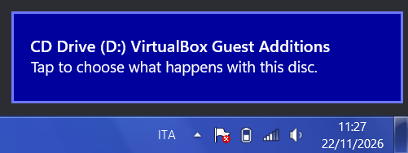

# Windows 8.1 Notifications Skin for Windows 11 Notification Center Styler

**Author**: [babamohammed2022](https://github.com/babamohammed2022)



A Windows 8.1-inspired toast notification skin for Windows 11 Notification Center Styler.

## Notes

- Uses system accent colors, square corners and approximately 385 × 90 logical units. Actual dimensions depend on DPI and notification content.
- The text is vertically centered with and without a standard notification image. The image is displayed at 90 × 90 logical units.
- The dismiss button is hidden by default. To try the native button, change `Visibility=Collapsed` to `Visibility=Visible` on `ActionCenter.ToastCenterPage > * > Button#DismissButton`. Its visibility and behavior depend on the Windows template.
- To place toast windows at the top right, separately install [Customize Windows notifications placement](https://windhawk.net/mods/notifications-placement) and set vertical placement to top and horizontal placement to right. This theme does not reposition the notification window.
- It has been tested on Windows 11 24H2. Results can vary by Windows build, DPI, and notification template. Windows 10 compatibility has not been verified.

## Manual installation

To import the theme styles manually, follow these steps:

* Open the Windows 11 Notification Center Styler mod in Windhawk.
* Go to the "Settings" tab and select "Textual mode".
* Copy the content below to the text box and click "Save settings".

<details>
<summary>Content to import (click to expand)</summary>

```yaml
# Windows 8.1 Notifications Skin for Windows 10/11
# Custom styles for Windows 11 Notification Center Styler.
# Theme=None: this is a custom configuration, not a built-in theme.
# Reference image: about 385 x 90 image pixels. XAML dimensions are logical
# units and can be scaled by Windows DPI. The actual toast window placement
# is controlled by Windows or the separate Customize Windows notifications
# placement mod. For the Windows 8.1 position, set Vertical placement to Top
# and Horizontal placement to Right in that companion mod.
# Uses selectors documented by the Windows 11 Notification Center styling
# guide (LayerMicaUI / Densy).
# Best effort: element names, template states and scaling vary by Windows build.
theme: ''
styleConstants:
  - 'Win81Background=<SolidColorBrush Color="{ThemeResource SystemAccentColorDark3}" />'
  - 'Win81Border=<SolidColorBrush Color="{ThemeResource SystemAccentColorLight1}" />'
controlStyles:
  # Set the same width on the containing grid and toast layers so that the
  # visible border and its content are not shifted relative to each other.
  - target: Grid#ToastCenterGrid
    styles:
      - Width=385
      - Margin=0
      - Padding=0
  - target: 'Grid#RevealGrid, Grid#RevealGrid2'
    styles:
      - Width=385
      - MinHeight=90
      - Background=Transparent
      - VerticalAlignment=Stretch
  - target: 'Grid#ToastGrid, Grid#ToastGrid2'
    styles:
      - Width=385
      - MinHeight=90
      - Padding=0
      - VerticalAlignment=Stretch
  - target: 'Border#ToastBackgroundBorder, Border#ToastBackgroundBorder2'
    styles:
      - 'Background:=$Win81Background'
      - 'BorderBrush:=$Win81Border'
      - BorderThickness=2
      - CornerRadius=0
      - Width=385
      - MinHeight=90
      - Margin=0
  - target: Border#ToastBorder
    styles:
      - 'Background:=$Win81Background'
      - 'BorderBrush:=$Win81Border'
      - BorderThickness=2
      - CornerRadius=0
      - Width=385
      - MinWidth=385
      - MaxWidth=385
      - MinHeight=90
      - Margin=0
  - target: 'Border#ToastRevealBorder, Border#ToastAcrylicHightlightBorder'
    styles:
      - Visibility=Collapsed
  # The close button is hidden by default, only for toast notifications.
  # To enable it, change Visibility=Collapsed below to Visibility=Visible,
  # save the settings and trigger a new notification. Windows keeps control
  # of the button's click behavior and its template/hover states.
  - target: 'ActionCenter.ToastCenterPage > * > Button#DismissButton'
    styles:
      - Visibility=Collapsed
  # These are the two parent types seen in the normal and expanded toast
  # templates. Leave their existing grid placement intact.
  - target: 'StackPanel#AuxAreaPanel, Grid#AuxAreaPanel'
    styles:
      - Visibility=Visible
      - Opacity=1
  - target: Grid#ToastTitleBar
    styles:
      - Visibility=Visible
      - Background=Transparent
  - target: 'ActionCenter.ToastCenterPage > * > Button#SettingsButton'
    styles:
      - Visibility=Collapsed
  - target: 'ActionCenter.ToastCenterPage > * > Image#AppLogo, ActionCenter.ToastCenterPage > * > Image#AppLogo2'
    styles:
      - Visibility=Collapsed
  - target: 'Grid#ToastTitleBar > TextBlock#SenderName'
    styles:
      - Visibility=Collapsed
  # Track the image container's visibility for text alignment.
  - target: Grid#ImageGrid
    styles:
      - Visibility=>Win81ImageGridVisibility
      - Margin=0
      - Padding=0
      - VerticalAlignment=Stretch
      - HorizontalAlignment=Left
      - Background=Transparent
      - BorderThickness=0
  # Keep the image 90 x 90 logical units and shift its border upward.
  # Layout and clipping depend on the Windows toast template.
  - target: Border#StandardImageBorder
    styles:
      - Margin=0,-24,0,0
      - Padding=0
      - CornerRadius=0
      - Width=90
      - Height=90
  - target: Image#StandardImage
    styles:
      - Stretch=UniformToFill
      - Width=90
      - Height=90
  - target: Ellipse#PersonableImage
    styles:
      - Width=0
      - Height=0
  - target: StackPanel#MainContent
    styles:
      - VerticalAlignment=Center
      # Visible=0: shift text upward when the image grid is visible.
      # Collapsed=1 or unavailable: preserve the no-image layout.
      - 'Margin=19,{{Win81ImageGridVisibility == 0 ? -24 : 0}},19,0'
  - target: 'StackPanel#MainContent > TextBlock#TitleText, StackPanel#MainContent > TextBlock#Title2'
    styles:
      - Foreground=White
      - Opacity=1
      - FontSize=16
      - FontWeight=SemiBold
      - TextWrapping=Wrap
  - target: 'StackPanel#MainContent > TextBlock#MessageText, StackPanel#MainContent > TextBlock#MessageText2'
    styles:
      - Foreground=White
      - Opacity=1
      - FontSize=15
      - Width=Auto
      - TextWrapping=Wrap
      - HorizontalAlignment=Stretch
  - target: 'StackPanel#MainContent > TextBlock#Attribution, StackPanel#MainContent > TextBlock#AttributionText'
    styles:
      - Foreground=White
      - Opacity=1
      - FontSize=14
  - target: Button#VerbButton
    styles:
      - BorderBrush=White
      - BorderThickness=1
      - CornerRadius=0

themeResourceVariables:
  - ''
```

</details>
